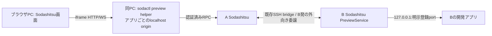

# リモートWebプレビュー：初期実装の設計

2026-10-17。調査の方式比較と一次資料は[research.md](research.md)。この文書は実装済み部分を記す。専用バイナリチャネル、永続化、公開B HTTPS adapter、plugin operationsは将来候補であり今回には含めない。

## 接続

UIは標準の専用Webプレビュー窓。workspace/paneに紐づく一覧・表示許可・開く・閉じる・更新・対象切替・別タブを提供する。既存プラグインのアプリビューへ外部URLを無制限に追加する機能ではない。GUI画像配信はしない。

`packages/protocol/src/preview.ts`に新しい型とRPCを追加。既存bridgeはJSON RPCを転送できるため、bridgeフレーム自体は変更せず、HTTPを32KiB chunk、WSを最大256KiB messageとしてbase64で運ぶ。HTTP応答はpullでstreaming、uploadは並行送信。接続ごとに同じ認証済みRPC経路を使用する。遅いreaderのためにmachine link全体をpauseしない。ただし同じTCP接続の帯域競合は残り、端末遅延の負荷測定は未実施。

## 登録と許可

登録はBのpane/workspaceとUUID/generation/name/portに限定し、起動コマンド・任意URL・資格情報を受け取らない。接続先はHTTPの127.0.0.1のみ。名前の重複はpane単位、replaceでID維持・generation更新。停止/置換は旧view/streamを失効する。登録はメモリ内のみで、再起動後は再登録する。登録だけでは転送しない。

ブラウザが現在paneに明示的に表示許可を与えると90秒のviewer leaseを持ち、pollで延長する。そのpaneのエージェントからの登録portを表示してよいという許可であり、portごとの確認ダイアログではない。helperは認証済みCLI接続でそのviewerへ紐づき、30秒leaseをworkで更新する。openは許可済みviewerが一意のときだけ自動選択。複数ならviewer指定が必要。bootstrap情報は選択viewerだけにpollで渡す。

pane.sockにはcaller paneのregister/list/open/stopだけを登録する。helper・転送・表示資格情報は認証済み経路限定。pane.sockは同OSユーザーの境界であり、相互に敵対するOSユーザー/tenantの隔離には使わない。Sodashitsuの既存ログイン資格情報を持つ利用者同士に新しいアカウントACLを追加する実装ではない。

open待機は25秒。返る`view_opened`はUIへのview作成ACKで、アプリの正常性やHTTP200を保証しない。ACK前のCLI切断/取消/検査中の失効は要求を取り消す。ACK後のCLI終了ではviewを閉じない。viewer/helper切断・pane変更・停止・期限切れでは転送を止める。Bから複数Aへの接続は既存bridgeのクライアント識別で区別し、他viewerへbroadcastしない。

## ブラウザ入口と安全境界

helperは127.0.0.1の動的portだけにbindし、viewごとに乱数の直接の子`p<uuid>.localhost`を生成する。Host完全一致と接続元を検査。1回限りfragment ticket→同origin POST→`__Host-soda-preview` Secure/HttpOnly/SameSite=None cookieで認証する。cookie重複は拒否。bootstrap再表示時は認証済みならrootへredirectする。

gateway cookieと予約cookie namespaceはBへ送らず、アプリ応答から予約Set-Cookieを拒否し、その他のDomain属性を除去する。管理cookie/接続tokenをアプリに渡さない。アプリごとにoriginとportが異なり、JS/storage/cookie/SWを管理originと分離する。iframeはscripts/same-origin/forms/downloadsのみ許可。アプリ自身のCSP/X-Frame-Optionsは緩めない。管理画面のframe-srcだけにlocalhostを追加し、既存display隔離は変更しない。

B側は各新規HTTP/WS接続で現サーバーとセッション一覧の既知Sodashitsu管理portを拒否する。任意host/URL、CONNECT、absolute-form、redirect追従はしない。HostはBの実loopback先、HTTPのX-Forwarded-Host/Protoはhelper originから生成、Originは実ブラウザ値を保持する。WSでは既存Forwarded/X-Forwarded-*を除去し再生成しない。ローカルupstreamの絶対Locationはhelper originへ直す。

これは悪意ある開発アプリ自体をOS sandboxへ閉じ込める機能ではない。アプリのB上の任意通信、別ユーザー/別環境の未把握管理listener、アプリが許可するCORS/外部通信は追加隔離が必要。悪意あるJSが管理originへcross-origin要求を試みること自体をbrowser sandboxだけで禁止できず、既存管理APIの認証/Origin検査も必要。SWはorigin間では分離されるが、同view内のcache応答や失効後の既取得データは回収できない。

## 上限

候補32/server・8/pane、viewer32、view16、検査待機16。stream64/server・24/helper。HTTP upload64MiB/download256MiB、chunk32KiB、header32KiB/100件、無通信30秒。gateway要求120秒。WS message256KiB、待ち行列1MiB/256件、128KiBまたは128件でpause、64KiBかつ64件未満でresume。pollはhelper250ms/UI750ms/WS50ms。常時高帯域/低遅延用途の性能保証はしていない。

## 互換性と未検証

root配信なので通常の相対path、`/assets`、同origin fetch、module import、CSS、SPA deep-linkはbasePath不要。HTML/baseタグ書換えはしない。`http://localhost:5173`の埋込URL、別port API、固定WS HMR URL、Host/Origin許可リスト、OAuth callback、Secure cookie/iframe制限にはアプリ設定が必要。CORSを無効化して救済しない。NextのHMR、Viteのフレームワークplugin個別互換性、SSR、Range/304、大量転送、SSH実機、OS/browser横断は未検証。WS binaryはサーバー単体で確認したが実ブラウザ遠隔経路では未確認。WS close code/reasonは現在一般化される。

Linux Chromium153の実2サーバー外向き委譲E2Eで、root module/API/SSE/upload/WS text・第2subprotocol選択・cookie分離・Location・停止を確認。公開HTTPS風の親は別PoCで模擬し、LNAなし拒否/付与後成功を確認。実公開HTTPS親/Windows/macOS/Firefox/Safariは未確認。ブラウザPCでhelperの初回手動起動と通常のローカルネットワーク許可が必要。遠隔paneでhelperを起動してもブラウザPCの入口にはならない。

## 実コード

- `packages/server/src/preview/PreviewService.ts`: 登録/許可/配送/失効。
- `packages/server/src/preview/PreviewStreams.ts`: 固定接続・stream/WS・背圧。
- `packages/cli/src/preview/LoopbackGateway.ts`, `RpcPreviewTransport.ts`: ブラウザ入口・RPC変換。
- `packages/cli/src/commands/preview.ts`: agent CLI/helper。
- `packages/web/src/components/WebPreview.vue`: 標準UI。
- `packages/e2e/src/specs/remote-web-preview.spec.ts`: 実外向き委譲の受入試験。

## 追加検証: Vite

再起動後に既存Vite 8.3.0 / Linux Chromium153で実HMRを確認。base/HMR URL/allowedHosts等の追加設定なしの最小JS/CSSアプリが、B発委譲→A→実helper→実iframeで更新され、documentを維持した。ブラウザlocalhost側のVite connected/js-update/css-updateを観測。これはNextやすべてのVite plugin/プロジェクトへの互換保証ではない。[実測記録](vite-poc-report.json)、[試験ソース](../../../scripts/remote-web-preview-vite-poc.mjs)。

Vite公式の[server.allowedHosts](https://vite.dev/config/server-options.html#server-allowedhosts)は既定でlocalhost配下とIPを許可する。[server.ws](https://vite.dev/config/server-options.html#server-ws)はproxyのWS転送と失敗時の直接接続fallbackを説明する。今回のPoCはBの127.0.0.1へ直接接続して成功したケースをブラウザのlocalhost側更新フレームとして数えない。
