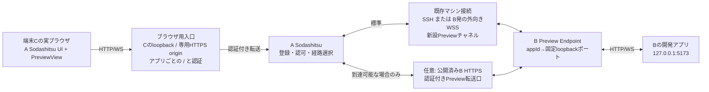

# 外部マシンのWebアプリ検証 — 調査・設計案

後続更新: ユーザーはPC側補助プログラムを許可済み。採用方式と入口PoCの測定結果は[design.md](design.md)と[test-result.md](test-result.md)を正とする。以下の方式選択に関する記述は初回調査時点のもの。

調査日: 2026-10-17。対象: `/workspaces/sodashitsu` の作業ツリー。コード・設定変更、起動、インストール、外部公開は実施していない。既存未コミット変更を含む現状を読み取ったため、以下は確定リリースの仕様ではない。

表記: **確認**=実コードまたは一次資料で確認、**提案**=新規設計、**要PoC**=未実測。CLI・プロトコル名と上限値はすべて提案で、現在使えるコマンドではない。

## 1. 推奨する方向

**既存のマシン接続を認証・接続管理の土台にし、専用のHTTP/WS転送層を追加する。ブラウザにはアプリごとの独立originの `/` を見せる。** 転送経路とブラウザのURLを別の問題として設計する。

- 標準経路: A→BのSSH接続、またはB→Aの外向き委譲接続の上で、新しいプレビュー転送チャネルを使う。Bのアプリポートはループバックのまま。
- 追加経路: 既に到達可能なBのHTTPS Sodashitsuに、認証付き転送口を用意する。Aの同じプレビューサービスから使い、UI・登録・認可・ヘッダー処理を共通にする。
- ブラウザ側: アプリ単位、必要なら利用者・検証セッション単位の独立origin。ドメイン不要のPC向け候補は、**実際にブラウザが動く端末C**のループバック補助プロセス。Aがその端末上で動く場合はAに統合できる。Aが遠隔サーバーならAの127.0.0.1をURLにしてもCからは届かない。
- 追加インストールなしのブラウザ向け候補は、別途用意できる専用HTTPS origin群。ただしDNS・証明書・到達経路が必要で、固定HTTPS URLを1つ得ただけでは自動的に用意できない。特定トンネル製品を前提にしない。

**条件の境界:** 単一の固定HTTPS originだけ、追加ソフトなし、アプリ無改修、通常のcookie/storage/SW、アプリ間・管理画面との分離を、一般のWebアプリで同時に満たす方式は本案では提示できない。パス、iframe、別タブだけでこの境界は解消しない。まず「PC補助プロセス可」か「別HTTPS originを確保」かを選ぶ必要がある。これは既存接続でBへの着信を不要にできることとは別問題。



外向き委譲ではTCP/WSSを開始するのはBだが、接続後のデータは双方向。Bに新しい外部向けlistenやルーター/Firewall開放は要らない。補助プロセス案のlistenはCのloopback限定であり、これ自体も許容されないならこの案は選べない。

## 2. 既存実装で確認したこと

| 対象 | 確認した構造・場所 | 設計への意味 |
|---|---|---|
| SSH/bridge | `packages/server/src/machine/bridgeCommand.ts`、`sshArgs.ts`、`BridgeEndpoint.ts:20`。SSH上の `soda bridge` がBの0600 Unix socketへ接続。endpointは論理チャネルを `WsConnection` として渡す | TCPの任意ポートforwardではない。SSH経路でも新規転送層が必要 |
| bridge wire | `bridgeFrames.ts:15`。version 1、HELLO/OPEN/CLOSE/TEXT/BINARY/PING/PONG。OPEN payloadは0バイト。`BridgeEndpoint.ts:213`のOPENはすべて既存WS gateway向け | BINARYが存在するだけで任意HTTPを流せるとは言えない。用途識別と新しいdispatcherが必要 |
| 既存relay | `MachineRelay.ts:6`。TEXTはJSON object風、下りBINARYはOUTPUT/SNAPSHOTのみ許可 | 既存 `/ws?machine=` にHTTPのバイトをそのまま入れる案は成立しない |
| 外向き委譲 | `ReverseConnections.ts:155`付近のupgradeはbrowser Originを拒否し、machine ID + Bearerを検証。受けたWSSをMachineLinkへ接続。`:295`付近でBがWSSを開始、`:326`で同じBridgeEndpointへ接続 | SSHと外向きWSSは同じbridgeを利用。公開済みB URLは不要。委譲鍵をアプリやブラウザに渡す用途ではない |
| HTTP | `http/HttpServer.ts:151`。login/logout/session、ask/displayビュー、artifact、静的ファイル。開発アプリの汎用proxyはこのdispatcherにはない | 新規routeとstreaming処理が必要。既存静的配信のSPA fallbackへ流してはいけない |
| WS routing | `ws/WsServerWs.ts:100`。委譲/ペアリングは専用upgrade、通常 `/ws` はOrigin検査→session認証→machine選択 | プレビューWSは独立upgrade経路と認可が必要 |
| 認証 | `auth/AuthService.ts:94,282`。session cookieを検証。cookieはPath=/、HttpOnly、SameSite=Strict、条件付きSecure。`auth/OriginPolicy.ts`はHost/Origin許可を管理。`WsGateway.ts:245`はsession失効で切断 | 管理sessionをproxy先へ転送しない。previewの失効連携を追加する。SameSiteやCORSだけを管理APIの防壁にしない |
| 現在のアプリビュー | `web/src/components/PluginView.vue` は登録displayを `DisplaySurface.vue` へ渡す。`protocol/src/model.ts:70`のPluginTabはextensionKey/display等、`:91`でtabのapp perspective | 現在のアプリビューは任意URLブラウザではない。配置の導線は参考にできるが専用PreviewViewが必要 |
| 隔離表示 | `HttpServer.ts:28,78`、`web/src/components/DisplayFrame.vue:74`。本体CSPはdefault-src/connect-src self、frame-ancestors none。displayのscript-htmlはsandbox allow-scripts、default-src noneなどでネットワークを制限 | 既存displayの隔離を緩めてWebアプリ用に流用しない。専用枠と、登録済みプレビューoriginだけを許す本体frame-srcが必要 |
| 流量制御 | `bridgeFrames.ts:29`の上限はチャネル64、上り1メッセージ4MiB、下り64MiB。`MachineRelay.ts:18`以降と`MachineLink.ts:285`は遅い受信側のためリンク全体のstdoutをpause | 現状の背圧をHTTPへそのまま使うと端末操作を巻き込む。プレビュー用のcreditと優先制御が必要 |

SSHの `soda bridge` は現行コードでWindowsを拒否する（`bridgeCommand.ts:34`付近）。外向き委譲はこのUnix socket用CLIを呼ばず、WSS streamを直接BridgeEndpointへ渡す構造なので、このCLI固有の制約は受けない。実機対応は別途検証が必要。

現行 `DefaultAuthService` の認可はsession中心で、確認した経路では利用者ごとのworkspace/app ACLを適用していない。「複数のログイン済みブラウザ」と「互いに権限分離された複数利用者」を同義にしない。後者はprincipal/ACLの追加設計が必要。

## 3. 転送経路の比較

| 経路 | Bが外向き接続だけ | Bアプリの公開 | 既存コードの再利用 | 注意点 |
|---|---|---|---|---|
| 既存bridgeへPreviewチャネル追加 | 対応可能 | 不要 | 接続・再接続・委譲の認証、machine catalog | v1互換性、credit、公平な送信、共有TCPの遅延を新設計 |
| 公開済みB URLの `/app/<id>/` をブラウザが直接表示 | 不可 | アプリポート公開は不要だがB HTTPSへの着信が必要 | HTTP/TLSのlisten | 認証、basePath、管理originとの衝突。標準経路に不向き |
| A→B HTTPSの専用転送口 | 不可 | 同上 | HTTP/TLSと既存接続管理の一部 | machine委譲鍵の流用はしない。app限定認証を新設。A側入口を共通化できる |

提案: `PreviewTransport`（概念名）の下に `BridgePreviewTransport` / `HttpsPreviewTransport` を置く。両者ともBの同じ登録・loopback connectorを使う。Bの `/app/<id>/` は、人が直接開くパスproxyにもできるが、Aからはバイト列とメタデータを運ぶ専用口として扱い、ブラウザURLはアプリ別originのままにする。内部転送口にパスがあることと、ブラウザのアプリURLにprefixがあることは異なる。

同じ物理接続を厳守する第一案はbridge v2または明示的capability negotiationによる新規チャネル。旧サーバーへ未知frameを送ると現行decoderは拒否するため、未対応なら機能を出さない。端末への影響の測定で条件を満たせなければ、同じ登録・委譲許可に紐づく第2の外向きデータ接続を検討する。後者は「接続設定の再利用」だが「同じ1本の接続」ではないので、要件変更として明記する。

## 4. ブラウザに見せるURLと分離

**確認:** originの基本要素はscheme/host/portで、pathは含まれない。cookieはportで分離されない。根拠: [HTML origin](https://html.spec.whatwg.org/multipage/browsers.html#origins)、[RFC6265 §8.5/8.6](https://httpwg.org/specs/rfc6265.html#section-8.5)。

| 方式 | アプリ変更 | 分離・セッション | ドメインなしでの条件 | 判定 |
|---|---|---|---|---|
| 管理originの `/app/<id>/` | basePath、API、HMR等の対応が必要になりやすい | JS権限・storageは管理画面と同じ。cookie Pathは安全な分離境界にならない | 固定URLで実現しやすい | 汎用検証の標準として非推奨 |
| 管理画面と別の専用preview hostに複数appのprefix | 同上 | 管理画面は分離できるがpreviewアプリ間は同一origin | 少なくとももう1つのHTTPS host | 信頼する同一アプリ群に限定 |
| アプリ単位のHTTPS host/subdomain、各 `/` | 通常のroot-relativeは保持。Host/Origin/HMR許可等は必要な場合あり | origin別storage/SW。兄弟subdomainはcookieの強い分離にならない | DNS/証明書/経路を提供する仕組みが別途必要 | cookie境界も確保できる場合の推奨形 |
| 同じhostの別port、各 `/` | root-relativeは保持 | JS originは別、cookieは共有。管理cookieの漏れ・上書きを解決しない | HTTPS port到達性も必要 | 単独では不十分 |
| Cのloopback補助プロセス、アプリごとの別host、各 `/` | root-relativeは保持。外部URL固定は別 | app/session別origin。cookieの親Domain共有も検証必須 | ローカル補助機能とloopback listenが必要。外部公開不要 | PC向け最小候補、要PoC |
| 別タブのみ | URL方式次第 | 同じprofile・originならcookie/storageを共有 | 手軽 | セッション分離にはならない |
| アプリごとの別browser context/profile | root配信と組み合わせる | cookie/storageを分離。profileにはSodashitsu管理資格情報を持たせない | 標準Webページだけで任意の隔離contextを作るAPIは期待しない。補助機能等が必要 | OAuth/SWや強い分離の補完 |

loopbackは例として `http://<random>.localhost:<port>/`。名前の解決・全OSでloopbackだけにbindできること、Secure cookie・SW・HTTPS親からのiframe・ブラウザのローカルネットワーク許可を要PoCとする。公開ワイルドカードDNSサービスや利用者のhosts編集は前提にしない。管理UIもlocalhostの場合、previewは管理とは別hostとし、管理originの重なりを検査する。アプリの応答のSet-Cookie Domainは削除してhost-only化するが、**JSのdocument.cookieによるDomain指定はproxyで除去できない**。localhost階層のcookie規則を実ブラウザで検証し、隔離を保証できなければ別のliteral loopback IP（対応OSでのbindとSecure cookie等は要PoC）、または独立browser contextへ切り替える。Domain共有cookieを前提とするアプリの動作は変わり得る。loopbackの信頼性判定の根拠は[Secure Contexts](https://www.w3.org/TR/secure-contexts/#is-origin-trustworthy)。一方でChromeはローカルネットワークアクセスの許可を導入しているため、信頼できるoriginと判定されることだけで埋め込み・通信の成功を保証しない。[Chrome公式説明](https://developer.chrome.com/blog/local-network-access)

専用HTTPSでも兄弟subdomainならsame-siteになり得る。管理cookieはhost-onlyを維持し、HTTP応答の親Domain cookieは拒否するが、アプリJSによる親Domain cookieの注入は残る。したがって**兄弟subdomainだけで異なるアプリのcookieまで完全に分離できるとは扱わない**。強いcookie分離にはアプリごとのregistrable domain/public-suffix境界、または独立browser contextが必要。管理系も別のregistrable domainに置く方が強いが、利用者がドメインを持たない現状で当然に使えるとはしない。管理API側のOrigin/CSRF検査を併用する。根拠: [RFC6265 §8.6](https://httpwg.org/specs/rfc6265.html#section-8.6)。

### 同一originのパスproxyが危ない具体例

`https://soda/app/x/` のJSが `fetch('/api/session')` や `new WebSocket('wss://soda/ws')` を実行すると、同一originなので管理cookieが付く。HttpOnlyはJSによるcookieの読み出しを抑えるが、資格情報を使った要求自体は止めない。`parent.document`、localStorage、別appへのfetchも権限が重なる。逆に「/apiを全部previewへ送る」と管理APIと他appの経路が壊れる。

iframeのsandboxからallow-same-originを外すと不透明originになるが、storage/cookieアクセス、module/fetchのCORS、Origin:nullの扱いなど互換性が変わる。allow-scriptsとallow-same-originを同一origin iframeに併用しても安全な隔離にならない。iframe属性だけなら直URLを開いた場合にも保護が残らない。[HTML iframe sandbox](https://html.spec.whatwg.org/multipage/iframe-embed-object.html#attr-iframe-sandbox)

別originなら `sandbox="allow-scripts allow-same-origin allow-forms"` を基本候補にし、download/popups等は用途に合わせて限定追加する。allow-same-originは「親と同じoriginへ変える」意味ではなく、その文書本来のoriginを保つ指定。上位navigationと親DOM操作は認めない。アプリ自身のframe-ancestors/X-Frame-Optionsで埋め込めない場合は診断し、別タブで開く。無断でセキュリティヘッダーを消さない。クロスサイトiframeのcookie制限、OAuth popup、COOP/COEPも別タブ/別contextでの検証を用意する。外部HTTPSからloopbackの埋め込みはブラウザ差を実測するまで保証しない。

## 5. URL・HTTP互換性の設計

以下は標準に基づく挙動の説明と、それを踏まえた提案。実アプリでの成立は未実測。

| 項目 | `/app/x/`方式 | 別originの `/`方式・転送で必要なこと |
|---|---|---|
| 相対URL | 末尾slashと現在の階層に依存。`/app/x/a/b`の`./main.js`は`/app/x/a/main.js` | 同じ元パス階層を保てる。SPAのasset設計は元アプリ同様に必要 |
| `/`始まり | `/api`, `/assets/a.js`はprefixを無視する | アプリorigin内に留まるため自然に配送可能 |
| SPA/history | router basenameとサーバーfallback双方が必要。UI側のfallbackと衝突させない | deep linkをそのままBへ。SPA fallbackはBの仕事。APIの404をHTMLに変えない |
| base URL | `<base href='/app/x/'>`は相対参照を補う範囲だけ | HTMLの書き換えを基本不要にする。`<base href='http://localhost:5173/'>`固定などは設定修正が要る |
| API/fetch | `fetch('/api')`、実行時生成URL、別port APIは別途対応 | 同一origin APIは通しやすい。`http://localhost:3001`固定はCを指してしまう。APIは開発サーバーのproxyか明示した別appとして登録 |
| import/dynamic import | root絶対import、import map、bundlerのpublicPath等が問題。HTML置換ではJS bundleや実行時importを覆えない | moduleのURLを維持。固定originのimportは設定が必要。CORSを一律緩和しない |
| CSS/fonts/images | 外部CSS内のurl()、font、画像URLまで検討が必要 | root/relative参照は維持。CSSのURLはそのstylesheetを基準とするため、文書のbaseだけで全参照は直らない |
| redirect | `Location: /login`やupstream絶対URLのprefix変換が必要 | root Locationは維持。登録upstream authorityへの絶対Locationだけpreview originへ写像。外部URLへproxyが自動追従しない。未許可遷移は検証UIで説明 |
| Set-Cookie | Path=/をapp prefixへ変えてもJS/storageの隔離にはならない。document.cookieによるPath指定も残る | Domain削除/検証、Path維持、複数Set-Cookie維持。Secure/SameSite/HttpOnlyを安易に弱めない。gateway cookieはupstreamへ渡さず、同名Set-Cookieも拒否 |
| Host/Origin | prefixだけで外部URLの意味は伝わらない | browser Originを検査。Hostは登録upstream authorityか明示したvirtual host。Originは既定で維持し、アプリの許可リスト対応を優先。必要な同一origin写像はapp限定の明示設定、任意Originをlocalhostへ置換しない |
| Forwarded系 | アプリがprefixを理解する保証はない | クライアントのForwarded/X-Forwarded-*を除去し、検証済みのpublic proto/host等だけ再構成。信頼proxy設定はアプリ側で必要な場合がある |
| CORS | 同一origin化で元の安全境界まで変えやすい | preview内same-origin通信には通常CORS許可追加不要。外部APIは元のCORSが適用。ACAO:*を挿入しない。OPTIONSも転送 |
| WS/HMR | HMR path・host・client port・ws/wssの調整が必要になりやすい | root WS pathを保持、upgrade/subprotocol/バイナリ/closeまで転送。別HMR portは明示登録。同一originのwssへ合わせる設定が必要な版もある |
| SSE/streaming | prefixと再接続URLに注意 | chunkを即時転送。全bodyをbufferしない。SSEのLast-Event-ID、abort、SSRの早期chunkを保つ |
| upload/download | form actionやdownload URLにもprefixが影響 | multipart bodyを改変しない。サイズ上限付きstreaming、Content-Disposition、Range/206/HEAD/ETag/304を扱う。iframe download許可は別判断 |
| Service Worker | scopeはpathだが権限の完全な隔離ではない。scopeを制限しても同じoriginの他pathへfetchできる | app別originかつsessionを跨いだorigin再利用を制御。PoC初期はSW非対応を明記。後段で登録/更新/終了後キャッシュを検証 |

根拠: [URL parsing](https://url.spec.whatwg.org/#url-parsing)、[HTML base](https://html.spec.whatwg.org/multipage/semantics.html#the-base-element)、[CSS Values URL](https://www.w3.org/TR/css-values-4/#urls)、[Fetch/CORS](https://fetch.spec.whatwg.org/#http-cors-protocol)、[HTTP semantics](https://httpwg.org/specs/rfc9110.html)、[WebSocket RFC6455](https://www.rfc-editor.org/rfc/rfc6455.html)、[SSE](https://html.spec.whatwg.org/multipage/server-sent-events.html)、[Service Worker](https://w3c.github.io/ServiceWorker/)。

baseタグだけでは救えない例:

```js
fetch('/api/orders');                         // /app/x/api/ordersにはならない
import('/assets/chunk.js');                   // 文書内scriptタグの置換だけでは直せない
new WebSocket('ws://localhost:5173/hmr');      // Bではなくブラウザ端末Cへ向く
location.assign('/login');                    // prefixの外へ出る
navigator.serviceWorker.register('/sw.js');   // アプリroot想定、別の設定が必要
```

Next.jsの `basePath` はサブパス用設定で、build時にbundleへ埋め込まれる。`assetPrefix`だけを汎用のbasePath代替にしない。[Next basePath](https://nextjs.org/docs/app/api-reference/config/next-config-js/basePath)、[assetPrefix](https://nextjs.org/docs/app/api-reference/config/next-config-js/assetPrefix)。Viteのbaseはasset側の設定であり、利用者の任意fetchまで自動で修正すると考えない。[Vite base](https://vite.dev/config/shared-options#base)

Vite公式はreverse proxyでWebSocketも転送すること、失敗時にはproxyを迂回したHMR接続が起き得ることを説明している。調査時の最新版ページは `server.ws` を使う記載もあるため、`server.hmr`を含む設定名は検証対象のインストール版で確認する。allowedHosts/corsを全面許可せずapp限定にする。[Vite server options](https://vite.dev/config/server-options)。Next devも許可originの設定を持つ。[Next allowedDevOrigins](https://nextjs.org/docs/app/api-reference/config/next-config-js/allowedDevOrigins)

**無改修で通しやすい範囲:** root配信、同一originのasset/API/WS、固定外部URLを生成しないアプリ。別originの `/`でも、Host制限、CSRF、固定callback URL、Secure cookie、外部認証、複数origin、iframe拒否は設定調整や別タブが必要。無改修の完全互換は約束しない。

## 6. 認可と安全境界（提案）

1. **明示登録のみ:** Bでapp UUID、machine/session、workspace UUID、任意pane UUID、scheme、literal loopback IP（127.0.0.1または::1）、portを登録。通常入力はportと表示名だけ。任意URL、任意host、任意Unix socket、CONNECT、TCP全般の転送を提供しない。必要なAPI/HMR追加portは個別登録する。
2. **接続時検証:** DNS名を受け付けずDNS rebindingを避ける。要求path/Host/queryで接続先が変わらないconnectorにする。absolute-form、二重slash/逆slashによるauthority化、CRLF、曖昧なContent-Length/Transfer-Encodingを拒否。hop-by-hopヘッダーとConnectionで指名されたヘッダーを除去し、WSだけ明示的にupgrade処理。
3. **管理面の遮断:** Sodashitsu本体/名前付きsessionの既知のlisten endpointと管理用socketへの登録を拒否。preview originでは全pathをそのappへ配送し、`/api`や`/ws`で管理routerへfallbackしない。preview originを管理用Origin許可リストへ追加しない。管理APIはOrigin/CSRFを検査し、credential付きCORSをpreviewへ許さない。CORSは読取りの制約だけでは送信を全面的に止めないため、これだけに依存しない。現行logoutは意図的にOriginを検査しない実装なので、アプリから管理操作を起こせないことを要求するなら、logoutを含む全状態変更経路の追加点検・対策が必要。
4. **資格情報を分離:** A login session、SSH鍵、委譲token、転送口Bearerはブラウザのapp JS・upstream HTTP headersへ渡さない。AとBの転送認証はserver間。preview用資格情報はapp+接続generation+owner sessionに限定し、管理権限を持たせない。
5. **起動認証:** 管理UIの認証済み操作から、短命・1回限り・appと受取先に固定したbootstrap ticketを発行。専用gatewayがconsumeしてHttpOnlyのpreview専用cookieを発行し、ticketを含まないURLへ遷移。ticketをupstreamへ送らず、ログ/Refererから除外。新規セッションoriginを使い、過去SWがbootstrapを横取りできないことを確認する。loopback helperは資格情報をプロセス内で保持し、アプリから触れるHTTP管理APIを置かない。
6. **認証済みだけ:** HTMLだけでなくasset、WS handshake、SSE、upload/downloadにもpreview認可を要求。app IDの秘匿は認証に数えない。CSRFはgatewayのbrowser向けoriginを使って検査。権限失効時にHTTP転送と長寿命WS/SSEをcancel。idle expiryもleaseで失効させる。
7. **利用者と状態:** `principal/session × machine × app × generation`を認可キーにする。登録・一覧・起動・閲覧・削除を別操作として扱う。現行にprincipal ACLがなければ初期版は「同じSodashitsu sessionを信頼して共有する利用者」に限定し、ユーザーごとの機密分離を謳わない。利用者別originを割当ててもB側アプリ自体のグローバル状態は分かれない。
8. **アプリセッション:** storage/SWはapp別origin、cookieはそれに加えて親Domain共有を許さない境界または独立browser contextで分離する。検証セッションごとの隔離も同じ基準で設計する。閉じるだけなら再開可、終了・失効ならoriginを再割当てしないか清掃を確認する。HTTP no-storeはSWのCache API保存を禁止する仕組みではない。失効後に既に受け取った画面・データを遠隔消去する保証はできない。

**保証の限界:** 明示登録は「誤って別サービスを転送しない」境界であり、同じOS権限の悪意ある開発サーバーをsandbox化しない。登録したアプリ自身がSSRF proxyや任意fetch APIを持てば、そのアプリ経由のアクセスは可能。Bのbackendプロセスから管理API・メタデータへの通信まで禁止する要件ならOS/containerのnetwork隔離が別途必要。登録後のport再利用もPID監視だけでは完全に識別できないため、初期版は利用者がB上のアプリを信頼する前提とし、停止検知・generation失効・再登録で事故を減らす。

## 7. チャネル・流量・ライフサイクル（提案）

- 要求単位stream IDを発行し、OPEN_HTTP(method, path+query, headers, appId, generation)、HEADERS(status, multi-value headers)、DATA、END、CANCEL/RESET、WINDOW_UPDATEを用意。WSはOPEN_WS→upgrade結果→message/fragment/closeを独立表現する。実際の名称とwire encodingは詳細設計事項。一般TCP openは出さない。
- bodyは小さなDATA（例32KiB）でstreaming。チャネル別・接続全体のcredit、round-robin、管理/端末優先、1イベントループの仕事量制限を設ける。遅いpreviewのためにリンク全体をpauseしない。SSE/WSもcredit対象。バイトcredit以外にmessage数・生成CPUのrate制限を設ける。
- 単一TCP/WSSではpacket lossのhead-of-line blockingと帯域共有は残る。端末遅延ゼロは保証しない。送信キューを短くし、previewのrateを制限し、受入値を測定する。
- 初期値の例: app当たりHTTP同時16、WS8、SSE4、マシン当たり総stream64（既存bridgeの64とは別予算）。header32KiB、DATA32KiB、未送信512KiB/stream・8MiB/machine、WS message8MiB、upload64MiB・download256MiB、マシンのpreview帯域8MiB/s。いずれも調整可能だがhard maximumを設ける。長時間転送にも累計byte/時間のbudgetを設ける。
- connect5秒、response header30秒、通常HTTP idle30秒/全体120秒の例。明示streamingは全体上限30分・lease更新・heartbeatを別扱いとし、SSE heartbeatも通信量に数える。WSはping/pongと認可leaseで生存監視。timeoutでそのstreamのみresetする。
- 切断したHTTP/WSを勝手に再実行しない。POST uploadを再送しない。Bアプリは停止せず、UIに切断を表示。リンク再接続後はその接続だけのconnectionGenerationを更新し、B共通のappGenerationとは分ける。別Aへの正常な接続は巻き込まない。ユーザーのreloadやアプリ自身の再接続に任せる。再開可能downloadはアプリのRangeで行う。
- 状態例: registered→connecting/ready→viewing→offline/stopped/revoked。登録は保存可能、転送許可leaseとアクティブstreamは保存しない。再起動時に保存ポートを自動公開せず、登録をinactiveで復元し再確認する。閲覧を閉じる、転送を停止、登録を削除、アプリプロセスを停止、を明確に区別する。
- Bアプリ停止/port変更、workspace削除、machine disable/remove、委譲停止、A logout、権限変更で関連streamを閉じる。複数A接続がある場合は、どの接続にpreviewを許したかをB側でも管理する。
- ログはowner/app/machine/状態/bytes/latency/errorを中心とし、cookie・Authorization・body・query secretsは記録しない。

## 8. 標準機能のUI/CLI案

workspaceに「Webプレビュー」の一覧。登録は対象machine/workspaceを固定し、アプリ名・port・任意の起動pane・初期pathを指定。portの自動スキャンや検出のみでの公開はしない。UIの「有効化」は転送の許可で、開発サーバー起動とは分ける。

paneのメニュー「Webプレビューを登録/開く」、tabの表示切替「端末/アプリ」に専用PreviewViewを追加。複数appから選び、表示中のmachine/workspace/app、接続状態を常時明示する。既存plugin app perspectiveを上書きせず、タブに複数viewを持つ既存構造との統合を設計する。プレビューを閉じる・更新・対象切替・別タブで開く・新しい検証セッション・転送停止を用意。iframe内のキー入力と端末shortcutの境界も確認する。

提案CLI例（未実装）:

```text
sodactl preview register --workspace <uuid> --pane <uuid> --port 5173 --name frontend
sodactl preview list
sodactl preview open <appId> [--new-session]
sodactl preview stop <appId>
sodactl preview remove <appId>
```

CLIは機械可読JSONとUUID/一意なprefixを使用し、転送tokenを結果に含めない。エージェントが新規portを登録できる権限と、人が閲覧許可する権限を分ける場合は明示的に設計する。pane.sockへ無条件で登録/公開操作を足さない。将来のplugin operationsは同じPreviewServiceを呼ぶだけとし、plugin独自proxyで権限を迂回させない。標準機能のHTTP/WS配信でありGUI映像配信ではない。

## 9. 段階的最小PoC計画（今回は実行しない）

**段階0: 提供条件を決める。** PC補助機能の可否、C=Aか別端末か、スマホ必須か、埋め込み必須か、敵対的PJも対象か、利用者を信頼共有か分離するかを確定する。単一固定HTTPSのみなら不足する独立originをどこで用意するかを決める。これを避けてpath rewriteから実装を始めない。

**段階1: browser入口の成立を先に測る。** 制御されたテストアプリ2つを使い、root origin別のcookie・storage・module・SW（後段）を確認。loopback候補なら主要OS/Chrome/Firefox/Safariで名前解決、secure context、HTTPS親iframe、ローカルネットワーク許可、別タブfallbackを確認。B転送はまだ偽の固定応答でもよい。HTTPS専用originが使える環境なら同じテストを通す。

**段階2: 外向きだけの最小転送。** BからAへの既存委譲を利用し、capability対応の新チャネルで登録した127.0.0.1の1アプリだけへGET/HEAD/POSTとbinary bodyを転送。外部からBへの接続がなくても動くことを接続記録で確認。次に同じテストをSSHで通す。未対応版は明示エラー。

**段階3: ブラウザの実動作。** Vite SPAのdeep link、fetch、dynamic import、CSS/font/image、cookieログイン、redirect、WS binary/HMR、SSE、upload/downloadを順に確認。Nextはdevとbuild/startを分け、SSR streaming、client navigation、画像とpublic assets、dev origin制限/HMRを検証。版・設定・必要な変更を記録し、「表示できた」と「無改修」を分ける。

**段階4: 安全・負荷・失効。** 下の拒否テスト、2app/2workspace/2machine/2session、切断/停止/再開、低速クライアントと大量転送中の端末応答を確認。要件を満たせなければチャネルの修正か別データ接続案を判断する。

**段階5: HTTPS経路。** 必要性が確認されてから、既にB HTTPSが到達可能なテスト環境でtransport adapterを追加。同一のUIと受入テストを通す。外向き経路のみで十分ならこの段階は後回し。

### 受け入れテスト

| ID | 操作・条件 | 合格の観測 |
|---|---|---|
| A1 | Bへの外部着信が禁止、B→A WSSだけ | Cのブラウザでフォーム操作→Bで結果反映。Bアプリはloopback listenのまま |
| A2 | SSH/外向き/任意HTTPS adapterを切替 | 同じ登録UIとPreviewViewで動作。要求のmethod/path/query/body/statusを保持 |
| A3 | root asset/API、deep link reload、dynamic import、CSS/font/image | 実ブラウザで描画・応答・console errorを確認。期待したB app以外へ送らない |
| A4 | Vite/Nextの画面コードを変更 | ブラウザ表示がHMRで更新。Bのlocalhostへ直接fallbackしない。Next SSRは最終body前に先頭部分が届く |
| A5 | cookieログイン、redirect、2app同名cookie、JSによる親Domain cookie注入 | 各appでログイン維持、相手のcookie/storage/SWに干渉しない。管理cookieはB upstreamに存在しない。兄弟subdomain案がここで失敗する場合は強い分離の対象から外す |
| A6 | SSE、binary WS、multipart、Range download、HEAD/304 | ブラウザが逐次イベントを観測、バイト一致、206やヘッダー保持、abortでB側転送も終了 |
| A7 | 未認証/別session/失効済み、URL直打ち、WS直結 | HTML/asset/WS/SSEすべて拒否。Bへ対象要求を送らない。logoutで長寿命streamも閉じる |
| A8 | 任意URL、169.254系metadata、非loopback、DNS rebinding名、管理port、CONNECT、path authority化 | 登録または転送前に拒否。Locationを使ってB側proxyが外部へ追従しない |
| A9 | appから管理 `/api`/`/ws`、親DOM、兄弟appへアクセス | preview内pathは管理routerへ行かず、管理originの要求は認可/CSRFで拒否。cookie injectionも拒否 |
| A10 | 遅いdownload/upload、SSE多数、停止stream、上限超過 | メモリ・queueが規定内、対象だけtimeout/reset。飽和時の端末キー→描画遅延は非飽和baselineに対しp95増分100ms以内を暫定目標として測定 |
| A11 | machine disable/remove、委譲失効、B app停止、A/B再起動、ネット断 | stream終了、状態表示、無許可の再開なし。POSTの自動再送なし、既存開発プロセスを勝手に停止しない |
| A12 | iframe拒否/外部認証/スマホ/loopback許可なし | 読込不能の理由を表示、別タブ等の対応可否を明示。失敗を「無改修対応」に数えない |
| A13 | SWを有効にする後段 | app間干渉なし、新session bootstrapを旧SWが取得しない、終了後cache再利用の範囲を実測しUIからreset可能 |

E2Eの合格は利用者のブラウザDOM・ブラウザが受けたHTTP/WS・実際の逐次表示で判定し、別のテストWSクライアントだけで代用しない。既存規約 `.aidev/conventions/e2e-observe-browser.md` に合わせる。安全機構のテストは意図的に検証を外した対照で失敗することを確認し、実装時は独立レビューも行う。

## 10. 次に決めたいこと

最優先は、**初期版でPC側補助プロセスを許容するか**。許容するなら、ドメイン・外部ポート開放なしのroot配信を先に試せる。許容しないなら、専用HTTPS origin群を用意する方法を具体化するか、basePath設定を要する限定プレビューへ要件を絞る必要がある。その場合も管理originでの汎用アプリ実行は避ける。

次点は、埋め込みと別タブのどちらを必須にするか、スマホ必須か、複数利用者が信頼を共有するか。転送チャネルの実装に先立って、この条件をユーザーと検討する。
