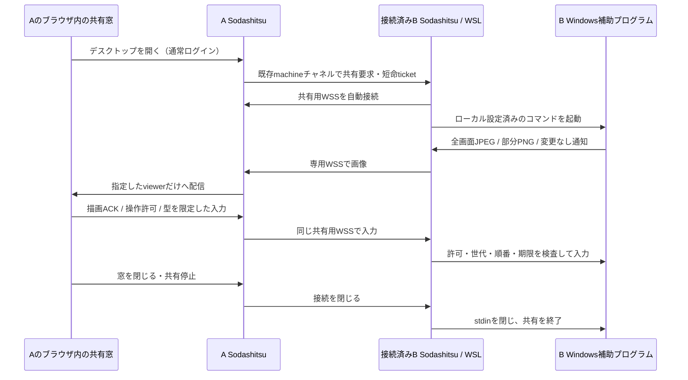
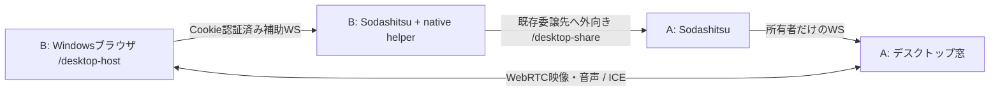

# リモートデスクトップ（実験版）

接続済みの別マシンBの実デスクトップを、操作側AのSodashitsu内の窓で表示・操作するPoCです。初期対象はWindowsのログイン済み・ロック解除済みセッションの通常権限アプリです。Windows実機1台で、画面表示・専用テストアプリへのクリック/通常キー/日本語・絵文字の確定文字入力を確認しました。全アプリや実回線での互換性・性能を保証するものではありません。模擬画面を使う自動試験と実機検証を区別してください。

WSL上のSodashitsuがWindows画面を直接取得するものではありません。BのWindows側で補助プログラムが動き、WSLのBを介してAへ接続します。

## 接続の流れ



A/BのSSHまたはB発の操作委譲が接続済みであることが前提です。操作のたびのコード交換や接続コマンド入力は不要です。B→Aの共有用WSSへの到達性は別に必要です。既存SSHが通るだけでB→AのHTTPSも通るとは限りません。

映像は既存のmachine/端末ストリームと別接続です。新しいRDP/VNCポートのインターネット公開を必要としません。Aの既存HTTPS入口が`/desktop-share`のWSS upgradeを通す構成が必要です。ルーター・Firewall・Funnelの設定を自動変更する機能はありません。

## キーとマウスの入力先

［操作する］が有効で、共有画面・ウィンドウ本体・操作ボタンにフォーカスがある間は、ブラウザに届くキーを接続先へ送ります。Esc、Tab、Ctrl/Alt/Winとの組み合わせや長押しも対象です。手元の文字送信欄・設定の入力欄はローカル入力を維持します。

Ctrl+Spaceなど接続先で設定したショートカットは、CtrlとSpaceの組み合わせとして送ります。Spaceが手元のIMEからON/OFFのキー名で通知されても、接続先の専用IMEキーへ置き換えません。フォーカス前からCtrlを押していた場合など、キーイベントの修飾状態から不足する押下を補います。OSがキーイベント自体をブラウザへ渡さない場合は転送できません。

Escは1回目をすぐ接続先へ送り、修飾キーなしのEscを500ms以内に2回押した場合だけ、2回目をローカルで使って操作権を返し、最大化も解除してフォーカスを外します。間に別のキー、マウス操作、フォーカス移動が入った場合や長押しリピートは2連打に数えません。［閲覧に戻る］ボタンでも操作を返せます。

左・中央（ホイール押し込み）・右・戻る・進むの5ボタンを区別して送ります。同時押しと解放にも対応します。手元の履歴移動、コンテキストメニュー、中央クリックの自動スクロールは共有画面上で抑止します。接続先のアプリが中央クリックや戻る・進むに割り当てた動作は、そのアプリの設定に従います。

F13〜F24、テンキーの演算/Enter、ロックキー、変換/無変換・かな、国際配列キー、メディア/ブラウザキーも追加しています。これらと戻る・進むはブラウザ・中継・helperの対応確認後にだけ有効になります。未対応の版でも既存のキーと中央クリックは継続し、追加入力を右クリックなどへ置き換えて送りません。認証画面でも追加入力を使う場合は専用サービスの更新が必要です。

OSやブラウザがイベントをページに渡さない予約操作は転送できません。通常の画面共有はOSのキーボードフックやポリシーを書き換えません。Ctrl+Alt+Delは許可されたロック解除経路の専用ボタンを使います。Windows側のマウス符号化は[MicrosoftのMOUSEINPUT仕様](https://learn.microsoft.com/en-us/windows/win32/api/winuser/ns-winuser-mouseinput)に従います。

## 操作の応答時間

FPSは映像の更新頻度で、操作の応答時間とは別です。下部の「入力ACK」はブラウザからの入力を共有元helperがOSへ適用してACKが戻るまでの時間です。接続先アプリの描画や、その結果が動画に映るまでの時間は含みません。動画の「送信→描画ACK」は映像側の往復時間で、これも入力から表示までの実測ではありません。

マウスの移動はブラウザの描画周期ごとに最新の座標へまとめ、古い座標がキーやクリックの前に大量に並ぶことを防ぎます。ドラッグ中も中間の座標はまとめます。クリック・ボタン解除・キー・ホイール・確定文字は待たせず、その直前の最新座標に続けて送ります。フォーカスや操作許可を失った場合は予約中の移動を破棄します。これは移動イベントの混雑を減らす処理で、通信や画面取得の遅延そのものを短縮するものではありません。

通常画面の新しいhelperとBでは、入力ACKを映像とは別の出力pipeで返します。Bが明示してhelperも対応を返した場合だけ使い、診断文字列は転送しません。旧helper・認証画面は従来のstdout ACKを使います。これによりhelper内の大きい映像出力が待っていてもACKがその後ろに並びません。

通常画面のnative GPU H.264では、取得・色変換・encoder待ちの間もstdin readerが入力を処理します。先行する入力・操作許可/解除・共有停止・設定変更の順序を維持し、映像ACKとheartbeatの bookkeeping待ちだけを追い越せます。期限、保持キー、通常デスクトップ、画面構成の検査は引き続き行います。入力後に古い準備画像を新しいsnapshotとして公開しないよう、入力の適用・ACKと画像確定を直列化します。画像配信と認証画面は従来のmain loopで処理します。

新しい両サーバの組み合わせでは、native動画中の手動操作は描画済み動画フレームの鮮度（2秒以内）を確認します。連続操作で補助画像を更新できなくても、動画が新しければ操作を継続します。初回描画前・古い動画・動画停止後の入力は、この動画の許可では通しません。エージェント操作は従来の画像の鮮度と観測一致を確認します。旧接続先へ新しい入力項目を送らず、従来の判定を維持します。この修正は両側のbuildとhandoffが必要です。

対応する補助プログラムでは、native動画の手動操作中に定期的な補助画像の取得・圧縮を後へ回し、最後の入力から150ms落ち着いたら再開します。動画と入力を優先し、ドラッグ中の周期的な待ちを減らします。エージェントの観測や再同期で明示的に要求された画像は優先して作ります。通常の画像配信・認証画面は従来の動作です。

`powershell.exe -NoProfile -STA -File scripts/remote-desktop/benchmark-input-priority.ps1`は、100ms止めた映像workerと模擬入力で入力待ちだけを比較します。OS入力・実画面・通信・ブラウザを含まないため、利用者の入力ACKや体感の改善値としては扱えません。

## IMEのON／OFFを接続先へ送る

［操作する］に切り替え、共有画面またはデスクトップウィンドウ内の操作ボタンにフォーカスがある状態で、専用のIME ON／OFFキーを押すと接続先へ送ります。ブラウザの`Lang1`をON、`Lang2`をOFFとして扱い、キーの意味が`IMEOn`／`IMEOff`と通知される場合も対応します。変換中のイベントでもこの専用キーは送ります。ウィンドウ外や閲覧専用では送信しません。文字送信欄や設定の入力欄では、手元のIMEをそのまま使えます。

操作バーの［IME ON］［IME OFF］からも送れます。ブラウザがキーイベントを受け取れないOS側の割り当てがある場合は、このボタンを使ってください。ウィンドウ内で扱った専用キーのブラウザ既定処理は抑止しますが、OSが先に処理するショートカットまで取り消す機能ではありません。

Windowsへは[専用のVK_IME_ON（0x16）／VK_IME_OFF（0x1A）](https://learn.microsoft.com/en-us/windows-hardware/design/component-guidelines/keyboard-japan-ime)を送ります。押下と解放を一組で送り、keyupが来ないキーボードでも次の操作を妨げません。半角／全角や変換／無変換キーを強制的にON／OFFへ読み替えるものではありません。IMEの導入・入力先アプリ側の対応は接続先の設定に従います。

両側のSodashitsuと接続先のWindows helperを更新し、接続ビューを開き直してください。サーバ更新後はブラウザの画面も再読み込みしてください。対応するブラウザ・中継・共有元の間でIME機能を確認した接続にだけ対応通知を返し、IME拡張に未対応の版との組み合わせではIME転送を無効にして通常の共有を継続します。IMEキー対応を通知しない旧helperでは転送せず、ボタンも無効になります。ロック解除の認証画面で使う場合は、Program Filesの専用サービスにも更新版のHostを入れる必要があるため、後述のインストーラーを再実行してください。撮影しない初期ロック画面の入口ではIMEキーを送りません。

## 複数のviewerで同じ画面を共有する

両端を更新し、共有窓の「情報・設定」で **複数viewerで同じ画面を共有** を選びます。ほかの窓でも同じ選択・画質設定にすると、最大8窓までBの1つの取得プロセスを共有します。各接続は通常のmachine認証とBの共有先許可を受ける必要があり、ログインだけでは画像を配信しません。単独共有が開いている場合は終了してから切り替えます。設定が異なる接続は拒否します。

各viewerの描画待ち・共有停止・machine接続の切断は独立しています。遅いviewerは保留中の1枚を描画した後、次に取得した完全画像から再開し、ほかのviewerを待たせません。新規接続に保存済み画像を再配信しません。最後のviewerが終了すると取得も止まり、次の取得は旧helperの終了を待ちます。

操作許可は各接続で別に要求し、Bで1窓だけに許可します。操作中の窓がある場合、別の窓の「操作する」は閲覧状態のままになります。操作中の窓で「閲覧に戻る」か共有を終了した後、別の窓で改めて「操作する」を押します。手元のフォーカスを失うと従来どおり操作を解除します。所有者の解除・切断で保持キーも解除し、操作権を自動で他の窓へ渡しません。

対応する新しい両端とブラウザでは、通常画面のJPEG/PNG完全画像に加えてGPU動画も共有できます。画像だけの窓と動画の窓が同じhelperを使い、動画viewer同士は1つのencoderを共有します。動画のcodec・FPS・ビットレートを同じ設定にしてください。すでに動作中のencoderと異なる設定の要求は、その窓だけ画像配信へ戻します。未対応のpeerには新しい動画共有の項目を送らず、従来の複数viewer画像配信を続けます。

動画はviewerごとのUUID・連番・描画待ちを持ちます。遅れて参照画像を取りこぼした窓は、先に送った画像の描画完了を待ち、次の新しいキーフレームから復帰します。過去のキーフレームを新規接続へ再生しません。描画待ちが既存の動画期限（約2.5秒）を超える窓は、その窓だけ画像へ戻ります。最後の動画viewerが終了するとencoderを止め、画像viewerが残っていれば共有を続けます。動画中の補助画像は低頻度になります。

新しい両端とブラウザでは、複数viewerでもUDPを選べます。各viewerが別のRTC/DTLS接続と描画ACKを持ち、パケット欠落時はその窓のキーフレーム復帰を要求します。UDP接続を失った窓だけが新しいstreamでWS/WSSへ戻り、他の窓の動画・操作権は維持します。旧peerではWS/WSSを使います。差分画像・自動画質調整・独立cursor・クリップボード・ファイル転送・解像度変更・仮想画面・管理者画面への拡張は未完了です。ロックや取得元の変更は全viewerを終了し、再接続と操作許可を要求します。単独接続では従来の機能を利用できます。他製品の全機能との同等性は主張しません。

## Bの初回設定

**通常のmachine認証と、PC全体の共有/入力の許可は別です。** 未許可のBは`desktop.capabilities`で`available: false`を返し、補助プログラムを起動しません。

通常は補助プログラムのコマンドを手入力する必要はありません。Windows用の補助ファイルは配布物に同梱され、Windows直接起動とWSLで自動検出します。WindowsのPowerShell 5.1/.NET Frameworkと、ログイン済み・ロック解除済みのデスクトップが必要です。実行ポリシーは自動変更しません。

### 起動オプションで許可

**共有されるPC（B）で**実行します。

```sh
# 閲覧のみ
soda serve --desktop
# マウス・キーボード操作も許可
soda serve --desktop --desktop-input
# クリップボード・解像度変更も必要な場合だけ追加
soda serve --desktop --desktop-input --desktop-clipboard --desktop-resize
```

入力・クリップボード・解像度のオプションには`--desktop`も必要です。これらはサーバー起動用（`soda serve`）の指定です。既に動いているサーバーには、次の設定画面から許可します。設定が保存されていなければ共有は既定で無効です。起動オプションは保存済み設定より優先して、その起動での初期値を指定します。起動後は設定画面から無効にできますが、同じオプションで次回起動すれば再び有効になります。

### 設定画面で許可

Bのブラウザで`http://localhost:7780`（ポートを変更している場合はそのポート）を開いてログインし、**メニュー → 設定 → デスクトップ共有**を開きます。画面共有・マウス/キーボード・クリップボード・解像度変更を個別に選び、［共有設定を保存］を押します。Bの端末版でも設定の「デスクトップ共有」から変更できます。

許可はサーバーの状態ディレクトリの`desktop-permissions.json`に保存され、再起動なしで反映します。変更すると進行中の共有や開始待ちを停止します。新しい許可で接続し直してください。無効化後、次回もオプションなしで起動すれば無効のままです。

許可を変更できるのは認証済みの直接ローカル接続だけです。マシン中継、LANのURL、公開URL、転送ヘッダー付きのプロキシ経由からは変更できません。Bのlocalhost画面かBの端末版を使ってください。ブラウザの同一PC判定だけでなくHost/Originも検査します（ローカルプロキシがHost等を書き換える構成を、物理的な利用者確認の代用にはできません）。

Aのブラウザは、**Bから到達できるHTTPSのURL**で開いてください。Aの`localhost`や`127.0.0.1`を開いた場合、Bから見た接続先がB自身になり共有できません。B発の操作委譲では、接続中の委譲先originを共有先として許可します。SSHで接続する場合の共有先の指定は、下の`SODA_DESKTOP_ORIGINS`を使用します。

### Sodashitsu起動中のロック解除（実験的・実機検証待ち）

Windows 10/11 x64の、**ログイン済み・active console sessionのロック**を解除する経路です。このロック解除経路では、サインアウト後のログイン、UAC、RDP sessionの切替、生体認証の遠隔再現は対象外です。管理者画面には後述の別の許可と経路を使います。Windows標準の認証画面に利用者が入力します。パスワード/PINの保存・自動入力は行いません。

**B側**で一度だけ、管理者の64bit Windows PowerShellから同梱のインストーラーを実行します。通常のSodashitsuを動かすWindowsアカウントで管理者へ昇格してください。別の管理者アカウントを使う場合は、`-OwnerSid`に通常アカウントのSIDを指定します。SIDは通常アカウント側の`whoami /user`で確認できます。

```powershell
# リポジトリのルートから。配布物では scripts/remote-desktop の実際の場所へ移動してください。
.\scripts\remote-desktop\install-unlock-service.ps1
# 取り除く場合（同じOwnerSid）
.\scripts\remote-desktop\install-unlock-service.ps1 -Uninstall
```

インストーラーは固定のexeだけをProgram Filesへ配置し、アカウント別の`SodaDesktopUnlock-*`をLocalSystem・**手動起動（DemandStart）**で登録します。インストール時やWindows起動時には起動しません。実行ポリシー・Firewall・Windowsのロック方針は変更しません。PowerShellの実行ポリシーにより拒否された場合は、そのPCの管理者の運用に従ってスクリプトを確認してください。

**補助サービスの修正を取り込む場合も、Bでインストーラーを再実行してください。** Sodashitsuやスクリプトを更新するだけでは、Program Filesのサービス本体は更新されません。再実行後、下の共有設定を保存し直します。

続いてBのローカル設定「デスクトップ共有」で、画面共有・操作・**Sodashitsu起動中のロック解除を許可**を有効にして保存します。起動時に指定する場合は次を使います。

```sh
soda serve --desktop --desktop-input --desktop-unlock
```

Sodashitsuが起動中で許可が有効な間だけ補助サービスへのleaseを維持します。正常終了/許可取り消しではstdinを閉じ、異常終了や応答停止ではheartbeat期限（約6秒）でworkerを回収します。インストール済みでも、Sodashitsu停止中は利用できません。許可を保存していた場合は次のSodashitsu起動で再開します。サービスを導入した後、許可を保存し直すとleaseを起動し直せます。 維持用の補助プロセスが途中で終了した場合は、許可が有効な間だけ1・2・4・8・16秒の間隔で最大5回起動し直します。再試行が尽きた後も、デスクトップを開く操作で再度試せます。30秒以上維持できた後の切断では再試行回数をリセットします。許可取り消しやサーバーの終了・handoffでは再試行も停止します。再起動するのはサービスの維持処理だけで、画面の操作権を取得したりキーを送ったりはしません。

Aは通常どおりデスクトップの接続ビューを開きます。ロック中は「Windowsのロック解除」と表示され、［操作する］からWindows標準の認証画面を操作します。下部の一時入力欄はマスク表示になります。Ctrl+Alt+Delが必須のPCでは同名のボタンを使えますが、既存のsoftware SAS policyがサービスによる送信を許す必要があります。Sodashitsuはそのpolicyを変更しません。解除後は旧接続・入力・画像を破棄し、通常画面へ**閲覧専用**で接続し直します。通常画面の共有中にロックされた場合も、許可があればロック画面へ接続し直します。

Windowsの時計・壁紙を表示する最初のロック画面では、画面を撮影せず、［サインイン画面へ進む］だけを表示します。このボタンを押すと、通常ユーザーの補助プログラムがWindows標準のLockAppを確認して、固定のEnter操作だけを送ります。この段階では文字・任意のキー・マウス操作を送れません。サインイン画面へ移ると接続し直し、操作権を解除します。PIN等の入力は、その後の認証画面で［操作する］を押して行います。初期画面の判定やEnter操作の可否はWindows環境に依存し、実機での確認が必要です。

ロック中のアクティブなコンソールセッションで、入力先が通常デスクトップで、前景ウィンドウがないか、同じユーザー・ログオンセッションのWindows標準ShellExperienceHostの実体が前景にあることを再確認できた場合も、画面を撮影せずボタンを表示します。消灯中はLockApp自体が存在しないこともあるため、この入口ではLockAppの起動を条件にしません。この状態で押した場合は画面の復帰要求だけを送り、操作権を解除して接続し直します。ボタンが再表示されたらもう一度押してください。復帰要求から続けてキー入力を送ることはありません。

画面の切り替え中は、共有方式の判定が安定するまで最大2秒待ちます。共有の準備中や認証画面の共有終了時に切り替えを確認できた場合は、新しい接続で判定し直します。［操作する］や［サインイン画面へ進む］などの明示操作を挟まず自動再接続が3回続くと停止します。再接続によって画面の復帰要求やキー入力が自動で送られることはありません。共有終了後も認証画面のまま、または状態を確認できない場合は、自動再接続せず終了理由を表示します。

Windowsの補助プログラムを終了すると、そのために起動したlease/shareの子プロセスも回収します。親の終了後に子が通信パイプを保持し、次の接続が「共有中」のまま拒否される状態を防ぎます。

ロック画面は人による操作専用です。エージェントの画像取得/操作、クリップボード、動画/音声、解像度変更は無効です。helper同士はlocal-only pipeでowner/logon SID・PID・sessionを検証し、ブラウザ側の認証と共有先の許可も従来どおり必要です。

通常ユーザーのhelperがサービスの実行ファイルを照合できるよう、サービスは起動時に、自分のプロセスの既存アクセス権へ、確認済みログオンセッションの限定照会権限だけを追加します。ほかのプロセスやWindows全体の権限は変更しません。権限の設定に失敗した場合は共有を開始しません。

検証済みなのはC#コンパイル、Windows上の未接続pipeの中断と既存display leaseの模擬検証、A/Bサーバーと模擬ロック画面を使うブラウザ試験です。Windows実機1台ではサービス導入・起動、限定照会権限の追加、認証画面でのworkerの待機まで確認しました。初期画面の固定Enter操作、実際の認証画面のキャプチャ・入力・解除は未確認です。接続先への初回導入と実機確認は利用者の管理者操作で行ってください。このロック解除経路はUACや状態不明では接続を拒否します。

### 管理者権限のアプリ・UAC画面（実験的・実機検証待ち）

ログオン済みのWindows 10/11 x64のactive console sessionに対する別の共有経路です。通常helperのUIPI制約を緩めるのではなく、管理者が導入した専用サービスが同じ利用者・ログオン・セッションに限定したworkerを起動します。既存のサービス本体も更新が必要です。通常共有とロック解除はこれまでの経路を維持します。

1. Bの共有を終了し、ローカル設定で「画面共有を許可」を一度無効にして保存します。補助サービスのleaseが停止してから、Bの管理者PowerShellで `scripts/remote-desktop/install-unlock-service.ps1` を再実行します。別アカウントへ昇格する場合の `-OwnerSid` は上の導入手順と同じです。`-ValidateOnly` はコンパイルだけで、サービスの導入・更新をしません。
2. Bのlocalhost画面または端末版の設定「デスクトップ共有」で、画面共有と「管理者権限のアプリ・UAC画面の共有を許可」を有効にします。操作も必要な場合は、マウス・キーボードの許可を別に有効にして保存します。ロック解除の許可や仮想画面の許可は不要です。
3. Aの共有窓で「管理者権限のアプリ・UAC画面を共有」を選びます。この選択はブラウザ設定へ保存しません。最初は閲覧専用で、操作はその接続で「操作する」を押して許可します。

共有開始時のDefault（昇格アプリを含む）かWinlogon（unlocked状態のUAC）のどちらかに固定します。同じ対話デスクトップ上で利用者がRunAsした別アカウントのウィンドウも対象です。別WTSセッション・別ログオン・サインアウト後のsigninは対象外です。UACの自動承認や認証情報の保存・再送は行いません。

UACの表示/終了、ロック、利用者変更等を検出したら共有を終了し、画面と保持入力を破棄します。接続し直し、操作を許可し直してください。古いhelperや未対応の相手から通常画面・ロック解除画面へ暗黙に戻すことはありません。

この経路は画像と利用者の入力だけです。Ctrl+Alt+DelのSAS、エージェントAPI、clipboard、ファイル転送、動画/音声、モニター選択・実解像度変更・仮想画面との併用は無効です。SYSTEMとして汎用コマンドを実行する受け口は追加しません。サービスは既存の利用者process/logonとheartbeatに結び、サインアウト後に永続するエージェントにはなりません。

コンパイル、生成facts/画像、private pipeの相互確認・期限close、専用WinEvent markerの実配送、ブラウザの許可/表示/拒否/終了を検証しています。実サービスの更新、SYSTEM worker生成、実UAC/昇格ウィンドウの取得・入力は自動試験していません。両端を更新・ビルド・handoffした後、サービス更新と実機確認は利用者の管理者操作で行ってください。

### 実装ファイルの配置と更新

これらのTS／CS／PowerShellは製品の実装ソースで、Gitリポジトリで管理します。接続先PCだけに修正を残さず、修正したファイルと利用手順・検証結果をPRに含めてから、両側のPCへ反映してください。

| ファイル | 用途・更新方法 |
| --- | --- |
| `packages/protocol/src/desktop.ts` | A/B間の共有・入力メッセージ。更新後は両側をビルドする |
| `packages/server/src/desktop/DesktopProvider.ts` | Bで共有用helperを起動し、Aへ画像と状態を送る。ビルド後にサーバへ反映する |
| `packages/server/src/desktop/DesktopRelay.ts` | Aで共有接続を中継し、操作権と画面切り替えを管理する。ビルド後にサーバへ反映する |
| `packages/server/src/desktop/unlockFailure.ts` | ロック画面の終了理由と再接続可否を判定する。ビルド対象の実装ファイル |
| `scripts/remote-desktop/windows-helper.ps1` | Windows helperの入口。同じフォルダのHost/UnlockのCSを起動時に読み、コンパイルする |
| `scripts/remote-desktop/WindowsDesktopAudio.cs` | 通常画面の要求時システム音声。PowerShellが追加コンパイルするため同じフォルダに残す。認証画面サービスへの追加は不要 |
| `scripts/remote-desktop/WindowsDesktopRichClipboard.cs` | 通常画面のPNG/HTML/RTFクリップボード。必要な場合はPowerShellと同じフォルダに残す。認証画面サービスへの追加は不要 |
| `scripts/remote-desktop/WindowsDesktopHost.cs` | 通常画面の取得と入力。上のPowerShellと同じフォルダに残す |
| `scripts/remote-desktop/WindowsDesktopUnlock.cs` | ロック画面の判定、非撮影の入口、専用サービスとの通信。上のPowerShellと同じフォルダに残す |
| `packages/server/src/machine/DelegationPairing.ts` | BからAへの接続申請。共有前のmachine接続に使う。ビルド対象の実装ファイル |

`src`配下のTSはサーバ用の`dist`へビルドされます。現在のプロセスが動いていても、TSを削除すると次のビルドができなくなります。CSはhelperの起動時にも必要なので、`dist`やインストール済みサービスがあっても削除しないでください。Program Filesに配置した専用サービスの更新は、前節のインストーラー再実行が別途必要です。

更新前に接続先でも`git status --short`と`git diff`を確認してください。古いHEADで`M`や`??`と出ていても、後からmainに採用された実装の場合があります。未追跡の実装ファイルを削除したり、ローカル差分を一括で戻したりせず、mainのファイルと比較し、未反映の修正は先に退避して取り込みます。差分を整理して作業ツリーがきれいになったら、次の順で更新します。

```powershell
git switch main
git pull --ff-only
pnpm install --frozen-lockfile
pnpm build
# 同じサーバの状態ディレクトリを指定する（以下は既定を使う場合）
soda handoff
```

独自の`--state-dir`や名前付きsessionで動かしている場合、handoffにも同じ指定を渡してください。helperのフォルダを別に置いている場合は、上のPowerShellとCSの3ファイルを同じ版で配置します。接続ビューは開き直してください。

`.soda/maintenance-backups/`に退避した旧版は運用上のバックアップで、実装ソースとしてコミットする対象ではありません。対応する修正がmainに入り、更新後の動作と復元不要を確認してから片付けます。

machine接続の申請でHTTP upgradeが拒否された場合は`HTTP 503`のような状態コードを、接続できない場合は`ECONNREFUSED`などの通信エラーコードを表示します。HTTPの本文や例外の自由な文面は表示しません。接続先URL・TLS・公開入口の状態を確認してください。

### 従来の環境変数・独自補助プログラム

既存の指定も引き続き使えます。環境変数は起動時に読みます。保存済みの画面設定がある場合は、画面側の許可を優先します（`SODA_DESKTOP_ALLOW_*`は固定上限ではなく初期値です）。独自コマンドには、補助プログラム自身の入力等の許可も必要です。画面設定が補助プログラムの引数を変更することはありません。

Bの`soda serve`を起動する環境に次を設定します。

| 環境変数 | 意味 |
|---|---|
| `SODA_DESKTOP_COMMAND` | 補助プログラムの実行ファイルと引数のJSON配列。シェルを通さず起動。ブラウザ/RPCから実行コマンドを指定できない |
| `SODA_DESKTOP_ALLOW_INPUT=1` | 保存済み設定がない場合のBの入力許可の初期値。省略時は閲覧専用。Windows helperの`-AllowInput`も必要 |
| `SODA_DESKTOP_ORIGINS` | 共有先AのHTTP(S) originをカンマ区切りで明示許可。SSH経由ではここでAを指定する |

接続中のB発操作委譲の接続先originも共有先として許可されます。したがってこのPoCで`SODA_DESKTOP_COMMAND`を設定することは、**既存の操作委譲先と明示したoriginにデスクトップ共有を許可する設定**です。ユーザー別ACLや都度の現地承認ダイアログはありません。信頼する接続先だけで検証してください。

Windows helperは[scripts/remote-desktop/](../scripts/remote-desktop/)内のPowerShellとCSを、Windowsから読める同じフォルダーへ揃えて配置します。`windows-helper.ps1`とHost/Unlockだけでなく、起動時に読み込むVirtualDisplayとProtectedのCSも必要です。リポジトリを利用する場合は個別に抜き出さず、同じrevisionのフォルダーをそのまま保ってください。PowerShell 5.1/.NET Frameworkを使い、通常共有ではWindowsサービスやキャプチャドライバーを使いません。ロック解除や仮想画面などを許可する場合は、前述の専用サービスの導入・更新が別途必要です。

BがWindows直接起動の場合も、上記のフォルダーを配置して、そのPCのPowerShellで起動前に設定します（閲覧用）:

```powershell
$desktopHelper = (Resolve-Path 'C:\SodaDesktop\windows-helper.ps1').Path
$env:SODA_DESKTOP_COMMAND = ConvertTo-Json -Compress -InputObject @(
  'powershell.exe', '-NoProfile', '-NonInteractive', '-STA', '-File',
  $desktopHelper, '-MonitorIndex', '0'
)
soda serve
```

`C:\SodaDesktop`は実際の配置先に置き換えます。この環境変数を別の端末やpaneで設定するだけでは、既に動いているサーバには反映されません。通常の`handoff`も元のサーバ環境を引き継ぐので、初回は設定した環境からの起動が必要です。既存サーバの停止・再起動は作業に影響するため、利用者がタイミングを選んで行います。

「接続先PCでデスクトップ補助プログラムが未設定です」と出る場合は、接続自体は通り、`desktop.capabilities`の`available`がfalseの状態です。補助プログラム未設定・不正な設定・設定前に起動したサーバを確認してください。

BがWSLの場合のコマンド設定例（パスは実際の配置先へ置換）:

```sh
export SODA_DESKTOP_COMMAND='["powershell.exe","-NoProfile","-NonInteractive","-STA","-File","C:\\SodaDesktop\\windows-helper.ps1","-MonitorIndex","0"]'
soda serve
```

操作も許可する場合は、上のJSON配列の末尾へ`"-AllowInput"`を追加し、`SODA_DESKTOP_ALLOW_INPUT=1`を設定します。人がマウス・キーを操作する場合、Aのブラウザで［操作する］を選ぶまで入力は届きません。エージェントは後述の専用の明示許可と接続コードを使います。

`.ps1`の実行はWindows側の実行ポリシーに従います。署名が必要な環境では組織の手順で署名する必要があります。実行ポリシーの変更・回避をこの機能で行いません。Windows側Node/.NET SDKの追加導入は、このhelperの実行要件には含めていませんが、対象Windows環境での実動作確認は残っています。

`-MonitorIndex`はその起動時のWindows `Screen.AllScreens`の添字です。初期検証はモニター1枚を前提にしてください。起動後に対象の画面/座標が変わった場合は共有を停止し、別モニターへ自動移行しません。

## ブラウザで使う

1. 対象の外部マシンとワークスペースを選び、Web版のタブ行右側の［＋接続ビュー］で［デスクトップ］を選びます。VSCodeのGUI共有も同じメニューの［VSCode］から開きます。端末版にはこれらの閲覧ボタン・閲覧タブを表示しません。サイドバーのマシン見出しには起動ボタンを置きません。
2. BからAへ自動接続し、閲覧専用で始まります。Bのhost/user/画面名を確認してください。
3. 操作する場合は［操作する］を押します。モニターを1枚選んでも、キーボードとフォーカス操作の権限はPC全体に及びます。
4. 日本語は下の入力欄で変換を確定して［文字を送る］を押します。Windows側IMEの候補操作を再現する機能ではありません。
5. ［閲覧に戻る］、Escの2連打（500ms以内）、ブラウザのblur/タブ非表示で操作を返します。閉じる/［共有停止］では画面配信も終了します。Windows側にも共有中の小窓と［Stop sharing］を出します。

画面はタブの領域全体に表示します。［最大化］でサイドバーやタブ行を覆ってブラウザのタブ内全体へ広げ、［元に戻す］でタブの領域へ戻ります。別のタブへ移るとデスクトップ・VSCodeの配信と操作は終了し、戻ったときは閲覧から始まります。ブラウザのアドレスバーやタブは残し、Fullscreen APIは使いません。最大化中もEsc1回は接続先へ送り、500ms以内の2連打で最大化を解除して操作を返し、ウィンドウからフォーカスを外します。ウィンドウサイズはWindowsの解像度を変更しません。「画面に合わせる」を外すと画像の1:1表示です。画質・計測の設定を変えた場合は［適用して再接続］を押します。直前のhelperがまだ終了している途中なら、停止後に再度開いてください。

共有元・画質・計測・クリップボードなどの詳細は［情報・設定］で開きます。通常は閉じ、画面表示を優先します。設定欄は画面に重ねるため、開閉で表示領域の大きさは変わりません。最大化中は映像の領域をブラウザのタブ内全体に広げ、操作ボタンと文字入力欄を重ねます。「接続先を最大解像度にする」が有効なら、表示領域の大きさにかかわらず、配信可能な対応解像度のうち画素数が最大のものを使います。画像の拡縮は「画面に合わせる」で別に選びます。有効時は縦横比を保って最大表示し、余白部分はクリック対象から外します。無効時は1:1表示で、必要ならスクロールします。

上部の操作バーと下部の文字入力欄は、それぞれ右端の三角ボタンで畳めます。畳むと右上・右下の小さな復元ボタンだけが残り、押すと元に戻ります。接続や操作権限は維持し、入力途中の文字も残します。最大化していない場合も同じ操作ができます。VSCodeビューも同様です。

閉じる操作はWindowsアプリ・ログインセッションを終了しません。machineの切断・無効化、サーバ停止/引き継ぎ、ログアウト、補助プログラム終了も共有を失効させます。machineが再接続しても共有や操作を自動復活しません。

## 接続設定

［画質・計測］でプリセットを選ぶか、項目を個別に変更して［適用して再接続］を押します。変更前の共有を終了し、操作権限・エージェント許可を失効させ、閲覧専用で再接続します。幅320～1920、fps 1～30、JPEG品質20～90の範囲外の値は、接続を切らずに拒否します。

| プリセット | 幅の上限 | fps上限 | JPEG品質 | 色 |
|---|---:|---:|---:|---|
| 低帯域 | 960 | 5 | 40 | 256色 |
| 標準（初期値） | 1280 | 10 | 65 | フルカラー |
| 高画質 | 1920 | 15 | 85 | フルカラー |

どのプリセットも差分転送と共有元カーソルの表示が有効です。色はフルカラー、約6.5万色（RGB565相当）、256色（RGB332相当）、16階調グレーから選べます。減色はWindows側で縮小・カーソル合成の後、変更比較・JPEG/PNG圧縮の前に行います。モニターの色深度を変更するものではありません。標準のJPEG/PNGとして運ぶため、パケットを16bit/8bitへ直接詰める方式ではありません。特にJPEG復号後の画素は選んだパレットの色数を超える場合があります。

［共有元のカーソルを表示］を外すと、共有元のカーソルを表示しません。Windowsのカーソル設定には影響しません。幅は縦横比を保った上限であり、元の画面より拡大しません。fpsは上限で、到達を保証しません。JPEG品質は全画面JPEGにだけ効き、差分PNGは減色後の画素を可逆圧縮します。

設定はこのブラウザのlocalStorageへマシンidごとに保存します。保存するのは幅/fps/JPEG品質/差分/色/カーソル表示だけで、入力権限やエージェントのコード・lease・画像は保存しません。別ブラウザへの同期はなく、ブラウザのサイトデータを消すと初期値へ戻ります。保存が利用できない場合は通知し、今回の接続には反映します。

減色・低品質・縮小によって細かな文字や色の差が失われ、エージェントの画像認識にも影響します。APIの全画面画像も選んだ設定に従います。差分の内容識別子も減色後の画素から計算するため、減色で消えた変化の検出は保証しません。通信量や最大fpsの改善は画面内容・取得/変換コスト次第で、設定を下げれば必ず速くなるとは限りません。

色/カーソル設定を使うにはBのサーバとWindows helperの両方を更新します。旧Bは既定のフルカラー・カーソル表示のみ接続でき、非対応の減色/カーソル非表示を黙って無視せず開始を拒否します。模擬ソースはPNGなのでJPEG品質の評価には使えません。

## 圧縮と差分転送

［画質・計測］の［差分転送］は初期状態で有効です。Windows helperは縮小後の生画素を64×64のタイルで比較し、隣接する変更タイルを長方形へまとめます。小さい変更は最大8領域をそれぞれPNGへ可逆圧縮し、ブラウザは最大8領域を並列に復号し、すべての復号・寸法検査・接続世代の確認が終わってから、その位置だけを元の順で描画します。途中の復号が失敗した場合は部分的に描画せず、取得済みbitmapを解放します。静止中は画像を再送せず、約1秒ごとの画像なし通知で共有と入力の鮮度を更新します。取得・比較は続くため、静止時のCPU使用率がゼロになる機能ではありません。

最初の画像、約30秒ごと、［再同期］、APIから必要になった全画面取得、変更領域が8個を超える場合、変更面積が画面の60%以上の場合、部分PNGの合計が2MiBを超える場合は全画面JPEGにします。PNGの方が常にJPEGより小さいとは限らず、この切り替えは初期の固定基準です。全画面JPEGは非可逆圧縮なので、部分PNGを重ねた画像と全画面JPEGを復号した画像では画素値が異なる場合があります。

各差分は直前の順序番号・全体寸法・画素内容の識別子に結び付けます。不正な境界、重複領域、基準の不一致を拒否し、全領域の復号と寸法確認を終えてからcanvasを更新します。［再同期］で全画面を取り直せます。旧版のBへは差分設定を送らず、全画面配信を使用します。

画像配信は変更箇所だけ送る独自プロトコルです。VNC/RFB互換やnoVNCではありません。追加の動画共有ではブラウザのWebRTC、またはVP8/OpusのWebM中継を使います（後述）。CopyRectはありません。実装は[Windowsの比較・圧縮](../scripts/remote-desktop/WindowsDesktopHost.cs)、[パケット検査](../packages/protocol/src/desktop.ts)、[ブラウザ合成](../packages/web/src/desktop/render.ts)を参照してください。

## 一時的な仮想画面（Windows 11 x64）

接続先の設定［デスクトップ共有］で［一時的な仮想画面の作成を許可］を有効にし、共有窓で［一時的な仮想画面を使う］を選ぶと、共有専用の仮想画面を作成して接続します。操作許可は新しい共有ごとに取得し直します。この選択はブラウザへ保存せず、通常モニターの選択と併用しません。未許可・未対応・起動失敗の場合に実画面へ切り替えることはありません。

利用にはSodashitsu専用の署名済みIDDドライバーと、新しい保護サービスが必要です。ドライバーsource/buildは `scripts/remote-desktop/virtual-display-driver/` にあります。CIのartifactは未署名のビルド検証用で、そのまま導入する配布物ではありません。UMDFの署名と、Hardware Dashboardを使う場合の要件は[Windows driver signing tutorial](https://learn.microsoft.com/en-us/windows-hardware/drivers/install/windows-driver-signing-tutorial)と[driver signing options](https://learn.microsoft.com/en-us/windows-hardware/drivers/dashboard/driver-signing-offerings)を参照してください。署名済み配布と実headless取得の検証は未完了です。

署名済み配布物を導入するときは、配布元と署名者の証明書を先に確認します。ローカルのWindowsドライブに `SodaVirtualDisplay.inf` / `.dll` / `.cat` を置き、通常のPowerShellで `install-virtual-display-driver.ps1 -PackagePath <folder> -Inspect` を実行すると、3ファイルのSHA256、manifest文字列、そのSHA256、署名証明書のSHA256をJSONで返します。catalogが有効な署名を持たない場合は拒否します。表示されたハッシュを単に信用せず、承認する配布物・証明書と照合してください。

manifestは返された文字列をUTF-8（BOM・末尾改行なし）で保存します。たとえば `$r=<InspectのJSON>|ConvertFrom-Json` のあと、`[IO.File]::WriteAllText($manifestPath,$r.manifest,(New-Object Text.UTF8Encoding($false)))` で保存します。`-ManifestPath <path> -ExpectedManifestSha256 <reviewed hash> -SignerSha256 <reviewed certificate hash> -ValidateOnly` を同じinstallerへ渡すと、内容と署名者の同一性を確認します。catalogのファイルmembershipとDriver Storeへ登録できるかはWindowsによる登録時の検証です。

登録する場合だけ、管理者PowerShellで同じ引数から `-ValidateOnly` を外します。installerは管理者保護した作業場所へコピーしてハッシュを再確認し、Windowsの `pnputil /add-driver` へ渡します。モニター作成や既存デバイスの再起動、証明書storeの変更、testsigningの有効化は行いません。続いて `install-unlock-service.ps1` で保護サービスを導入・更新します。サービスの仮想画面専用の許可はロック解除専用の許可と分離され、片方だけの許可からもう一方の処理へ進めません。

共有ごとに独立したdevice/containerを作り、実PnP instance・adapter・monitorを照合して共有対象を決めます。`DISPLAY1`等の名前が増えたことだけでは選択しません。作成取消・接続切れ・所有者の終了・期限切れ・対象消失で自分のdevice handleだけを解放し、他のアプリの仮想画面設定を全置換しません。通常desktopを確認してから作成を開始し、secure desktopへの遷移や対象変更時は入力を停止します。UAC・昇格アプリは管理者画面の別経路です。サインアウト後のサインインは未対応です。

共有窓には、ドライバー未導入・起動不可・保護サービス未導入/未更新・権限不足・時間切れ・対象消失を固定メッセージで知らせます。native例外のパスやウィンドウ名は転送しません。独自の旧 `SODA_DESKTOP_COMMAND` 設定からGUIで仮想画面を有効にする場合は、同梱helperを使う設定へ移行してください。

検証は生成画像とfake device/owner/clock、実C++ callbackのbuffer試験、Windowsでのcompile-onlyです。`validate-virtual-broker.ps1` / `validate-virtual-package.ps1` は実driver導入・画面取得・OS入力・clipboard変更を行いません。package検査では検証用のTEMPディレクトリーとjunctionだけを作成・削除します。[検証記録](../.aidev/works/20261026-desktop-parity-expansion/test-virtual-display-integration.md)を参照してください。

## GPU動画のコーデック選択

新しいviewer・A/B・Windows補助プログラムが揃うと、GPU動画の［動画コーデック］でH.264、H.264 4:4:4、HEVC、AV1を選べます。既定はH.264です。GPUの登録候補がある形式を「試行」と表示します。候補の存在は圧縮成功の保証ではなく、開始時に実際のhardware encoder出力とブラウザの復号可否を検査します。ソフトウェア圧縮への暗黙の変更はしません。旧版を含む接続ではH.264を使い、新しい項目を送りません。

要求と実際のコーデック、H.264へ復帰した理由を動画欄に表示します。HEVC/AV1/4:4:4が初期化・圧縮・復号できなければ、同じ要求で一度だけH.264へ戻します。復号失敗による切替では保持キーを解放して操作許可を解除し、新しい映像を開始します。操作を続けるには改めて［操作する］を押してください。切替前の入力は再送しません。H.264も利用できなければ画像配信へ戻ります。

HEVCはAnnex-B、AV1はlow-overhead OBUを使い、実際のSPS/sequence headerから復号設定を作ります。UDP欠損後は必要なheaderを含むrandom access frameから復帰します。同じコーデックの自動解像度変更でも、世代と実headerを確認してから再開します。4:4:4はAYUV入力・High 4:4:4 profile・実SPSのchroma formatを確認し、4:2:0を4:4:4として表示しません。

Windowsの生成画像検査は `scripts/remote-desktop/validate-codec-encoders.ps1`、bitstreamの純粋検査は `validate-codec-packets.ps1`、登録候補だけの照会は `probe-codecs.ps1` です。実画面・入力・clipboardを扱いません。今回の両PCではhardware H.264/HEVC圧縮が成功し、H.264 4:4:4/AV1は利用できませんでした。AV1の転送・復号試験は明示したsoftware生成fixtureを使い、hardware AV1の実機確認とは区別しています。詳細は[検証記録](../.aidev/works/20261026-desktop-parity-expansion/test-native-codecs.md)を参照してください。

## ネイティブのGPU H.264動画

通常画面の［動画・音声］で、経路［GPU H.264（音声なし）］を選び［動画共有を依頼］を押すと、Windows補助プログラムがハードウェアで映像を圧縮します。この経路はBのブラウザや`/desktop-host`の追加共有を必要としません。ブラウザのWebCodecsと、新しいA/B/helperが揃うときだけ選択肢が出ます。ハードウェア対応は開始時に確認し、利用できない場合は画像配信へ戻って知らせます。従来の画像配信が既定です。対応するWindows Node/helperではシステム音声も要求できます（次節）。

同梱helperでは、B側の既存のデスクトップ共有許可と、認証済みviewerからの明示開始が必要です。独自helperコマンドでは従来の`SODA_DESKTOP_ALLOW_MEDIA=1`に加え、新しいhelper側の対応が必要です。ロック画面では常に無効です。旧版A/B/helperの組み合わせでは新機能を提示せず、画像共有を続けます。接続元と接続先の両方をpull/build/handoffして、ブラウザを再読み込みしてください。

ビットレートは初期2500kbpsの目標値で、瞬間的な上限保証ではありません。別途JPEG/PNG画像も1fpsで流してエージェントの画像取得と入力鮮度を維持するため、総帯域はその分を含みます。動画の描画実測FPSを表示し、従来のFPS・圧縮時間は画像側の計測として表示します。画像のFPS上限は既存の設定値（最大30）のままです。native動画の動的bitrate調整はまだ行いません。

新しいviewer・A/B・helperが揃うと、GPU動画に独立した［動画FPS上限］が表示され、30／60fpsを指定できます。画像設定のfps上限（最大30）やJPEG品質とは別です。旧版との組み合わせは従来の動画上限を使い、未知の設定を送りません。60fpsは要求上限で、GPU・解像度・回線による到達は保証しません。この設定はA/Bのbuild・handoffとブラウザ再読み込み後に使えます。

GPU動画でシステム音声を使うには、新しいviewer・A/B/helper、Windows上のNode、Bの動画・音声共有許可が必要です。対応時は経路名が［GPU H.264（システム音声対応）］になり、［システム音声を要求］を選んで［動画共有を依頼］を押します。既定は音声取得なしです。取得開始後もAは初めはミュートで、［音声を再生］を押して再生します。［音声を止める］で消音し、動画停止・共有終了・認証画面への移行で取得と再生を解放します。マイクは取得しません。

Windowsの既定の再生デバイスからWASAPI loopbackで取得し、48kHzステレオのOpusで送ります。PCMは所有者と接続PIDを検証するローカル専用パイプで扱います。UDPでは音声専用の再送なしchannel、WSSでは動画用接続を使い、音声の待ちを制限します。欠落した音声は破棄し、溜まった音声を後から再生しません。音声だけが利用できなくなった場合も映像は続きます。ブラウザのAudioDecoder/AudioContextが必要です。

BのNodeがWSL/Linux上の場合、このWindows音声パイプには接続せず、native音声の選択を無効にします。その場合は既存のBブラウザ補助による音声共有を使えます。Windowsの既定デバイス変更後に音声が停止した場合は、動画共有を依頼し直してください。旧helper・旧サービスは音声追加なしで既存共有を続けます。今回の音声更新に認証画面サービスの再インストールは不要です。 `validate-audio.ps1`で所有者ACL・接続PID・取消と停止・生成PCMを確認できます。この検証は実音声デバイスを開きません。A/Bのpull・pnpm install・build・handoffとブラウザ再読み込みが必要です。

新しいviewer・A/B・通常画面helperでは［UDPを優先（利用できない場合はWSS）］を選べます。既定は有効で、native H.264をWebRTCの暗号化されたdatachannelで直接送ります。映像の順序待ち・再送待ちを避け、最大3枚と150msの期限で欠けた映像を破棄し、キーフレームを要求して復旧します。描画ACKも直接Bへ返し、破棄した映像で入力用の画像鮮度を延長しません。入力・操作許可は既存の認証済み接続で扱います。ビットレートはACKの待ちと破棄を見て、依頼した上限内で調整します。

接続の開始に失敗した場合、経路が切れた場合、映像の描画が止まった場合は、新しい映像ストリームとして一度だけWSSへ戻します。UDPが開始した後の切替では操作許可と保持キーを解除するため、再び［操作する］を押してください。古い入力の再送は行いません。［UDPを優先］を外せばWSSを直接使えます。旧版や認証画面は新しい経路を使いません。A/Bの依存追加を含むため、pull後にpnpm install・build・handoffとブラウザ再読み込みが必要です。

外部STUN/TURNは自動追加しません。既定のICE設定は空で、Bに明示した設定だけを使います。NAT・UDP遮断等で直結できない場合はWSSへ戻ります。すべての回線でUDPが使えることや、実回線の遅延改善率は保証しません。[設計と検証](../.aidev/works/20261026-desktop-udp/design.md)、[依存パッケージの修正](../patches/README.md)も参照してください。


通常画面では、対応するviewer・A/B・helperが揃い、［共有元のカーソルを表示］が有効な場合、現在の形状・位置・可視状態を映像と別に送ります。画像が静止中でも更新し、操作中は手元の移動を最大250ms先に描画してから共有元の実位置へ戻します。hotspot・透過・文字選択などの背景反転を扱います。通常の透過カーソルは動画をCPUへ読み戻さず重ね、背景反転だけ小さい領域を読みます。操作許可の解除・エージェントへの引継ぎ・切断で予測を消します。カーソル更新は入力権限や画像の鮮度を更新しません。エージェントの画像取得はカーソル層を含みません。旧peer・認証画面は従来表示へ戻り、別送が失敗した場合も共有元の標準矢印の描画へ戻ります。A/Bのbuild・handoffとブラウザ再読み込み後に有効です。

`powershell.exe -NoProfile -File scripts/remote-desktop/validate-cursor.ps1`は生成カーソルとメモリ内の画像だけで、透過・白黒・色付き反転・hotspotをWindowsのDrawIconExと比較し、workerの停止期限も確認します。実画面の取得やOS入力は行いません。


新しい版の組み合わせでは、動画の実寸、取得・NV12変換・圧縮とencoder待ち・送信から描画ACKまで・ブラウザ復号と描画までの時間、未ACK枚数を約1秒間隔で表示します。直近1枚の値で、区間の合計やp95ではありません。ACK時間には通信とブラウザ側の待ちも含みます。「接続先を最大解像度にする」が有効な間は、幅上限より実ディスプレイの解像度を優先します。例えば幅上限1280でも1920×1200の等倍動画になるため、取得・変換の負荷が増えます。

新しいviewerとA/Bが揃う場合、native H.264の動画・その状態通知は、B→AとA→ブラウザの両区間で専用WebSocketを使います。キー・マウス・操作許可・解放・入力ACKは既存の接続にまとめ、動画データの送信待ちの後ろへ並べません。認証済み共有に紐づく役割別の一回券（10秒）で追加接続を結び、共有終了・認証失効で破棄します。専用接続の障害や詰まりはnative動画を止めて画像へ戻し、同じ共有のnative動画を無効化します。画像表示と操作は続けられ、動画を再開する場合は共有を開き直してください。旧版の組み合わせは従来の接続を使い、未知の項目を旧peerへ送りません。

新しいviewerとA/Bでは、通常の画像と動画中の補助画像snapshotも別の接続で送ります。画像が入力ACKや許可通知と同じTCP接続を占めることを防ぎます。画像の未ACKは1枚までで、共有開始をブラウザが確認してから最初の画像を流します。旧版や専用接続の開始に失敗した場合は従来の接続へ戻します。稼働中に画像の専用接続が切れた場合は、失われた画像や入力を再送せず共有を停止するため、接続し直してください。

画像とWSS動画の接続分離はTCP上の接続を分けるものです。native動画のUDP経路は前述の追加機能です。回線自体の混雑やGPU処理の待ちは残ります。helper内の入力ACKの分離は、入力の節を参照してください。[検証記録](../.aidev/works/20261026-desktop-video-lane/test-result.md)を参照してください。サーバーとWebの変更を含むため、A/Bでbuildとhandoff後、デスクトップ共有を開き直してください。

生成したH.264を製品canvasへ描画し、ACKへ100msの待ちを加えた比較では、従来8.54fps・3枚並行26.04fpsでした。実画面の取得・圧縮・実回線を含むsr-pcの性能値ではありません。[条件と検証記録](../.aidev/works/20261025-desktop-native-video-pipeline/test-result.md)を参照してください。

GPU変換時は縮小も「色変換」に含みます。GPU直接入力では描画命令の発行までを計り、GPU完了待ちは圧縮・encoder待ちへ含まれるため、「取得＋色変換＋圧縮・待機」の合計で比較してください。CPU読み戻しを使う経路では読み戻しも色変換の時間へ含みます。

通常画面のDXGI経路ではGPUで縮小・カーソル合成・BT.709のNV12色変換を行います。対応するGPUではNV12画像を同じGPUのMedia Foundation hardware MFTへ直接渡し、動画のフルフレームCPU読み戻しを省きます。4枚の固定画像を、encoderの最後の参照が解放されてから再利用します。GPU内部のコピーの有無はドライバーに依存します。非対応時は変換済みの1.5 bytes/pixelをCPUへ読み戻す従来のhardware圧縮へ戻し、GPU変換も使えない場合はBitmap・CPU色変換を使います。動画公開前の直接入力失敗では新encoderで開始し直し、公開後の失敗では動画を止めて画像へ戻します。通常の画像snapshotや認証画面は既存の取得経路です。CPU encoderへ暗黙に切り替えません。偶数の画素寸法が必要で、画面構成やドライバーによって対応寸法は異なります。［色］設定は従来の画像へ適用し、native動画はフルカラーです。新しい通常画面の共有では、カーソルを映像と別に描画します（次節）。

新しいブラウザ・A/B/helperが揃う場合、未描画の動画を最大3枚まで順番に送ります。描画ACKが届くごとに次の1枚を送り、参照画像が必要なH.264 deltaは間引きません。旧版が混じる場合は従来の1枚ごとのACK待ちへ戻ります。最古の未ACKフレームの期限を検査し、混雑時は画像配信へ戻します。復号非対応・失敗、動画の更新停止、通常画面からの遷移でも動画を停止し、保持入力を解放します。APIが戻る範囲のエラーは画像へ復帰しますが、ドライバーAPI自体が応答しない場合は既存helper watchdogで共有自体が終了する場合があります。

native動画のencoder完了待ちと次フレームの待ちは、Windows 10 1803以降で利用できる[高精度waitable timer](https://learn.microsoft.com/ja-jp/windows/win32/api/synchapi/nf-synchapi-createwaitabletimerexw)をencoderごとに使います。次フレームの時刻に達したら余分に待ちません。タイマーが使えない場合は従来のSleepへ戻り、停止時にタイマーを解放します。通常の画像配信・認証画面の待ちは変更しません。OS全体のタイマー分解能を変更する処理はありません。

`powershell.exe -NoProfile -STA -File scripts/remote-desktop/benchmark-h264-generated.ps1 -ValidateTimer`では、1ms待機の実時間と、生成した1920×1200の画像90枚のhardware H.264圧縮・フレーム間隔を測れます。実画面、ネットワーク、ACK、ブラウザを含まず、デスクトップのFPS測定の代わりにはなりません。`deadlinePacing`は新しい待機方針の有無、`highResolution`は別途確認したタイマーの利用可否です。対応環境の1ms平均待機が10ms以上の場合に検証を失敗させるため、`-ValidateTimer`は負荷の少ない状態で使ってください。

Windowsで`powershell.exe -NoProfile -File scripts/remote-desktop/validate-h264.ps1`を実行すると、実画面を取得せず、生成画像だけでNV12変換とhardware H.264出力を確認できます。[生成fixtureと実ブラウザ検証](../.aidev/works/20261025-desktop-native-h264/test-result.md)に条件を記録します。

`powershell.exe -NoProfile -STA -File scripts/remote-desktop/validate-gpu-surfaces.ps1 -Benchmark`は、生成したGPU画像で直接入力・画像の保持と解放・NV12の色とカーソル・停止後の再利用を確認します。実画面やOS入力は扱いません。`-Fps 60`を加えると60fpsのmedia typeも検証します。`-FixtureFile <path>`で生成したH.264を保存し、製品canvasのブラウザ試験へ使えます。[検証条件と限界](../.aidev/works/20261026-desktop-gpu-surfaces/test-result.md)を参照してください。GPU直接入力だけの更新は補助プログラムの変更なので、接続先でpullして共有を開き直すと反映され、build/handoffは不要です。

`powershell.exe -NoProfile -STA -File scripts/remote-desktop/validate-nv12.ps1 -Gpu -Benchmark`は、生成テクスチャでCPU/GPUの色変換・縮小・カーソル・読み戻しを比較します。実画面や通信・エンコーダ・ブラウザは含みません。`-CaptureDesktop`を明示すると通常画面に短時間だけ専用の色窓を出し、本番の取得入口と初回未確定frame・色・失敗時のfallbackを確認します。ロック中は解除せず停止し、OS入力や画面画像の保存は行いません。補助プログラムだけの更新なので、接続先でpull後に共有を開き直すと有効です。handoffと専用サービスの再インストールは不要です。

明示的な性能測定は、信頼するhelperのコマンド配列をJSONで`SODA_DESKTOP_BENCH_COMMAND`へ指定し、`node scripts/remote-desktop/benchmark-native-video.mjs --width 1280 --fps 30 --frames 180 --bitrate 2500`を実行します。実画面→A/B→製品canvasを測り、入力は要求せず、スクリーンショットやtraceを保存しません。`--ack-delay-ms 100`で描画ACKへの追加待ちも指定できます。動画帯域はJPEG画像を含まず、CPU/RSSは画像側のカウンターから広い区間を採る点に注意してください。出力は一時フォルダの`soda-desktop-native-video.json`です。通常デスクトップの取得guardが拒否した場合は測定できません。ロック解除などでガードを迂回することはありません。

## 通常画面のDXGI取得とGDIへの切り替え

Bのサーバーからhelperへの内部configureで`captureBackends: ["dxgi"]`を提示した場合だけ、新helperがDXGIを試します。旧サーバー＋新helper、新サーバー＋旧helperはGDIで動作します。viewerへ出すbackend名は互換性のため`windows-gdi`のままで、実際のGPU利用を表す表示ではありません。native helper自身の初回readyは`windows-dxgi`または`windows-gdi`です。途中で取得に失敗した場合はGDIへ切り替えるため、初回readyは継続利用の保証ではありません。

問題の切り分けでは、Bのhelperコマンドに`-CaptureBackend gdi`を追加してGDIに固定できます。Bのサーバーを起動するプロセスの環境変数`SODA_DESKTOP_CAPTURE=gdi`でも固定できます。再接続すると反映されます。環境変数やコマンドはBのローカル設定で、ブラウザから変更するAPIはありません。既定の`auto`へ戻すと次の接続でDXGIを再試行します。

GPUの基本動作はWindows PowerShellで次を実行して確認できます。生成した画像だけをGPUへ送り、縮小・色・向き・奇数幅の行処理・再描画を確かめます。既定では実デスクトップの取得・入力・画面モード変更は行いません。`-STA -File scripts/remote-desktop/validate-dxgi.ps1 -CaptureDesktop`を明示すると、通常デスクトップに一時的な4色の窓を表示し、DXGI取得後の色・座標も検証します。画像保存や入力送信は行いません。

```powershell
powershell.exe -NoProfile -File scripts/remote-desktop/validate-dxgi.ps1
```

信頼するhelperコマンド配列をJSONで`SODA_DESKTOP_BENCH_COMMAND`へ指定した場合だけ、`node scripts/remote-desktop/benchmark-capture.mjs --backend auto`で実画面の取得・圧縮のみを測定できます。`--backend gdi`はDXGIを提示せず同じhelperのGDI経路と比較します。幅1280・30fps・JPEG65・60枚が既定です。画像を保存せず入力も要求しませんが、helper自体は実画面を取得するため明示的な実行だけに使ってください。結果は一時フォルダの`soda-desktop-capture.json`です。ブラウザ・ネットワーク・入力遅延はこの測定に含まれません。

2026-10-25の手元のWindows実画面（3200×2000→1280×800、JPEG65、差分なし、30fps設定、目標60枚）→WSLのA/B→Chromiumでは、追加ACK待ちなしの各1回で実効12.41→21.30fps、取得・縮小p95 78.48→6.24ms、helper CPUは1コア換算53.9→29.4%でした。peak RSSは136.4→178.0MiB、帯域は13.9→22.6Mbpsです。ACKへ100msを追加した各2回ではFPSは平均7.72→7.85で、helper CPUは平均40.0→14.2%でした。固定していない画面内容・実行時の変動を含むため、sr-pcや実WANの速度保証ではありません。[条件と生データ](../.aidev/works/20261025-desktop-dxgi/test-result.md)を参照してください。

DXGIのdirty/move rectanglesはまだ利用せず、従来のタイル比較を続けます。カーソル形状は新しい通常画面の共有で利用します。画面回転はGDIへ戻し、非プライマリーGPUの出力はWindows表示名と物理座標の一致で選びます。複数GPU・混在DPI・RDP仮想画面は個別の実機検証が必要です。

## 指紋を確認する暗号化接続

通常接続はAでWSSを終端します。接続先Bとブラウザの間で内容を暗号化する場合は、両方を新しい版へ更新し、次の順で設定します。既定では有効にしません。

1. B自身のlocalhost画面のデスクトップ設定で［暗号化接続の鍵と許可］を開き、［このPCの暗号化接続用の鍵を作成］を押します。表示された64桁の指紋をB側で確認します。
2. 接続元の共有窓で［情報・設定］→［暗号化接続］を開き、［このブラウザの鍵を作成］を押します。この指紋をB側で確認し、Bの設定に接続元の指紋・名前を登録して［この接続元を許可］を押します。
3. Bで［暗号化接続を必須にする］を保存します。接続元の欄へ、手順1でB側から確認した指紋を入力し、確認欄を選んで［この接続先を記憶して暗号化で接続］を押します。
4. 共有窓の［暗号化接続（相手の指紋を確認済み）］を確認します。画像・入力・動画・カーソル・システム音声・マイク・テキスト/書式付きclipboard・ファイル転送は、この接続で暗号化します。UDP動画/音声の接続情報も暗号化して交換します。共有・操作・音声・マイク・clipboard・ファイルそれぞれの許可は引き続き必要です。

指紋の照合には、各PCの画面や別の信頼できる連絡手段を使ってください。Bの鍵はWindowsでは現在のOS利用者のDPAPI、POSIXでは所有者限定ファイルへ保存します。ブラウザの秘密鍵は取り出せないCryptoKeyとしてIndexedDBへ保存し、相手の指紋と必須設定を同じブラウザの同じサイトに記憶します。ブラウザのデータ削除や別ブラウザへの移行時は、相互に確認して設定し直します。指紋の不一致・鍵の欠落・破損・権限不正時は停止し、自動の鍵再作成や通常接続への復帰は行いません。Bの許可を取り消すと、その相手の親接続と追加転送を停止します。

通常接続へ戻す場合は、Bで必須設定を解除し、接続元でも確認欄を選んで［通常接続へ明示的に切り替える］を押します。［相手の設定を削除して切断］だけでは通常接続へ戻しません。必須設定が有効なBでは旧版からの共有を拒否します。

この段階で使えるのは人が操作するWeb共有窓です。暗号化接続ではエージェント連携欄を表示せず、agent API/CLI/MCPの暗号化受信者経路は後続です。中継Aには接続先・接続時刻・長さなどの通信情報が見えます。ブラウザへ配信するプログラムと両端のPCは信頼する必要があり、悪意ある配信プログラム、XSS、同じOS利用者のプロセスからの隔離を保証するものではありません。

## 制限と安全の境界

- Bの共有は同時に1件。共有要求ごとに独立したmachineチャネルと一回限りの短命ticketを使います。他のブラウザ/タブに画像やticketをbroadcastしません。同じCookieの別接続でも自動配信されません。
- 通常のWindows helperは非昇格のデスクトップを扱います。ロック解除と管理者画面は、上記の別の許可と専用サービス経路を使います（実取得/入力は実機検証待ち）。サインアウト後のログイン画面、無人ログイン、DRM保護画面は対象外です。headlessは仮想画面の節の条件と未検証範囲を確認してください。通常helperの入力は[SendInput/UIPIの制約](https://learn.microsoft.com/en-us/windows/win32/api/winuser/nf-winuser-sendinput)を受けます。
- x64の通常デスクトップはDXGI Desktop Duplicationで取得し、D3D11の線形サンプリングでGPU上で縮小してからCPUへ読み戻します。JPEG/PNG圧縮・差分転送・入力は従来の経路です。画像経路自体はGPU動画エンコードではありません。追加のnative H.264は上記を参照してください。初回のポインター更新のみ・画像未到着はそのフレームだけGDIを使い、有効なデスクトップ画像が届いてからDXGIへ移ります。回転画面、利用できないGPU/API、初期化・取得失敗はその接続中GDI `StretchBlt`へ戻します。ロック解除用のsecure desktopは常にGDIです。追加DLLやWindows SDKの導入は不要です。[Microsoft Desktop Duplication API](https://learn.microsoft.com/en-us/windows/win32/direct3ddxgi/desktop-dup-api) / [StretchBlt](https://learn.microsoft.com/en-us/windows/win32/api/wingdi/nf-wingdi-stretchblt)
- 同一権限の通常のネイティブダイアログも取得対象になる設計ですが、実機互換性は未検証です。GPU描画や動画、cursor形状、混在DPI/複数モニター、日本語配列の記号/IME、アプリごとのUnicode入力は別途検証が必要です。旧peer・認証画面のカーソルは取得位置への標準矢印の近似です。
- OSやブラウザが取る特殊キーをすべて転送できるとは限りません。通常共有にはCtrl+Alt+Delの送信ボタンはなく、許可済みのロック解除経路でのみ提供します。Esc1回は接続先へ送ります。修飾キーなしのEscを500ms以内に2回押すとローカルの操作解除になります。
- エージェントからのマイク開始、ファイル転送、plugin operation、TUI画像表示、Linux/macOSのnative capture backendは含みません。クリップボード・音声・CLIは後述の追加許可が必要です。
- 1画像2MiB、最大4096×2400かつ800万pixel。UIの送信幅は最大1920、fps上限30、JPEG品質20～90。送信画像は1枚の描画ACKを待ち、5秒ACKがなければ共有を閉じます。通常画面のhelperはACK待ち中に次の1枚だけを取得・圧縮して準備します。準備完了後200msを超えた画像や、入力・保持キーの解放・画質変更・再同期より前の準備画像は破棄して取り直します。準備中の画像は差分の基準にせず、実際に送った画像だけを基準にします。認証画面（Winlogon）は従来どおりACKを受けてから次の取得を始めます。
- 画像の寸法をヘッダーで検査してからブラウザで復号し、復号後も実寸を確認します。入力の種類・座標・サイズ・順番・参照frameを制限し、古い入力の再送をしません。通信/pipeの詰まりは共有を終了します。
- heartbeatはブラウザ→A→B→helperへ届きます。A/Bの接続監視とWindows helper側の独立watchdogを使います。helperの8秒watchdogは取得ループが詰まった場合も押下解除を試みて終了します。実際の障害時のキー解除は実機PoCの受け入れ項目です。
- 通常接続ではAがWSSを終端し画面・入力の内容を扱えます。通常接続をE2E暗号化とは説明しません。指紋確認式の暗号化接続は上記の別設定です。通常のログや永続stateへ画像・入力本文・ticketを保存する処理はありません。XSSや同じOSユーザーの悪意あるプロセスからの隔離を保証するものではありません。

## 模擬ソースでの開発

実デスクトップを取得せずに使う場合、BのコマンドへNodeの模擬ソースを指定します。

```sh
export SODA_DESKTOP_COMMAND='["node","/absolute/path/to/sodashitsu/scripts/remote-desktop/synthetic-helper.mjs"]'
soda serve
```

模擬入力を試す場合は配列に`"--allow-input"`を追加し、`SODA_DESKTOP_ALLOW_INPUT=1`にします。これはOS入力を実行せずACKを返します。画面に「模擬画面」と表示されます。`--record <file>`はテスト専用の模擬入力記録で、本番Windows helperにはありません。

自動試験:

```sh
pnpm build
pnpm exec vitest run packages/server/src/desktop packages/server/src/surface/methods/desktop.test.ts packages/protocol/src/desktop.test.ts packages/web/src/desktop --maxWorkers=4
pnpm --filter @sodashitsu/e2e exec playwright test remote-desktop.spec.ts remote-desktop-agent.spec.ts remote-desktop-delta.spec.ts remote-desktop-settings.spec.ts
node scripts/remote-desktop/benchmark.mjs --width 1280 --fps 10 --frames 100
```

遅延条件は `--ack-delay-ms 100` のように追加できます。これはブラウザのACK送信を遅らせる試験で、実WANを再現するものではありません。既定は0です。

実Windows helperを使う場合は、信頼したローカルの実行コマンドを `SODA_DESKTOP_BENCH_COMMAND` にJSON配列で明示指定します。書式は前述の `SODA_DESKTOP_COMMAND` と同じで、入力・clipboard・解像度変更・ロック解除のオプションを含めず、通常のWindows画面が利用できる環境で実行します。`SODA_DESKTOP_BENCH_DELTAS=0` でJPEG全画面転送を測れます。画像はその試験ブラウザへ表示し、出力する成果物は性能数値だけです。設定しなければ従来の模擬PNGソースを使用します。

PNG復号だけを旧版と比較する場合は、生成した8領域のPNGを使う次のコマンドを実行します。実画面は取得しません。

```sh
node scripts/remote-desktop/benchmark-render.mjs --baseline dc115ebb
```

benchmarkは2つの一時サーバーを実際にB発操作委譲で接続し、製品の共有窓をChromiumで開きます。既定の模擬ソースはPNGを生成し、実Windows helperを起動しません。結果は`/tmp/soda-desktop-perf-<width>-<fps>.json`とPlaywright attachmentへ出します。幅640/1280/1920、fps5/10/20/30、frame数20～900を指定できます。

## 計測の読み方と実機PoC

窓の数値は、達成fps・画像通信量・A relay→ブラウザ描画ACKのp95、sourceの取得/encode所要時間、ブラウザの復号/描画処理時間、入力→helper ACKの往復時間です。**描画ACKはcanvasへのdrawImage完了であり、物理モニターの表示完了ではありません。入力ACKもアプリの見た目が変わったことの確認ではありません。**

benchmarkはさらにsourceの累計CPU/メモリ、同一Node内のA/Bサーバー合計CPU/メモリ、ブラウザtask時間/JS heap、共有あり/なしの端末echo→ブラウザ受信後の次のanimation frameまでを記録します。Node/ブラウザの時計を単純に引かず、ブラウザ内の単調時計を使います。CPU%は1coreを100%として計算します。

模擬PNGの結果からWindowsのGDI/JPEG性能や実ネットワークの遅延を推定しないでください。Windows実機1台では、専用アプリへのクリック/通常キー/日本語・絵文字の確定文字送信をcanvas画素の変化で確認し、停止/再接続と100frameの測定を行いました。送信1280×800・設定10fpsの100frame測定は、改善前の約3.46fps/3.93Mbpsから改善後は約8.14fps/10.56Mbpsとなり、取得＋縮小p95は約181msから95msでした。同じ実機・設定での各1回の測定であり、画面内容や時間による変動を含みます。次は文字スクロール・ウィンドウ移動・drag/wheel、実回線負荷、切断時解除、混在DPI、ロック/UAC時の停止を検証します。表示反映時間は入力ACKと別に観測します。

差分転送の実機比較では、同じ3200×2000（200% DPI）のWindows画面を1280×800・JPEG品質65・上限10fpsで配信し、専用テスト画面の各条件を5秒ずつ測定しました。初回の全画面画像（約299KB）を除く、独自パケットの通信量です。TLS/TCPのヘッダーは含みません。

| 専用画面の条件 | 全画面方式 | 差分方式 | 差分方式で送ったもの |
|---|---:|---:|---|
| 静止 | 17.254Mbps | 0.00175Mbps | 画像なし通知4件 |
| 小領域を250msごとに更新 | 19.144Mbps | 0.505Mbps | PNG部分更新19件 |
| 全体を250msごとに更新 | 15.329Mbps | 9.583Mbps | 全画面JPEG20件 |

全体更新では変更なしの取得結果も抑制するため、送信回数が32件から20件になっています。動画圧縮が改善したという測定ではありません。全体更新ではsource CPUが約46.5%→50.3%、peak RSSが約89.9→124.5MiBで、差分方式がすべての負荷を下げるとは限りません。静止時のsource CPUは1core換算で約44.7%→39.2%で、取得コストは残っています。1台・loopback・各1回の短時間測定であり、実回線/動画/長時間性能を示しません。生の数値は[実機比較](../.aidev/works/20261017-remote-desktop/windows-delta-comparison.json)にあります。

2026-10-24の次フレーム準備の比較では、Windows実画面→WSLのA/B→Chromium、1280幅・JPEG65・差分なし・60枚・ACKに100msの待ちを追加した条件で、30fps設定の実効FPSが平均4.79→7.89（各3回）、10fps設定で4.82→7.11（各1回）になりました。30fps設定のhelper CPUは1コア換算平均22.7→37.4%、帯域は平均5.1→8.5Mbpsへ増え、peak RSSは双方約137MiBでした。画面内容は固定していないため帯域・圧縮量は変動します。生成PNG8領域の復号・描画はChromiumで平均16.73→9.94msでした。sr-pc・実WAN・入力反映遅延の測定ではありません。[条件と生データ](../.aidev/works/20261024-desktop-frame-preparation/test-result.md)を参照してください。現在のハーネスでは、非表示の端末の購読が解除されるため、端末echoの指標はnullとして未計測を明示します。

初期目標は、20Mbps/RTT100msの条件で1080p 5fps、視覚的な操作反映p95 500ms以内、端末echo p95の増加100ms以内です。目標値であり達成済みではありません。生成H264/Opus・loopback UDPの30分試験では、受信欠落と40ms順序入替を加えて映像17,648枚/音声77,585件が継続し、decoder queue最大2/source最大5でした（640×360・要求10fps）。[条件・生出力・メモリの範囲](../.aidev/works/20261026-desktop-endurance/test-result.md)を参照してください。実画面60fps・実音声endpoint・WAN/帯域制限の性能確認は引き続き別に必要です。取得/encodeが律速ならDXGIやhardware encoderを、帯域/映像伝送が律速なら動画encoding/WebRTCを比較する判断材料にします。

実装・検証と模擬ソースの測定値は[検証記録](../.aidev/works/20261017-remote-desktop/test-result.md)、独立点検は[レビュー記録](../.aidev/works/20261017-remote-desktop/review.md)を参照してください。

## エージェントAPI（実験版）

共有窓の［エージェント連携］を開き、［エージェントへの画面提供・操作を許可］を押すと、その窓だけに接続コードを表示します。コードは30秒以内・1回だけ使用でき、権限は発行時から最大2分です。対象はその共有中の1画面です。通常のSodashitsu認証に加えて、このコードが必要です。pane.sockには登録していません。画像をモデルへ提供する用途を含む許可です。

エージェント接続中は［エージェント操作中］を表示し、人の遠隔入力と排他にします。［操作を引き取る］でエージェントを失効させて人が操作できます。許可取り消し、窓のEsc2連打、共有終了、agentのRPC接続断、期限切れでも失効します。Bの停止ボタンは残ります。Bの現地キーボード・マウスを遮断するものではありません。

APIはAの既存認証済み `/ws` のRPCです。attachした同じ接続だけがleaseを使えます。画像・コード・leaseをsnapshotや他のブラウザへbroadcastしません。APIの画像は要求したエージェント接続に返し、サーバ側で永続保存しません。

| メソッド | 引数 | 結果 |
|---|---|---|
| `desktop.agent.attach` | `ticket`（窓に出した接続コード） | `leaseId`, `expiresAt` |
| `desktop.agent.observe` | `leaseId`, 任意の`afterFrameSeq` | `observationId`, `frameSeq`, `width`, `height`, `format`, `imageBase64`, `latestFrameMaxAgeMs` |
| `desktop.agent.act` | `leaseId`, `observationId`, `inputs`（1～32個） | `acknowledged`, `afterFrameSeq` |
| `desktop.agent.release` | `leaseId` | `released: true` |

`observe`は最新受信から2秒未満の画像を返します。最大5枚/秒で、agent接続の送信queueが256KiBを超えている場合は画像を生成せずleaseを失効させます。差分配信中に最新内容と一致する全画面画像がない場合は、helperへ全画面取得を要求し、最大2.5秒待ちます。`afterFrameSeq`を指定した場合も、それより後の画像/変更なし通知を待ちます。期限内に得られなければ`server_busy`を返します。取得の再試行は可能です。画像は2MiB以下、base64化後の応答は約2.7MiB以下です。

`act`は参照した全画面画像と最新の取得内容が一致する場合だけ実行します。差分の生画素識別子が変わった場合は、古い全画面キャッシュを使えません。有効な全画面画像同士の照合には画像bytesのSHA-256も使います。新しいframeでも同じ画像なら使用でき、画像が変わった場合は`invalid_params`で入力前に拒否します。時計・動画・カーソル・Bでの現地操作も変化の原因になります。初期版は画面全体の一致を求める保守的な仕様です。領域単位の比較や動画画面への最適化は未実装です。

1回の`act`は1つの観測を消費します。同じ観測による再実行、並行操作はできません。各入力をhelperのACKを待って順番に実行し、終了時にこのhelperが保持する押下を解除します。複数API要求にまたがるキー/ボタンの押しっぱなしには対応しません。入力ACK待ちは各1.5秒で、途中失敗・不明な結果ではleaseを失効させます。**一部の入力が実行済みの場合があるため、失敗した操作を自動再送しないでください。**

入力の形は以下です。座標は取得画像の左上を(0,0)、右下を(1,1)とする正規化座標で、WSLの座標ではありません。対象モニターの物理範囲への対応はWindows helperが行います。

```json
[
  {"kind":"pointer","event":"down","button":0,"x":0.5,"y":0.4},
  {"kind":"pointer","event":"up","button":0,"x":0.5,"y":0.4}
]
```

`pointer`は`move/down/up`とbutton 0=左/1=中/2=右、`wheel`は`delta`が±1200以内、`key`は対応するDOM codeと`down`、`text`は確定した文字列1～1024文字です。dragや修飾キーは同じ`act`内でdown→move/key→upを組み立てます。Windows IMEの変換操作やすべての特殊キーを保証しません。

`act`のACKはアプリが意図どおり変わったことの確認ではありません。返された`afterFrameSeq`を次の`observe`へ渡し、新しい画像の内容で結果を確認します。観測と入力はOS側で原子的ではなく、最新画像の検査後にも画面は変わり得ます。送信・購入・削除などの意味的な承認は、この低水準APIでは判定しません。呼び出すエージェント側で確認点を設け、画面内の文章を信頼された指示として扱わないでください。

### 参照クライアント

`pnpm build`後、持続接続を使うNodeクライアントを起動できます。通常の認証は`SODACTL_COOKIE`または`SODACTL_TOKEN`、共有窓から発行したコードは`SODA_DESKTOP_GRANT`へ設定します。接続先はHTTPS、またはloopbackのHTTPに限定しています。

```sh
export SODACTL_URL='https://your-sodashitsu.example'
# SODACTL_COOKIE または SODACTL_TOKEN と、SODA_DESKTOP_GRANT を設定してから:
node scripts/remote-desktop/agent-client.mjs
```

stdin/stdoutは1行1JSONです。起動時に`ready`と期限を返します。CLI引数にコードや通常ログイントークンを載せず、接続の間だけメモリに保持します。

```json
{"id":"view-1","method":"observe","path":"/tmp/soda-agent-001.jpg"}
{"id":"click-1","method":"act","observationId":"取得結果のobservationId","inputs":[{"kind":"pointer","event":"down","button":0,"x":0.5,"y":0.4},{"kind":"pointer","event":"up","button":0,"x":0.5,"y":0.4}]}
{"id":"view-2","method":"observe","afterFrameSeq":123,"path":"/tmp/soda-agent-002.jpg"}
{"id":"done","method":"release"}
```

`afterFrameSeq:123`は操作結果の値へ置き換えます。pathを省略するとbase64画像をJSONに含め、指定すると新しいローカルファイルへmode 0600で保存します（既存ファイルは上書きしません）。拡張子は返されたformatに合わせます。保存・モデルへの送信・送った先での保持はクライアント側の責任です。EOFでもlease返却を試みて終了します。SIGINT/SIGTERMでは未完の待機を中断して接続を閉じ、サーバ側でleaseを失効させます。actのRPC待機は最大60秒、ほかは10秒です。

この参照クライアントはモデルを呼ばず、自動で操作を決めません。統合CLI・MCP・OpenAI接続は以下を使います。プラグインoperationは未実装です。


## 音声受信とマイク転送

共有するPCのlocalhost画面またはTUIの「デスクトップ共有」で「システム音声の送信を許可」を有効にします。接続側の「動画・音声」で「システム音声を要求」を選んで共有を依頼し、再生を開始します。通常のWindows native音声は既存のOpus経路を使います。音声許可はマウス・キーボードとは独立し、OFFではブラウザ補助の音声要求も拒否します。

マイクは接続側の「マイク入力」→「マイク転送を開始」で初めてブラウザのマイクを要求します。「停止」、共有終了、接続切断でトラックと待機音声を破棄します。画質設定を復元しても自動で録音を再開しません。

接続先アプリからマイクとして選ぶには、接続先Windowsに仮想オーディオケーブルが必要です。署名済みの製品を別途導入し、次の手順で設定します。この機能は仮想ドライバーを同梱・自動導入せず、既定のスピーカーにも切り替えません。

1. 接続先で `powershell.exe -NoProfile -File scripts/remote-desktop/list-audio-endpoints.ps1` を実行します。表示するのはデバイスの名前・方向・IDだけで、録音や再生は行いません。
2. 仮想ケーブルの **render（再生）側ID** を、接続先のローカル設定「マイク転送先の仮想オーディオ再生デバイスID」へ入れ、「接続元からのマイク転送を許可」をONにして保存します。物理スピーカーのIDは指定しないでください。
3. デスクトップを接続し直し、接続先アプリのマイクを、その仮想ケーブルの **capture（録音）側** に設定します。接続側でマイク転送を開始します。

初期実装はWindows Nodeの通常・単独共有が対象です。WSL/Linux Node、共有source、仮想画面、UAC/ロック画面にはマイクを提供しません。音声入力は48kHz/mono/16bit PCMを20msごとに専用の認証済み接続で送り、PCM本体は約0.77Mbps、base64/JSONを含めると約1.1Mbpsです。未ACKは最大12枚（240ms分）、Bで待機するPCMは最新1枚だけ保持し、private pipeのPCMは100msで期限切れになります。マイク入力のOpus圧縮は未対応です。実デバイス・実通話アプリでの確認は別途必要で、検証済みなのは生成音声と仮想sinkです。

参考実装として[FreeRDPの音声入力チャネル](https://github.com/FreeRDP/FreeRDP/blob/master/channels/audin/client/audin_main.c)と[RustDeskのaudio service](https://github.com/rustdesk/rustdesk/blob/master/src/server/audio_service.rs)の構成を確認し、コードは独自に実装しました。仕様の一次資料は[AnyDeskの接続先音声再生設定](https://support.anydesk.com/Audio)と[Microsoft RDPの音声入力転送仕様](https://learn.microsoft.com/en-us/openspecs/windows_protocols/ms-rdpeai/d04ffa42-5a0f-4f80-abb1-cc26f71c9452)です。RDPとのプロトコル互換や、他製品の機能すべてとの同等性を意味しません。

## 動画・システム音声（追加機能）

Windows上のChrome/EdgeをBの初期対象にします。ネイティブのGDI画像・入力に加えて、Bのログイン済みブラウザを共有補助として使います。この節はBブラウザ補助の方式です。前述のnative音声とは別で、OSの無人サービスから音声を取得する方式ではありません。ブラウザの許可画面で毎回対象モニターを選ぶ必要があります。画面選択・音声の有無にはOS/ブラウザによる違いがあります。[getDisplayMedia](https://developer.mozilla.org/en-US/docs/Web/API/MediaDevices/getDisplayMedia) に従いHTTPSまたはloopbackのsecure contextとユーザー操作が必要です。WSLのブラウザをWindowsデスクトップとして扱いません。



1. Bの起動環境に `SODA_DESKTOP_ALLOW_MEDIA=1` を追加します。既存の `SODA_DESKTOP_COMMAND` が必要です。マウス・キー操作には別途入力許可も設定します。
2. Bの**Windowsブラウザ**でBのURLの `/desktop-host` を開きログインして「共有補助を接続」を押します。
3. Aの共有窓の「動画・音声」で音声の有無、WebRTC優先/圧縮動画中継、映像帯域上限128〜12000kbpsを選び「動画共有を依頼」を押します。
4. Bで表示された対象を確認し、native helperで選択したものと同じモニターであることをチェックして「画面を選んで共有開始」を押します。ブラウザの選択画面でもモニター全体を選びます。アスペクト比とmonitor surfaceを検査しますが、モニターの同一性をOSのIDで自動照合する仕組みはありません。選択は現地の確認が必要です。
5. 音声を選んだ場合もAでは初めはミュートです。「音声を再生」は別操作です。マイクは取得しません。ブラウザがシステム音声trackを返さなければ映像だけになります。
6. Aで動画停止/共有終了、Bで停止/補助切断/タブ終了を行うと配信を止めます。補助の12秒heartbeat切れも停止します。制御送信が詰まった場合は補助接続を閉じます。

WebRTCのoffer/answer/ICE candidateのシグナリングは既存の外向き経路を通します。ICEは接続候補を試す仕組み、STUNは外部アドレスの発見、TURNは直接接続できない場合の専用中継です。[WebRTC connectivity](https://developer.mozilla.org/en-US/docs/Web/API/WebRTC_API/Connectivity)を参照してください。既定のICEサーバーは空で、公開STUNへの自動送信やTURNの自動配備は行いません。必要ならBの `SODA_DESKTOP_ICE_SERVERS` にJSON配列（`urls`, 任意の`username`/`credential`）を設定します。認証情報はその共有のA/Bブラウザだけへ配送します。保存・ログ出力はしません。TURNを置かない場合でも、WebRTCが7秒で接続できなければ既存B→A WebSocket経路の圧縮動画中継に移ります。RDP/VNCポートの公開は不要です。

中継は[MediaRecorder](https://developer.mozilla.org/en-US/docs/Web/API/MediaRecorder)でVP8、音声があればOpusをWebMへ圧縮し、約200ms単位のchunkをAの[MediaSource](https://developer.mozilla.org/en-US/docs/Web/API/MediaSource)で再生します。サーバーでの動画変換サービスは不要です。ブラウザがこの組み合わせをencode/decodeできない場合は利用できません。WebRTCのcodecはブラウザ交渉に従い、H.264固定やhardware encodingを保証しません。

chunkは最大512KiB、世代番号と連番を検査します。各送出queue・受信queueを制限し、混雑時は動画だけ停止して画像配信へ戻します。動画中もnative画像を1fpsで取り、停止後の画面とagentの観測を維持します。初回描画を12秒待っても始まらない場合、または描画開始後に2秒超更新がない場合は、500ms間隔の検査で動画を停止し、取得済みnative画像へ戻して保持入力を解放します（完全な静止画でも起こる保守的な制限）。動画の到着前/鮮度切れの操作は拒否します。動画とnative入力は別経路なので、厳密に同一フレームへ入力することは保証しません。agentは動画ではなく従来の観測IDと画像照合を使います。

画像接続の「自動画質調整」を有効にすると、遅いACK・描画時間・送出queueに応じてfps/JPEG品質を下げ、安定が続けば要求上限までゆっくり戻します。動画ではloss/RTT/encoderの帯域・CPU制約と再生遅れからbitrateを調整し、低帯域時はWebRTC送信fps/解像度も下げます。[RTCRtpSender.setParameters](https://developer.mozilla.org/en-US/docs/Web/API/RTCRtpSender/setParameters)の対応範囲に依存します。中継はbitrate変更時に最短10秒間隔でRecorderを作り直します。帯域値はencoderへの目標であり厳密な回線上限ではありません。色削減は動画でもcanvasで前処理できますがCPU負荷が増え、動画decode後の色数は厳密なパレットになりません。

## 複数モニター

Bのlocalhost画面または端末版の「設定 → デスクトップ共有」で「全モニターの共有と切替を許可」を有効にして保存します。入力の許可とは別です。独自の`SODA_DESKTOP_COMMAND`を使う場合は`SODA_DESKTOP_ALLOW_MONITORS=1`とWindows helperの`-AllowMonitors`も必要です。同梱helperを設定画面から使う場合は自動で指定します。A/Bを更新後、共有窓を開き直してください。

Aの「情報・設定 → 表示モニター」でWindowsのモニター名・画素数・主画面・表示倍率を確認し、対象を切り替えます。「全モニターをまとめて表示」は現地の配置のまま一枚の画面にします。左/上に配置した画面の負の座標や表示倍率の違いも、画素の座標で扱います。画面間の空白はクリック・移動・ホイールの転送対象から外し、離す操作は保持ボタンの解除のために転送します。

切替では接続を作り直し、操作・clipboard・ファイル等の許可を解除します。「接続先を最大解像度にする」も解除します。モニターの追加/削除・配置/倍率の変更を検出すると保持キー/ボタンを解除して共有を止め、勝手に別の画面へ入力を続けません。案内の「既定のモニターで接続し直す」から再開し、対象を選び直してください。ロック画面ではこの選択を使わず、専用の認証画面を表示します。旧helper/未許可では選択欄を出しません。

対象は16画面まで、まとめる範囲は各辺32768画素・4000万画素までです。範囲が大きい場合も個別の画面は選択できます。配信は画質の幅上限等で縮小し、現地のOS解像度とは分離します。複数画面の取得にはGDIを使い、単一画面では従来のDXGI/GDIを使います。複数画面のGPU合成やモニターごとの独立した窓は含みません。主画面の名前はWindowsが付けたIDで、モニターの物理的な製造番号を固定して追跡する機能ではありません。

構成情報だけの確認は`powershell.exe -NoProfile -STA -File scripts/remote-desktop/probe-monitors.ps1`、構成チェック単体の短時間計測は`-Benchmark`を付けます。これらは画像を撮影せず、入力・clipboard・解像度/倍率の変更・共有開始もしません。`validate-monitors.ps1`はさらにOS構成の読取りも使わず、fake driverとmemory入力で配置・隙間・変更後の入力拒否/保持キー解除を検証します。実際の複数モニターでの画質・操作・性能は別途確認が必要です。

## ファイル転送

Bのlocalhost画面または端末版の「設定 → デスクトップ共有」で「ファイル共有フォルダ」に実在するフォルダの絶対パスを指定します。空欄で無効です。BのサーバーOSのパスを使うため、WSLでは`/mnt/c/Users/...`等を指定します。入力やclipboardとは別の許可で、通常デスクトップだけで使えます。共有フォルダを変えると既存共有を止め、接続し直して反映します。

Aの共有窓の「情報・設定 → ファイル転送」で許可すると、Bの共有フォルダ内を一覧できます。フォルダ名で移動し、場所欄へ相対パスを入れて一覧を更新することもできます。表示中の一覧の場所は別に表示し、場所欄だけの編集では一覧の取得元を変えません。保存先のフォルダは事前に用意してください。絶対パス、`..`、リンクを経由する指定は拒否します。

手元のファイルをデスクトップ窓へドロップするか、ファイル欄から選ぶとBへ送ります。受信は一覧の「ダウンロード」からブラウザのダウンロードへ渡します。1ファイル100MiB、待機・処理中は8件まで、通常のファイルだけが対象でフォルダ一式は送信できません。Bの一覧は500件まで、転送履歴は100件まで保持します。B側のOSへファイルを自動で開く操作や、リモートExplorerから手元へ直接ドラッグする操作は含みません。

転送一覧に方向・名前・bytes・状態と結果を出します。一時停止した転送はこの窓が接続している間に再開できます。再読込や接続終了をまたぐ再開は未対応で、再送が必要です。取り消し・許可解除・共有終了は途中ファイルを片付けます。既存の保存先は上書きせず、内容全体のサイズとSHA-256を再検査してから公開します。保存処理に入ると取消ボタンを外します。OSへの公開呼出しが始まった後の切断・タイムアウトでは結果が不明な場合があるため、完了表示のないファイルは保存先を確認してください。自動で再送しません。

ファイル用の接続は映像・操作・clipboardから分離し、64KiBずつ確認して転送します。中継の認証・親共有・役割に結び付く一回限りのticketを使い、共有元の許可・通常画面・heartbeat・取消を各処理と保存直前で検査します。期限切れ（60秒無操作）の途中ファイルは片付けます。一時停止中はこの窓から期限を更新し、解除・切断では終了します。ファイルAPIはagent/MCPへ公開していません。PJに固定した`remote_work`の転送とは別の機能です。

## クリップボード（テキスト）

Bで `SODA_DESKTOP_ALLOW_CLIPBOARD=1` とWindows helperの `-AllowClipboard` の**両方**を設定します。書込みには既存の `SODA_DESKTOP_ALLOW_INPUT=1` / `-AllowInput` も必要です。Aの窓で「クリップボード共有を許可」を押して初めて利用できます。従来のテキスト欄は8192 UTF-16 code unitsまでです。対応版同士では、以下の画像・書式付き転送も使えます。ファイルそのもののクリップボード転送は含みません。通常のWindowsデスクトップ、heartbeat、操作世代、要求期限をhelperでも検査します。

「共有元から取得」「共有元へ送信」は明示操作です。「双方向の自動同期を開始」はAのブラウザclipboard許可も必要で、前面にある間だけ1秒周期で比較します。同時変更はAを優先します。blur/非表示/共有停止で同期と許可を失効させます。再開には再許可が必要です。ブラウザの許可エラー時は手動のテキスト転送を利用してください。clipboard内容はlocalStorageやログへ保存せず、他のブラウザにも配信しません。MCP/agentへclipboardツールは公開していません。


### 画像・表の書式をコピーする

A/Bとも更新して`pnpm build`、`soda handoff`後、共有窓を開き直します。Bでクリップボードと入力が許可されている場合、「クリップボード共有を許可」を押すと「画像・書式を手元へコピー」「画像・書式を共有元へ送信」が使えます。入力が許可されていない共有では読み取りだけ利用できます。HTTPSまたはlocalhostと、ブラウザのクリップボード許可が必要です。旧helperや非対応ブラウザでは従来のテキスト欄を使います。

PNG画像とHTML（Excel等の表の書式）を1項目ずつ転送します。HTMLは表示用DOMに挿入せず、クリップボード形式として扱います。ブラウザが公開する対応形式だけを転送するため、Excel固有形式・数式・ブックをそのまま複製する機能ではありません。RTFはバイト列を保持しますが、多くのブラウザはRTFの貼り付けに対応しないため、その場合はHTML/テキスト等を使い、非対応形式を通知します。画像は2MiB・4096辺・800万画素以内、テキスト/HTML/RTFは各512KiB、束全体はJSON/base64込み4MiBまでです。

「画像・書式も自動同期する」を選んで双方向同期を開始できます。同期は窓が前面の間だけ動き、手元の新しいコピーを優先します。ブラウザの形式変換を扱うため、共有元の内容を手元へ反映した後、次回に手元の現在の内容を一度送り返します。未対応形式はその過程で失われる場合があります。手動転送中は自動同期を開始できません。「転送を取り消す」または自動同期停止で途中の処理を取り消せます。

転送は映像・操作と別の接続で16KiBずつ確認し、共有元へは束全体の検証後に書き込みます。途中の取り消し、許可解除、フォーカス喪失、切断、現地での新しいコピーは適用直前にも検査します。応答3秒・無操作5秒・全体60秒で転送を終了します。画像・書式の経路だけが切れた場合も画面操作は続き、テキスト同期へ戻せます。WindowsのClipboard APIは書き込み開始後のOS障害時に元の内容へ戻すことを保証しないため、転送失敗の表示を確認してください。

## 統合CLI・MCP・OpenAI

Aの共有窓で発行したコードを環境変数 `SODA_DESKTOP_GRANT` へ設定します。コードは30秒・1回限り、接続後の権限は発行から最長120秒です。通常のSodashitsu認証も必要です。引数にコードを渡す方式、pane.sock、`--machine`による転送は使いません。AのHTTPS URL（またはloopback）へ直接接続します。

```sh
sodactl desktop session --url https://A.example
sodactl desktop mcp --url https://A.example
sodactl desktop model --url https://A.example --task '画面の状態を確認して説明する'
```

`session` はstdin/stdoutのNDJSONで `observe` / `act` / `release` を扱います。参照クライアントと同様にobserveへ `path` を渡すと新規ファイルだけへ0600で保存します。入力行64KiB・出力4MiBを上限とし、非同期の出力待機も2秒で打ち切ります。CLIは権限と接続を先に閉じ、読まれないpipe書込みが残る場合は停止処理開始から2.5秒で終了します（この強制終了はexit 1、未配送の出力は破棄）。OSによる同期書込みがevent loop自体を止める場合の期限保証はありません。入力失敗・切断・SIGINT/SIGTERM・期限切れで同じ接続を閉じ、結果が不明な入力は再送しません。

`mcp` は[2025-11-25 stdio transport](https://modelcontextprotocol.io/specification/2025-11-25/basic/transports)のJSON-RPCを実装し、`desktop_observe`（image+観測metadata）、`desktop_act`（観測ID+型付き入力）、`desktop_release` の3ツールだけを公開します。MCPホストの起動コマンドへ上記を登録し、環境で短命コードを渡します。起動だけではコードを消費せず、最初のツール呼出し時にattachします。権限延長・共有開始・一覧取得はできません。任意のモデルを持つMCPホストで利用するための入口であり、全ホストとの互換性は未検証です。

`model` は[OpenAI Responses computer tool](https://developers.openai.com/api/docs/guides/tools-computer-use)の `computer_call.actions[]` と `computer_call_output` を扱います。既定モデルは確認時の公式例に合わせ `gpt-6.1-sol`、`--model` で変更できます。`OPENAI_API_KEY` は環境だけから読み、モデルを実行した場合にだけ取得画像・指示を `https://api.openai.com/v1/responses` へ送ります。`store:false`と履歴を使いますが、API側のデータ取扱いを無保持と保証する設定ではありません。開発中の検証はmock APIだけです。API利用権・実モデル互換性・実画面でのタスク成功率は未検証です。Anthropic等の専用adapterはありません（MCPから利用可能）。

既定は各入力batch前にstdoutへ `approval_required` を出し、stdinの `{"decision":"approve"}` を待ちます。`--auto-act` は通常batchの確認を省略しますが、モデルのpending safety checksは必ず明示承認が必要です。`--max-steps` は1〜20（既定10）。画面内容を信頼しない指示を付け、実行前にbatch全体を検査します。モデル応答/呼出しが明示的に生成未完了なら入力前に拒否し、APIのHTTP redirectも追跡しません。pixel座標を正規化し、最大32の型付き入力だけを送り、任意コードを実行しません。横スクロール・未知キー・待機と入力の混在は拒否します。重要な操作の許可判断は呼出し側と利用者が行ってください。画面照合が厳しいため、時計・動画等で画面が変わると拒否されることがあります。


検証記録は [.aidev の test-result](../.aidev/works/20261017-remote-desktop/test-result.md) と [独立レビュー](../.aidev/works/20261017-remote-desktop/review.md) を参照してください。動画の短時間参考値は1280×720・10fps要求の合成画面でWebRTC約9.8fps、WebM中継約10.3fpsです。4秒前後の計測で、Windows画面取得・WAN・長時間連続動作の性能を示しません。

## Bを対応する最大解像度にする

共有窓の「最大化」またはタイトルのダブルクリックで、Sodashitsuを開いているブラウザ内いっぱいに広げられます。「元に戻す」または再度のタイトルダブルクリックで、直前の位置・サイズへ戻ります。下記の最大解像度設定が有効でも、最大化・復帰や窓のリサイズで接続先の解像度を下げません。

Windowsの実ディスプレイを対象に、対応する解像度へ一時的に変更する機能です。初期対象は**モニター1枚のWindowsセッション**です。Bの起動環境へ `SODA_DESKTOP_ALLOW_DISPLAY_RESIZE=1`、helperの引数へ `-AllowDisplayResize` を追加してください。通常の画面共有・入力・clipboardとは別のローカル許可で、省略時はOSの解像度を変更しません。BのSodashitsuを設定付きで再起動後、Aの共有窓で「接続先を最大解像度にする」を有効にします。この指定はブラウザへ保存せず、新たに共有窓を開くたびにオフから始まります。

設定を有効にすると、700msの待機後に、Bが返した対応解像度から配信上限内で総画素数が最大のものを選択します。同じ画素数なら幅が大きいものを選びます。窓のリサイズや最大化・復帰では解像度を変更しません。対応解像度が変わる場合だけ共有を再接続し、Bの解像度と取得画像の画素数を一致させます。「画面に合わせる」が有効なら窓に収まる大きさへ拡縮し、無効なら**Bの1画素をAの1 CSSピクセル**として表示します。縦横比による余白や、1:1表示でのスクロールは生じます。WindowsのDPI倍率・ブラウザのズームは変更しません。動画の画素数が一致しなくなった場合は画像配信に戻します。

再接続時は、人の操作許可、agentの許可、clipboard共有、動画/音声を解除します。操作等の再開には再許可が必要です。オフへ戻す場合・窓を閉じる場合・接続が終わる場合はhelperが元の幅・高さへの復元を試みます。通常の終了に加え、別のPowerShell監視プロセスがhelperの異常終了を監視します。監視プロセスの起動とdevice mutex取得を確認してから解像度を変更し、監視側が復元を終えるまで次のhelperは元の解像度を読み取りません。正常な復元後は監視側を解除します。現地ユーザーが別の解像度・向き・位置へ変更した場合は、その変更を上書きしません。復元要求は幅・高さだけに限定し、元のリフレッシュレートや色深度を復元要求に含めません。

実装はWindowsの [EnumDisplaySettingsExW](https://learn.microsoft.com/en-us/windows/win32/api/winuser/nf-winuser-enumdisplaysettingsexw) で対応モードを列挙し、[ChangeDisplaySettingsExW](https://learn.microsoft.com/en-us/windows/win32/api/winuser/nf-winuser-changedisplaysettingsexw) の `CDS_TEST` で検査後、flags=0で一時変更します。レジストリ更新・再起動・ドライバー導入は行いません。指定範囲は幅320〜4096、高さ200〜2400、合計800万画素以内です。未対応の寸法をブラウザから送ってもWindows helperが拒否します。[protocol](../packages/protocol/src/desktop.ts)、[許可とhelper確認](../packages/server/src/desktop/DesktopProvider.ts)、[選択処理](../packages/web/src/desktop/display.ts)、[Windows lease/guardian](../scripts/remote-desktop/WindowsDesktopHost.cs) を参照してください。

表示とクリック座標は、拡縮後の実画像の矩形を基準に対応付けます。Windowsの絶対入力の全体範囲も、取得対象と同じnative modeの座標から読み直します。このWindows側の修正を利用するには接続先Bのhelperも更新してください。

任意の窓寸法（例: 1137×683）へ完全一致できるとは限りません。Windows/ディスプレイドライバーが報告する対応モードだけを使用します。任意サイズの仮想ディスプレイを作る機能は含まれていません。また、解像度変更に伴う現地アプリの窓の再配置を復元する機能はありません。監視プロセス自体の強制終了、OS障害、モニターの接続・取り外し等の構成変更、ドライバーによる復元拒否では自動復元を保証できません。必要な場合はWindowsの「設定 → システム → ディスプレイ」で戻してください。

検証では実機の解像度を変更していません。C#のコンパイル、偽driverでの適用/復元・属性保持、guardianと次の共有のmutex待機、合成画面を使ったブラウザでの解像度切替・等倍描画・許可失効・非永続化を確認しています。`validate-display-lease.ps1` は偽driverとWindows kernel objectだけを使い、OSの解像度変更・画面キャプチャ・入力送信を行いません。実機でのモード変更・異常終了後の復元・DPI別の見え方は別途PoCが必要です。

### native動画のFPS自動調整

「自動画質調整」を有効にして動画共有を開始すると、対応する接続元・接続先では、描画ACKと取得・色変換・圧縮の時間に合わせて（対応する閲覧側では復号時間も利用し）動画FPSを下げます。損失や送信待ちがある場合はビットレートも下げ、余裕が続くと開始時に指定した上限まで段階的に戻します。WSS/UDPともに対象です。固定的な回線遅延だけでビットレートを下げ続けません。FPS変更で音声や操作許可を取り直す必要はありません。

新しい接続元・接続先・Windows helperの組み合わせでは、取得・色変換・圧縮・復号の負荷や、損失・送信待ちが複数回続いたときに動画の転送解像度も段階的に下げます。余裕が続けば元の上限へ戻します。固定的な回線遅延だけで転送解像度を下げ続けません。「接続先を最大解像度にする」で選んだOSの画面解像度や、画像スナップショットのサイズは変えません。動画の実際の解像度は「動画・音声」の計測に表示します。

通常の解像度切替では、音声・UDP接続・入力許可を維持します。送信済みフレームの描画を待ち、新しい解像度の先頭フレームを閲覧側の準備完了後に送ります。準備が3秒以内に完了しなければ画像配信へ戻り、動画・音声を停止します。古い保持フレームの描画で入力の鮮度を延長しません。自動調整を無効にして動画共有を開始した場合や、旧接続先との組み合わせでは転送解像度を自動変更しません。


### 接続ごとの画質設定の記憶

画像の幅・fps・JPEG品質・色・差分・自動調整・カーソル表示と、動画の経路・帯域・codec・FPS・UDP優先、画面に合わせる設定は、ブラウザのlocalStorageに接続先マシンごとに保存します。変更した有効値を随時記憶するため、適用前に閉じたり再読み込みしたりしても復元します。画像への実際の反映は「適用して再接続」で行います。編集中の範囲外の値は最後の有効値を維持します。

接続先が一時的に動画経路へ対応していない場合は使える経路へ切り替え、再接続時に希望の経路を再評価します。同じ接続先の別窓を閉じても、その窓の未編集の古い値で上書きしません。操作やエージェントの許可・音声要求・録音開始を記憶して自動再開することはありません。ブラウザの保存データを消すと初期値へ戻ります。


### 複数viewerのシステム音声

対応する両端では、同じ通常画面のGPU動画とシステム音声を最大8viewerへ配信できます。音声取得・Opus圧縮は接続先で一つにまとめ、各viewerが個別に音声を要求・再生・ミュート・停止します。一方のUDPからWSSへの復帰や動画・音声停止は他方を止めません。音声要求がなくなると取得を止め、再開は新しい取得として扱います。Bのシステム音声送信許可も必要です。旧peerは画像/動画のみで接続します。shared mic・共通encoderの自動調整・保護画面の共有条件は別対応です。


### Linux native実験版とmacOSの準備状況

LinuxのPortal共有は部分実装です。通常インストールでは有効になりません。試す場合は接続先の起動環境に`SODA_DESKTOP_LINUX_PORTAL=1`を明示し、接続先のローカル設定で共有・必要なら入力を許可します。PyGObject、GStreamerのGIとPipeWire/JPEGプラグイン、systemd-logind、ScreenCast Portal v6（`pipewire-serial`を返す実装）が必要です。画面を取得せず依存importだけを確認するコマンドは`/usr/bin/python3 -I scripts/remote-desktop/linux-portal-helper.py --probe`です。実Portalとcompositorの互換性は未検証です。

共有開始時に接続先OSの選択画面でモニターを選びます。入力にはRemoteDesktop Portalの追加許可が必要です。選択の保存・前回画面の自動復元は行いません。OSの選択待ちは最大115秒です。Windows/WSLの既存経路には影響しません。画像はJPEGフルカラー、幅・fps・品質・カーソル表示を指定でき、対応する生キー・中央/戻る/進むボタン・ホイール・文字を転送します。Ctrl+SpaceをIMEキーへ変換しません。非対応キーは通知します。

**静止画面でも新しいsampleを送り続けるPortalが必要です。** 1.5秒間新しいsampleがなければ理由を表示して共有を停止します。damage時のみ画像を送る環境では静止するだけで停止するため、通常利用には適しません。保持画像の再送を新しい取得や入力後の確認画像に見せかけません。この制限の解消はtask9の残件です。ロック・非アクティブ化・利用者/セッション/画像サイズの変更・Portal終了も共有を終了し、再接続と再許可が必要です。

Linux版のGPU動画・音声・マイク・OSクリップボード・解像度変更・複数monitor/viewer・仮想画面・管理者/signin共有は未対応です。ファイルは別許可のサーバー側フォルダを使用できます。macOSはプロトコル・利用条件表示だけで、ScreenCaptureKit実装と補助プログラムの配布は未完了です。どちらもWindows版と同等の対応完了とはしていません。

生成検証は`/usr/bin/python3 scripts/remote-desktop/test-linux-portal-helper.py`で実行します。fake D-Bus/Portal/入力とGStreamerの生成画像を使い、実画面の撮影、Portal要求、OS入力、ロック操作を行いません。Portal/GStreamerの扱いは[ScreenCast仕様](https://flatpak.github.io/xdg-desktop-portal/docs/doc-org.freedesktop.portal.ScreenCast.html)、[RemoteDesktop仕様](https://flatpak.github.io/xdg-desktop-portal/docs/doc-org.freedesktop.portal.RemoteDesktop.html)、[PipeWireのGStreamer source](https://github.com/PipeWire/pipewire/blob/master/src/gst/gstpipewiresrc.c)を参照して独自実装しています。既存アプリのコードはコピーしていません。

### 共有動画のFPS・帯域の自動調整

対応する両端とhelperでは、複数viewer共有の「動画・音声」に「動画のFPS・帯域を自動調整」が表示されます。同じsource設定で参加し、各viewerの取得/復号負荷・ACK・損失から希望値を計算します。共通encoderは各希望の最大値を採用するため、1窓だけ遅い場合はその窓が次のキーフレームから復帰し、他の窓の画質は下げません。全viewerの希望が低くなった場合に共通FPS・帯域を下げます。固定設定のviewerがいれば、その設定を維持します。

調整時に動画・システム音声・操作許可は取り直しません。旧provider/helperでは固定の配信を続けます。共有画像の自動調整と、共有動画の転送解像度の自動変更はまだ行いません。
