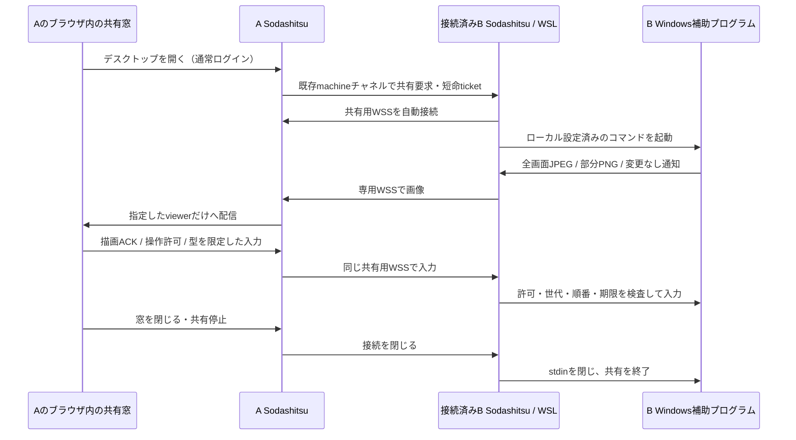
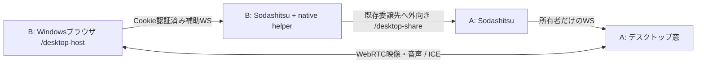

# リモートデスクトップ（実験版）

接続済みの別マシンBの実デスクトップを、操作側AのSodashitsu内の窓で表示・操作するPoCです。初期対象はWindowsのログイン済み・ロック解除済みセッションの通常権限アプリです。Windows実機1台で、画面表示・専用テストアプリへのクリック/通常キー/日本語・絵文字の確定文字入力を確認しました。全アプリや実回線での互換性・性能を保証するものではありません。模擬画面を使う自動試験と実機検証を区別してください。

WSL上のSodashitsuがWindows画面を直接取得するものではありません。BのWindows側で補助プログラムが動き、WSLのBを介してAへ接続します。

## 接続の流れ



A/BのSSHまたはB発の操作委譲が接続済みであることが前提です。操作のたびのコード交換や接続コマンド入力は不要です。B→Aの共有用WSSへの到達性は別に必要です。既存SSHが通るだけでB→AのHTTPSも通るとは限りません。

映像は既存のmachine/端末ストリームと別接続です。新しいRDP/VNCポートのインターネット公開を必要としません。Aの既存HTTPS入口が`/desktop-share`のWSS upgradeを通す構成が必要です。ルーター・Firewall・Funnelの設定を自動変更する機能はありません。

## Bの初回設定

**通常のmachine認証と、PC全体の共有/入力の許可は別です。** 未許可のBは`desktop.capabilities`で`available: false`を返し、補助プログラムを起動しません。

通常は補助プログラムのコマンドを手入力する必要はありません。Windows用の補助ファイルは配布物に同梱され、Windows直接起動とWSLで自動検出します。WindowsのPowerShell 5.1/.NET Frameworkと、ログイン済み・ロック解除済みのデスクトップが必要です。実行ポリシーは自動変更しません。

### 起動オプションで許可

**共有されるPC（B）で**実行します。

```sh
# 閲覧のみ
soda serve --desktop
# マウス・キーボード操作も許可
soda serve --desktop --desktop-input
# クリップボード・解像度変更も必要な場合だけ追加
soda serve --desktop --desktop-input --desktop-clipboard --desktop-resize
```

入力・クリップボード・解像度のオプションには`--desktop`も必要です。これらはサーバー起動用（`soda serve`）の指定です。既に動いているサーバーには、次の設定画面から許可します。設定が保存されていなければ共有は既定で無効です。起動オプションは保存済み設定より優先して、その起動での初期値を指定します。起動後は設定画面から無効にできますが、同じオプションで次回起動すれば再び有効になります。

### 設定画面で許可

Bのブラウザで`http://localhost:7780`（ポートを変更している場合はそのポート）を開いてログインし、**メニュー → 設定 → デスクトップ共有**を開きます。画面共有・マウス/キーボード・クリップボード・解像度変更を個別に選び、［共有設定を保存］を押します。Bの端末版でも設定の「デスクトップ共有」から変更できます。

許可はサーバーの状態ディレクトリの`desktop-permissions.json`に保存され、再起動なしで反映します。変更すると進行中の共有や開始待ちを停止します。新しい許可で接続し直してください。無効化後、次回もオプションなしで起動すれば無効のままです。

許可を変更できるのは認証済みの直接ローカル接続だけです。マシン中継、LANのURL、公開URL、転送ヘッダー付きのプロキシ経由からは変更できません。Bのlocalhost画面かBの端末版を使ってください。ブラウザの同一PC判定だけでなくHost/Originも検査します（ローカルプロキシがHost等を書き換える構成を、物理的な利用者確認の代用にはできません）。

Aのブラウザは、**Bから到達できるHTTPSのURL**で開いてください。Aの`localhost`や`127.0.0.1`を開いた場合、Bから見た接続先がB自身になり共有できません。B発の操作委譲では、接続中の委譲先originを共有先として許可します。SSHで接続する場合の共有先の指定は、下の`SODA_DESKTOP_ORIGINS`を使用します。

### Sodashitsu起動中のロック解除（実験的・実機検証待ち）

Windows 10/11 x64の、**ログイン済み・active console sessionのロック**を解除する経路です。サインアウト後のログイン、UAC、RDP sessionの切替、生体認証の遠隔再現は対象外です。Windows標準の認証画面に利用者が入力します。パスワード/PINの保存・自動入力は行いません。

**B側**で一度だけ、管理者の64bit Windows PowerShellから同梱のインストーラーを実行します。通常のSodashitsuを動かすWindowsアカウントで管理者へ昇格してください。別の管理者アカウントを使う場合は、`-OwnerSid`に通常アカウントのSIDを指定します。SIDは通常アカウント側の`whoami /user`で確認できます。

```powershell
# リポジトリのルートから。配布物では scripts/remote-desktop の実際の場所へ移動してください。
.\scripts\remote-desktop\install-unlock-service.ps1
# 取り除く場合（同じOwnerSid）
.\scripts\remote-desktop\install-unlock-service.ps1 -Uninstall
```

インストーラーは固定のexeだけをProgram Filesへ配置し、アカウント別の`SodaDesktopUnlock-*`をLocalSystem・**手動起動（DemandStart）**で登録します。インストール時やWindows起動時には起動しません。実行ポリシー・Firewall・Windowsのロック方針は変更しません。PowerShellの実行ポリシーにより拒否された場合は、そのPCの管理者の運用に従ってスクリプトを確認してください。

**補助サービスの修正を取り込む場合も、Bでインストーラーを再実行してください。** Sodashitsuやスクリプトを更新するだけでは、Program Filesのサービス本体は更新されません。再実行後、下の共有設定を保存し直します。

続いてBのローカル設定「デスクトップ共有」で、画面共有・操作・**Sodashitsu起動中のロック解除を許可**を有効にして保存します。起動時に指定する場合は次を使います。

```sh
soda serve --desktop --desktop-input --desktop-unlock
```

Sodashitsuが起動中で許可が有効な間だけ補助サービスへのleaseを維持します。正常終了/許可取り消しではstdinを閉じ、異常終了や応答停止ではheartbeat期限（約6秒）でworkerを回収します。インストール済みでも、Sodashitsu停止中は利用できません。許可を保存していた場合は次のSodashitsu起動で再開します。サービスを導入した後、許可を保存し直すとleaseを起動し直せます。

Aは通常どおりデスクトップの接続ビューを開きます。ロック中は「Windowsのロック解除」と表示され、［操作する］からWindows標準の認証画面を操作します。下部の一時入力欄はマスク表示になります。Ctrl+Alt+Delが必須のPCでは同名のボタンを使えますが、既存のsoftware SAS policyがサービスによる送信を許す必要があります。Sodashitsuはそのpolicyを変更しません。解除後は旧接続・入力・画像を破棄し、通常画面へ**閲覧専用**で接続し直します。通常画面の共有中にロックされた場合も、許可があればロック画面へ接続し直します。

Windowsの時計・壁紙を表示する最初のロック画面では、画面を撮影せず、［サインイン画面へ進む］だけを表示します。このボタンを押すと、通常ユーザーの補助プログラムがWindows標準のLockAppを確認して、固定のEnter操作だけを送ります。この段階では文字・任意のキー・マウス操作を送れません。サインイン画面へ移ると接続し直し、操作権を解除します。PIN等の入力は、その後の認証画面で［操作する］を押して行います。初期画面の判定やEnter操作の可否はWindows環境に依存し、実機での確認が必要です。

ロック中のアクティブなコンソールセッションで、入力先が通常デスクトップ、前景ウィンドウがないことを再確認できた場合も、画面を撮影せずボタンを表示します。消灯中はLockApp自体が存在しないこともあるため、この入口ではLockAppの起動を条件にしません。この状態で押した場合は画面の復帰要求だけを送り、操作権を解除して接続し直します。ボタンが再表示されたらもう一度押してください。復帰要求から続けてキー入力を送ることはありません。

画面の切り替え中は、共有方式の判定が安定するまで最大2秒待ちます。共有の準備中や認証画面の共有終了時に切り替えを確認できた場合は、新しい接続で判定し直します。［操作する］や［サインイン画面へ進む］などの明示操作を挟まず自動再接続が3回続くと停止します。再接続によって画面の復帰要求やキー入力が自動で送られることはありません。共有終了後も認証画面のまま、または状態を確認できない場合は、自動再接続せず終了理由を表示します。

Windowsの補助プログラムを終了すると、そのために起動したlease/shareの子プロセスも回収します。親の終了後に子が通信パイプを保持し、次の接続が「共有中」のまま拒否される状態を防ぎます。

ロック画面は人による操作専用です。エージェントの画像取得/操作、クリップボード、動画/音声、解像度変更は無効です。helper同士はlocal-only pipeでowner/logon SID・PID・sessionを検証し、ブラウザ側の認証と共有先の許可も従来どおり必要です。

通常ユーザーのhelperがサービスの実行ファイルを照合できるよう、サービスは起動時に、自分のプロセスの既存アクセス権へ、確認済みログオンセッションの限定照会権限だけを追加します。ほかのプロセスやWindows全体の権限は変更しません。権限の設定に失敗した場合は共有を開始しません。

検証済みなのはC#コンパイル、Windows上の未接続pipeの中断と既存display leaseの模擬検証、A/Bサーバーと模擬ロック画面を使うブラウザ試験です。Windows実機1台ではサービス導入・起動、限定照会権限の追加、認証画面でのworkerの待機まで確認しました。初期画面の固定Enter操作、実際の認証画面のキャプチャ・入力・解除は未確認です。接続先への初回導入と実機確認は利用者の管理者操作で行ってください。UACや状態不明では接続を拒否します。

### 実装ファイルの配置と更新

これらのTS／CS／PowerShellは製品の実装ソースで、Gitリポジトリで管理します。接続先PCだけに修正を残さず、修正したファイルと利用手順・検証結果をPRに含めてから、両側のPCへ反映してください。

| ファイル | 用途・更新方法 |
| --- | --- |
| `packages/protocol/src/desktop.ts` | A/B間の共有・入力メッセージ。更新後は両側をビルドする |
| `packages/server/src/desktop/DesktopProvider.ts` | Bで共有用helperを起動し、Aへ画像と状態を送る。ビルド後にサーバへ反映する |
| `packages/server/src/desktop/DesktopRelay.ts` | Aで共有接続を中継し、操作権と画面切り替えを管理する。ビルド後にサーバへ反映する |
| `packages/server/src/desktop/unlockFailure.ts` | ロック画面の終了理由と再接続可否を判定する。ビルド対象の実装ファイル |
| `scripts/remote-desktop/windows-helper.ps1` | Windows helperの入口。同じフォルダのHost/UnlockのCSを起動時に読み、コンパイルする |
| `scripts/remote-desktop/WindowsDesktopHost.cs` | 通常画面の取得と入力。上のPowerShellと同じフォルダに残す |
| `scripts/remote-desktop/WindowsDesktopUnlock.cs` | ロック画面の判定、非撮影の入口、専用サービスとの通信。上のPowerShellと同じフォルダに残す |
| `packages/server/src/machine/DelegationPairing.ts` | BからAへの接続申請。共有前のmachine接続に使う。ビルド対象の実装ファイル |

`src`配下のTSはサーバ用の`dist`へビルドされます。現在のプロセスが動いていても、TSを削除すると次のビルドができなくなります。CSはhelperの起動時にも必要なので、`dist`やインストール済みサービスがあっても削除しないでください。Program Filesに配置した専用サービスの更新は、前節のインストーラー再実行が別途必要です。

更新前に接続先でも`git status --short`と`git diff`を確認してください。古いHEADで`M`や`??`と出ていても、後からmainに採用された実装の場合があります。未追跡の実装ファイルを削除したり、ローカル差分を一括で戻したりせず、mainのファイルと比較し、未反映の修正は先に退避して取り込みます。差分を整理して作業ツリーがきれいになったら、次の順で更新します。

```powershell
git switch main
git pull --ff-only
pnpm install --frozen-lockfile
pnpm build
# 同じサーバの状態ディレクトリを指定する（以下は既定を使う場合）
soda handoff
```

独自の`--state-dir`や名前付きsessionで動かしている場合、handoffにも同じ指定を渡してください。helperのフォルダを別に置いている場合は、上のPowerShellとCSの3ファイルを同じ版で配置します。接続ビューは開き直してください。

`.soda/maintenance-backups/`に退避した旧版は運用上のバックアップで、実装ソースとしてコミットする対象ではありません。対応する修正がmainに入り、更新後の動作と復元不要を確認してから片付けます。

machine接続の申請でHTTP upgradeが拒否された場合は`HTTP 503`のような状態コードを、接続できない場合は`ECONNREFUSED`などの通信エラーコードを表示します。HTTPの本文や例外の自由な文面は表示しません。接続先URL・TLS・公開入口の状態を確認してください。

### 従来の環境変数・独自補助プログラム

既存の指定も引き続き使えます。環境変数は起動時に読みます。保存済みの画面設定がある場合は、画面側の許可を優先します（`SODA_DESKTOP_ALLOW_*`は固定上限ではなく初期値です）。独自コマンドには、補助プログラム自身の入力等の許可も必要です。画面設定が補助プログラムの引数を変更することはありません。

Bの`soda serve`を起動する環境に次を設定します。

| 環境変数 | 意味 |
|---|---|
| `SODA_DESKTOP_COMMAND` | 補助プログラムの実行ファイルと引数のJSON配列。シェルを通さず起動。ブラウザ/RPCから実行コマンドを指定できない |
| `SODA_DESKTOP_ALLOW_INPUT=1` | 保存済み設定がない場合のBの入力許可の初期値。省略時は閲覧専用。Windows helperの`-AllowInput`も必要 |
| `SODA_DESKTOP_ORIGINS` | 共有先AのHTTP(S) originをカンマ区切りで明示許可。SSH経由ではここでAを指定する |

接続中のB発操作委譲の接続先originも共有先として許可されます。したがってこのPoCで`SODA_DESKTOP_COMMAND`を設定することは、**既存の操作委譲先と明示したoriginにデスクトップ共有を許可する設定**です。ユーザー別ACLや都度の現地承認ダイアログはありません。信頼する接続先だけで検証してください。

Windows helperは[scripts/remote-desktop/windows-helper.ps1](../scripts/remote-desktop/windows-helper.ps1)、[WindowsDesktopHost.cs](../scripts/remote-desktop/WindowsDesktopHost.cs)、[WindowsDesktopUnlock.cs](../scripts/remote-desktop/WindowsDesktopUnlock.cs)の3ファイルを、Windowsから読める同じフォルダーへ配置して使います。PowerShell 5.1/.NET Frameworkの標準APIを使用するPoCで、通常共有ではWindowsサービスやキャプチャドライバーを使いません。ロック解除を許可する場合だけ、上記の専用サービスが必要です。

BがWindows直接起動の場合は、同じ3ファイルを配置して、そのPCのPowerShellで起動前に設定します（閲覧用）:

```powershell
$desktopHelper = (Resolve-Path 'C:\SodaDesktop\windows-helper.ps1').Path
$env:SODA_DESKTOP_COMMAND = ConvertTo-Json -Compress -InputObject @(
  'powershell.exe', '-NoProfile', '-NonInteractive', '-STA', '-File',
  $desktopHelper, '-MonitorIndex', '0'
)
soda serve
```

`C:\SodaDesktop`は実際の配置先に置き換えます。この環境変数を別の端末やpaneで設定するだけでは、既に動いているサーバには反映されません。通常の`handoff`も元のサーバ環境を引き継ぐので、初回は設定した環境からの起動が必要です。既存サーバの停止・再起動は作業に影響するため、利用者がタイミングを選んで行います。

「接続先PCでデスクトップ補助プログラムが未設定です」と出る場合は、接続自体は通り、`desktop.capabilities`の`available`がfalseの状態です。補助プログラム未設定・不正な設定・設定前に起動したサーバを確認してください。

BがWSLの場合のコマンド設定例（パスは実際の配置先へ置換）:

```sh
export SODA_DESKTOP_COMMAND='["powershell.exe","-NoProfile","-NonInteractive","-STA","-File","C:\\SodaDesktop\\windows-helper.ps1","-MonitorIndex","0"]'
soda serve
```

操作も許可する場合は、上のJSON配列の末尾へ`"-AllowInput"`を追加し、`SODA_DESKTOP_ALLOW_INPUT=1`を設定します。人がマウス・キーを操作する場合、Aのブラウザで［操作する］を選ぶまで入力は届きません。エージェントは後述の専用の明示許可と接続コードを使います。

`.ps1`の実行はWindows側の実行ポリシーに従います。署名が必要な環境では組織の手順で署名する必要があります。実行ポリシーの変更・回避をこの機能で行いません。Windows側Node/.NET SDKの追加導入は、このhelperの実行要件には含めていませんが、対象Windows環境での実動作確認は残っています。

`-MonitorIndex`はその起動時のWindows `Screen.AllScreens`の添字です。初期検証はモニター1枚を前提にしてください。起動後に対象の画面/座標が変わった場合は共有を停止し、別モニターへ自動移行しません。

## ブラウザで使う

1. 対象の外部マシンとワークスペースを選び、Web版のタブ行右側の［＋接続ビュー］で［デスクトップ］を選びます。VSCodeのGUI共有も同じメニューの［VSCode］から開きます。端末版にはこれらの閲覧ボタン・閲覧タブを表示しません。サイドバーのマシン見出しには起動ボタンを置きません。
2. BからAへ自動接続し、閲覧専用で始まります。Bのhost/user/画面名を確認してください。
3. 操作する場合は［操作する］を押します。モニターを1枚選んでも、キーボードとフォーカス操作の権限はPC全体に及びます。
4. 日本語は下の入力欄で変換を確定して［文字を送る］を押します。Windows側IMEの候補操作を再現する機能ではありません。
5. ［閲覧に戻る］、Esc、ブラウザのblur/タブ非表示で操作を返します。閉じる/［共有停止］では画面配信も終了します。Windows側にも共有中の小窓と［Stop sharing］を出します。

画面はタブの領域全体に表示します。［最大化］でサイドバーやタブ行を覆ってブラウザのタブ内全体へ広げ、［元に戻す］でタブの領域へ戻ります。別のタブへ移るとデスクトップ・VSCodeの配信と操作は終了し、戻ったときは閲覧から始まります。ブラウザのアドレスバーやタブは残し、Fullscreen APIは使いません。最大化中のEscは最大化を解除して操作を返します。ウィンドウサイズはWindowsの解像度を変更しません。「画面に合わせる」を外すと画像の1:1表示です。画質・計測の設定を変えた場合は［適用して再接続］を押します。直前のhelperがまだ終了している途中なら、停止後に再度開いてください。

共有元・画質・計測・クリップボードなどの詳細は［情報・設定］で開きます。通常は閉じ、画面表示を優先します。設定欄は画面に重ねるため、開閉で表示領域の大きさは変わりません。最大化中は映像の領域をブラウザのタブ内全体に広げ、操作ボタンと文字入力欄を重ねます。「接続先を最大解像度にする」が有効なら、表示領域の大きさにかかわらず、配信可能な対応解像度のうち画素数が最大のものを使います。画像の拡縮は「画面に合わせる」で別に選びます。有効時は縦横比を保って最大表示し、余白部分はクリック対象から外します。無効時は1:1表示で、必要ならスクロールします。

上部の操作バーと下部の文字入力欄は、それぞれ右端の三角ボタンで畳めます。畳むと右上・右下の小さな復元ボタンだけが残り、押すと元に戻ります。接続や操作権限は維持し、入力途中の文字も残します。最大化していない場合も同じ操作ができます。VSCodeビューも同様です。

閉じる操作はWindowsアプリ・ログインセッションを終了しません。machineの切断・無効化、サーバ停止/引き継ぎ、ログアウト、補助プログラム終了も共有を失効させます。machineが再接続しても共有や操作を自動復活しません。

## 接続設定

［画質・計測］でプリセットを選ぶか、項目を個別に変更して［適用して再接続］を押します。変更前の共有を終了し、操作権限・エージェント許可を失効させ、閲覧専用で再接続します。幅320～1920、fps 1～30、JPEG品質20～90の範囲外の値は、接続を切らずに拒否します。

| プリセット | 幅の上限 | fps上限 | JPEG品質 | 色 |
|---|---:|---:|---:|---|
| 低帯域 | 960 | 5 | 40 | 256色 |
| 標準（初期値） | 1280 | 10 | 65 | フルカラー |
| 高画質 | 1920 | 15 | 85 | フルカラー |

どのプリセットも差分転送と共有元カーソルの表示が有効です。色はフルカラー、約6.5万色（RGB565相当）、256色（RGB332相当）、16階調グレーから選べます。減色はWindows側で縮小・カーソル合成の後、変更比較・JPEG/PNG圧縮の前に行います。モニターの色深度を変更するものではありません。標準のJPEG/PNGとして運ぶため、パケットを16bit/8bitへ直接詰める方式ではありません。特にJPEG復号後の画素は選んだパレットの色数を超える場合があります。

［共有元のカーソルを表示］を外すと、キャプチャ画像へ標準矢印を重ねません。ブラウザ側のポインターやWindowsのカーソル設定には影響しません。幅は縦横比を保った上限であり、元の画面より拡大しません。fpsは上限で、到達を保証しません。JPEG品質は全画面JPEGにだけ効き、差分PNGは減色後の画素を可逆圧縮します。

設定はこのブラウザのlocalStorageへマシンidごとに保存します。保存するのは幅/fps/JPEG品質/差分/色/カーソル表示だけで、入力権限やエージェントのコード・lease・画像は保存しません。別ブラウザへの同期はなく、ブラウザのサイトデータを消すと初期値へ戻ります。保存が利用できない場合は通知し、今回の接続には反映します。

減色・低品質・縮小によって細かな文字や色の差が失われ、エージェントの画像認識にも影響します。APIの全画面画像も選んだ設定に従います。差分の内容識別子も減色後の画素から計算するため、減色で消えた変化の検出は保証しません。通信量や最大fpsの改善は画面内容・取得/変換コスト次第で、設定を下げれば必ず速くなるとは限りません。

色/カーソル設定を使うにはBのサーバとWindows helperの両方を更新します。旧Bは既定のフルカラー・カーソル表示のみ接続でき、非対応の減色/カーソル非表示を黙って無視せず開始を拒否します。模擬ソースはPNGなのでJPEG品質の評価には使えません。

## 圧縮と差分転送

［画質・計測］の［差分転送］は初期状態で有効です。Windows helperは縮小後の生画素を64×64のタイルで比較し、隣接する変更タイルを長方形へまとめます。小さい変更は最大8領域をそれぞれPNGへ可逆圧縮し、ブラウザはその位置だけを復号・描画します。静止中は画像を再送せず、約1秒ごとの画像なし通知で共有と入力の鮮度を更新します。取得・比較は続くため、静止時のCPU使用率がゼロになる機能ではありません。

最初の画像、約30秒ごと、［再同期］、APIから必要になった全画面取得、変更領域が8個を超える場合、変更面積が画面の60%以上の場合、部分PNGの合計が2MiBを超える場合は全画面JPEGにします。PNGの方が常にJPEGより小さいとは限らず、この切り替えは初期の固定基準です。全画面JPEGは非可逆圧縮なので、部分PNGを重ねた画像と全画面JPEGを復号した画像では画素値が異なる場合があります。

各差分は直前の順序番号・全体寸法・画素内容の識別子に結び付けます。不正な境界、重複領域、基準の不一致を拒否し、全領域の復号と寸法確認を終えてからcanvasを更新します。［再同期］で全画面を取り直せます。旧版のBへは差分設定を送らず、全画面配信を使用します。

画像配信は変更箇所だけ送る独自プロトコルです。VNC/RFB互換やnoVNCではありません。追加の動画共有ではブラウザのWebRTC、またはVP8/OpusのWebM中継を使います（後述）。CopyRectはありません。実装は[Windowsの比較・圧縮](../scripts/remote-desktop/WindowsDesktopHost.cs)、[パケット検査](../packages/protocol/src/desktop.ts)、[ブラウザ合成](../packages/web/src/desktop/render.ts)を参照してください。

## 制限と安全の境界

- Bの共有は同時に1件。共有要求ごとに独立したmachineチャネルと一回限りの短命ticketを使います。他のブラウザ/タブに画像やticketをbroadcastしません。同じCookieの別接続でも自動配信されません。
- Windows helperは非昇格の通常デスクトップのみを対象とします。ロック画面は上記の専用サービス経路だけを実験的に追加しています（実機未検証）。サインアウト後のログイン画面、UAC、昇格アプリ、無人ログイン、headless、DRM保護画面は対象外です。入力は[SendInput/UIPIの制約](https://learn.microsoft.com/en-us/windows/win32/api/winuser/nf-winuser-sendinput)を受けます。
- 初期backendはGDI `StretchBlt`で取得と縮小を行い、全画面JPEGまたは部分PNGへ圧縮します。DXGI/Desktop Duplicationは未実装です。動画共有は別のブラウザ補助を使います。GDIを選んだのは、初期PoCを標準ランタイムでコンパイルし測定可能にするためです。性能優位を確認したという意味ではありません。[Microsoft StretchBlt API](https://learn.microsoft.com/en-us/windows/win32/api/wingdi/nf-wingdi-stretchblt) / [HALFTONEとSetBrushOrgEx](https://learn.microsoft.com/en-us/windows/win32/api/wingdi/nf-wingdi-setstretchbltmode)
- 同一権限の通常のネイティブダイアログも取得対象になる設計ですが、実機互換性は未検証です。GPU描画や動画、cursor形状、混在DPI/複数モニター、日本語配列の記号/IME、アプリごとのUnicode入力は別途検証が必要です。カーソルは取得位置に標準矢印を描く近似です。
- OSやブラウザが取る特殊キーをすべて転送できるとは限りません。通常共有にはCtrl+Alt+Delの送信ボタンはなく、許可済みのロック解除経路でのみ提供します。Escはローカルの操作解除に使います。
- マイク、ファイル転送、plugin operation、TUI画像表示、Linux/macOSのnative capture backendは含みません。クリップボード・音声・CLIは後述の追加許可が必要です。
- 1画像2MiB、最大4096×2400かつ800万pixel。UIの送信幅は最大1920、fps上限30、JPEG品質20～90。送信画像は1枚の描画ACKを待ち、5秒ACKがなければ共有を閉じます。OS helperもACKが来るまで次の画像を生成しません。
- 画像の寸法をヘッダーで検査してからブラウザで復号し、復号後も実寸を確認します。入力の種類・座標・サイズ・順番・参照frameを制限し、古い入力の再送をしません。通信/pipeの詰まりは共有を終了します。
- heartbeatはブラウザ→A→B→helperへ届きます。A/Bの接続監視とWindows helper側の独立watchdogを使います。helperの8秒watchdogは取得ループが詰まった場合も押下解除を試みて終了します。実際の障害時のキー解除は実機PoCの受け入れ項目です。
- AはWSSを終端し画面・入力の内容を扱えます。E2E暗号化とは説明しません。通常のログや永続stateへ画像・入力本文・ticketを保存する処理はありません。XSSや同じOSユーザーの悪意あるプロセスからの隔離を保証するものではありません。

## 模擬ソースでの開発

実デスクトップを取得せずに使う場合、BのコマンドへNodeの模擬ソースを指定します。

```sh
export SODA_DESKTOP_COMMAND='["node","/absolute/path/to/sodashitsu/scripts/remote-desktop/synthetic-helper.mjs"]'
soda serve
```

模擬入力を試す場合は配列に`"--allow-input"`を追加し、`SODA_DESKTOP_ALLOW_INPUT=1`にします。これはOS入力を実行せずACKを返します。画面に「模擬画面」と表示されます。`--record <file>`はテスト専用の模擬入力記録で、本番Windows helperにはありません。

自動試験:

```sh
pnpm build
pnpm exec vitest run packages/server/src/desktop packages/server/src/surface/methods/desktop.test.ts packages/protocol/src/desktop.test.ts packages/web/src/desktop --maxWorkers=4
pnpm --filter @sodashitsu/e2e exec playwright test remote-desktop.spec.ts remote-desktop-agent.spec.ts remote-desktop-delta.spec.ts remote-desktop-settings.spec.ts
node scripts/remote-desktop/benchmark.mjs --width 1280 --fps 10 --frames 100
```

benchmarkは2つの一時サーバーを実際にB発操作委譲で接続し、製品の共有窓をChromiumで開きます。模擬ソースはPNGを生成し、実Windows helperを起動しません。結果は`/tmp/soda-desktop-perf-<width>-<fps>.json`とPlaywright attachmentへ出します。幅640/1280/1920、fps5/10/20/30、frame数20～900を指定できます。

## 計測の読み方と実機PoC

窓の数値は、達成fps・画像通信量・A relay→ブラウザ描画ACKのp95、sourceの取得/encode所要時間、ブラウザの復号/描画処理時間、入力→helper ACKの往復時間です。**描画ACKはcanvasへのdrawImage完了であり、物理モニターの表示完了ではありません。入力ACKもアプリの見た目が変わったことの確認ではありません。**

benchmarkはさらにsourceの累計CPU/メモリ、同一Node内のA/Bサーバー合計CPU/メモリ、ブラウザtask時間/JS heap、共有あり/なしの端末echo→ブラウザ受信後の次のanimation frameまでを記録します。Node/ブラウザの時計を単純に引かず、ブラウザ内の単調時計を使います。CPU%は1coreを100%として計算します。

模擬PNGの結果からWindowsのGDI/JPEG性能や実ネットワークの遅延を推定しないでください。Windows実機1台では、専用アプリへのクリック/通常キー/日本語・絵文字の確定文字送信をcanvas画素の変化で確認し、停止/再接続と100frameの測定を行いました。送信1280×800・設定10fpsの100frame測定は、改善前の約3.46fps/3.93Mbpsから改善後は約8.14fps/10.56Mbpsとなり、取得＋縮小p95は約181msから95msでした。同じ実機・設定での各1回の測定であり、画面内容や時間による変動を含みます。次は文字スクロール・ウィンドウ移動・drag/wheel、実回線負荷、切断時解除、混在DPI、ロック/UAC時の停止を検証します。表示反映時間は入力ACKと別に観測します。

差分転送の実機比較では、同じ3200×2000（200% DPI）のWindows画面を1280×800・JPEG品質65・上限10fpsで配信し、専用テスト画面の各条件を5秒ずつ測定しました。初回の全画面画像（約299KB）を除く、独自パケットの通信量です。TLS/TCPのヘッダーは含みません。

| 専用画面の条件 | 全画面方式 | 差分方式 | 差分方式で送ったもの |
|---|---:|---:|---|
| 静止 | 17.254Mbps | 0.00175Mbps | 画像なし通知4件 |
| 小領域を250msごとに更新 | 19.144Mbps | 0.505Mbps | PNG部分更新19件 |
| 全体を250msごとに更新 | 15.329Mbps | 9.583Mbps | 全画面JPEG20件 |

全体更新では変更なしの取得結果も抑制するため、送信回数が32件から20件になっています。動画圧縮が改善したという測定ではありません。全体更新ではsource CPUが約46.5%→50.3%、peak RSSが約89.9→124.5MiBで、差分方式がすべての負荷を下げるとは限りません。静止時のsource CPUは1core換算で約44.7%→39.2%で、取得コストは残っています。1台・loopback・各1回の短時間測定であり、実回線/動画/長時間性能を示しません。生の数値は[実機比較](../.aidev/works/20261017-remote-desktop/windows-delta-comparison.json)にあります。

初期目標は、20Mbps/RTT100msの条件で1080p 5fps、視覚的な操作反映p95 500ms以内、端末echo p95の増加100ms以内です。目標値であり達成済みではありません。30分の継続試験や回線制限時のメモリ・queue推移も残っています。取得/encodeが律速ならDXGIやhardware encoderを、帯域/映像伝送が律速なら動画encoding/WebRTCを比較する判断材料にします。

実装・検証と模擬ソースの測定値は[検証記録](../.aidev/works/20261017-remote-desktop/test-result.md)、独立点検は[レビュー記録](../.aidev/works/20261017-remote-desktop/review.md)を参照してください。

## エージェントAPI（実験版）

共有窓の［エージェント連携］を開き、［エージェントへの画面提供・操作を許可］を押すと、その窓だけに接続コードを表示します。コードは30秒以内・1回だけ使用でき、権限は発行時から最大2分です。対象はその共有中の1画面です。通常のSodashitsu認証に加えて、このコードが必要です。pane.sockには登録していません。画像をモデルへ提供する用途を含む許可です。

エージェント接続中は［エージェント操作中］を表示し、人の遠隔入力と排他にします。［操作を引き取る］でエージェントを失効させて人が操作できます。許可取り消し、窓のEsc、共有終了、agentのRPC接続断、期限切れでも失効します。Bの停止ボタンは残ります。Bの現地キーボード・マウスを遮断するものではありません。

APIはAの既存認証済み `/ws` のRPCです。attachした同じ接続だけがleaseを使えます。画像・コード・leaseをsnapshotや他のブラウザへbroadcastしません。APIの画像は要求したエージェント接続に返し、サーバ側で永続保存しません。

| メソッド | 引数 | 結果 |
|---|---|---|
| `desktop.agent.attach` | `ticket`（窓に出した接続コード） | `leaseId`, `expiresAt` |
| `desktop.agent.observe` | `leaseId`, 任意の`afterFrameSeq` | `observationId`, `frameSeq`, `width`, `height`, `format`, `imageBase64`, `latestFrameMaxAgeMs` |
| `desktop.agent.act` | `leaseId`, `observationId`, `inputs`（1～32個） | `acknowledged`, `afterFrameSeq` |
| `desktop.agent.release` | `leaseId` | `released: true` |

`observe`は最新受信から2秒未満の画像を返します。最大5枚/秒で、agent接続の送信queueが256KiBを超えている場合は画像を生成せずleaseを失効させます。差分配信中に最新内容と一致する全画面画像がない場合は、helperへ全画面取得を要求し、最大2.5秒待ちます。`afterFrameSeq`を指定した場合も、それより後の画像/変更なし通知を待ちます。期限内に得られなければ`server_busy`を返します。取得の再試行は可能です。画像は2MiB以下、base64化後の応答は約2.7MiB以下です。

`act`は参照した全画面画像と最新の取得内容が一致する場合だけ実行します。差分の生画素識別子が変わった場合は、古い全画面キャッシュを使えません。有効な全画面画像同士の照合には画像bytesのSHA-256も使います。新しいframeでも同じ画像なら使用でき、画像が変わった場合は`invalid_params`で入力前に拒否します。時計・動画・カーソル・Bでの現地操作も変化の原因になります。初期版は画面全体の一致を求める保守的な仕様です。領域単位の比較や動画画面への最適化は未実装です。

1回の`act`は1つの観測を消費します。同じ観測による再実行、並行操作はできません。各入力をhelperのACKを待って順番に実行し、終了時にこのhelperが保持する押下を解除します。複数API要求にまたがるキー/ボタンの押しっぱなしには対応しません。入力ACK待ちは各1.5秒で、途中失敗・不明な結果ではleaseを失効させます。**一部の入力が実行済みの場合があるため、失敗した操作を自動再送しないでください。**

入力の形は以下です。座標は取得画像の左上を(0,0)、右下を(1,1)とする正規化座標で、WSLの座標ではありません。対象モニターの物理範囲への対応はWindows helperが行います。

```json
[
  {"kind":"pointer","event":"down","button":0,"x":0.5,"y":0.4},
  {"kind":"pointer","event":"up","button":0,"x":0.5,"y":0.4}
]
```

`pointer`は`move/down/up`とbutton 0=左/1=中/2=右、`wheel`は`delta`が±1200以内、`key`は対応するDOM codeと`down`、`text`は確定した文字列1～1024文字です。dragや修飾キーは同じ`act`内でdown→move/key→upを組み立てます。Windows IMEの変換操作やすべての特殊キーを保証しません。

`act`のACKはアプリが意図どおり変わったことの確認ではありません。返された`afterFrameSeq`を次の`observe`へ渡し、新しい画像の内容で結果を確認します。観測と入力はOS側で原子的ではなく、最新画像の検査後にも画面は変わり得ます。送信・購入・削除などの意味的な承認は、この低水準APIでは判定しません。呼び出すエージェント側で確認点を設け、画面内の文章を信頼された指示として扱わないでください。

### 参照クライアント

`pnpm build`後、持続接続を使うNodeクライアントを起動できます。通常の認証は`SODACTL_COOKIE`または`SODACTL_TOKEN`、共有窓から発行したコードは`SODA_DESKTOP_GRANT`へ設定します。接続先はHTTPS、またはloopbackのHTTPに限定しています。

```sh
export SODACTL_URL='https://your-sodashitsu.example'
# SODACTL_COOKIE または SODACTL_TOKEN と、SODA_DESKTOP_GRANT を設定してから:
node scripts/remote-desktop/agent-client.mjs
```

stdin/stdoutは1行1JSONです。起動時に`ready`と期限を返します。CLI引数にコードや通常ログイントークンを載せず、接続の間だけメモリに保持します。

```json
{"id":"view-1","method":"observe","path":"/tmp/soda-agent-001.jpg"}
{"id":"click-1","method":"act","observationId":"取得結果のobservationId","inputs":[{"kind":"pointer","event":"down","button":0,"x":0.5,"y":0.4},{"kind":"pointer","event":"up","button":0,"x":0.5,"y":0.4}]}
{"id":"view-2","method":"observe","afterFrameSeq":123,"path":"/tmp/soda-agent-002.jpg"}
{"id":"done","method":"release"}
```

`afterFrameSeq:123`は操作結果の値へ置き換えます。pathを省略するとbase64画像をJSONに含め、指定すると新しいローカルファイルへmode 0600で保存します（既存ファイルは上書きしません）。拡張子は返されたformatに合わせます。保存・モデルへの送信・送った先での保持はクライアント側の責任です。EOFでもlease返却を試みて終了します。SIGINT/SIGTERMでは未完の待機を中断して接続を閉じ、サーバ側でleaseを失効させます。actのRPC待機は最大60秒、ほかは10秒です。

この参照クライアントはモデルを呼ばず、自動で操作を決めません。統合CLI・MCP・OpenAI接続は以下を使います。プラグインoperationは未実装です。


## 動画・システム音声（追加機能）

Windows上のChrome/EdgeをBの初期対象にします。ネイティブのGDI画像・入力に加えて、Bのログイン済みブラウザを共有補助として使います。OSの無人サービスから音声を取得する実装ではありません。ブラウザの許可画面で毎回対象モニターを選ぶ必要があります。画面選択・音声の有無にはOS/ブラウザによる違いがあります。[getDisplayMedia](https://developer.mozilla.org/en-US/docs/Web/API/MediaDevices/getDisplayMedia) に従いHTTPSまたはloopbackのsecure contextとユーザー操作が必要です。WSLのブラウザをWindowsデスクトップとして扱いません。



1. Bの起動環境に `SODA_DESKTOP_ALLOW_MEDIA=1` を追加します。既存の `SODA_DESKTOP_COMMAND` が必要です。マウス・キー操作には別途入力許可も設定します。
2. Bの**Windowsブラウザ**でBのURLの `/desktop-host` を開きログインして「共有補助を接続」を押します。
3. Aの共有窓の「動画・音声」で音声の有無、WebRTC優先/圧縮動画中継、映像帯域上限128〜12000kbpsを選び「動画共有を依頼」を押します。
4. Bで表示された対象を確認し、native helperで選択したものと同じモニターであることをチェックして「画面を選んで共有開始」を押します。ブラウザの選択画面でもモニター全体を選びます。アスペクト比とmonitor surfaceを検査しますが、モニターの同一性をOSのIDで自動照合する仕組みはありません。選択は現地の確認が必要です。
5. 音声を選んだ場合もAでは初めはミュートです。「音声を再生」は別操作です。マイクは取得しません。ブラウザがシステム音声trackを返さなければ映像だけになります。
6. Aで動画停止/共有終了、Bで停止/補助切断/タブ終了を行うと配信を止めます。補助の12秒heartbeat切れも停止します。制御送信が詰まった場合は補助接続を閉じます。

WebRTCのoffer/answer/ICE candidateのシグナリングは既存の外向き経路を通します。ICEは接続候補を試す仕組み、STUNは外部アドレスの発見、TURNは直接接続できない場合の専用中継です。[WebRTC connectivity](https://developer.mozilla.org/en-US/docs/Web/API/WebRTC_API/Connectivity)を参照してください。既定のICEサーバーは空で、公開STUNへの自動送信やTURNの自動配備は行いません。必要ならBの `SODA_DESKTOP_ICE_SERVERS` にJSON配列（`urls`, 任意の`username`/`credential`）を設定します。認証情報はその共有のA/Bブラウザだけへ配送します。保存・ログ出力はしません。TURNを置かない場合でも、WebRTCが7秒で接続できなければ既存B→A WebSocket経路の圧縮動画中継に移ります。RDP/VNCポートの公開は不要です。

中継は[MediaRecorder](https://developer.mozilla.org/en-US/docs/Web/API/MediaRecorder)でVP8、音声があればOpusをWebMへ圧縮し、約200ms単位のchunkをAの[MediaSource](https://developer.mozilla.org/en-US/docs/Web/API/MediaSource)で再生します。サーバーでの動画変換サービスは不要です。ブラウザがこの組み合わせをencode/decodeできない場合は利用できません。WebRTCのcodecはブラウザ交渉に従い、H.264固定やhardware encodingを保証しません。

chunkは最大512KiB、世代番号と連番を検査します。各送出queue・受信queueを制限し、混雑時は動画だけ停止して画像配信へ戻します。動画中もnative画像を1fpsで取り、停止後の画面とagentの観測を維持します。初回描画を12秒待っても始まらない場合、または描画開始後に2秒超更新がない場合は、500ms間隔の検査で動画を停止し、取得済みnative画像へ戻して保持入力を解放します（完全な静止画でも起こる保守的な制限）。動画の到着前/鮮度切れの操作は拒否します。動画とnative入力は別経路なので、厳密に同一フレームへ入力することは保証しません。agentは動画ではなく従来の観測IDと画像照合を使います。

画像接続の「自動画質調整」を有効にすると、遅いACK・描画時間・送出queueに応じてfps/JPEG品質を下げ、安定が続けば要求上限までゆっくり戻します。動画ではloss/RTT/encoderの帯域・CPU制約と再生遅れからbitrateを調整し、低帯域時はWebRTC送信fps/解像度も下げます。[RTCRtpSender.setParameters](https://developer.mozilla.org/en-US/docs/Web/API/RTCRtpSender/setParameters)の対応範囲に依存します。中継はbitrate変更時に最短10秒間隔でRecorderを作り直します。帯域値はencoderへの目標であり厳密な回線上限ではありません。色削減は動画でもcanvasで前処理できますがCPU負荷が増え、動画decode後の色数は厳密なパレットになりません。

## クリップボード（テキスト）

Bで `SODA_DESKTOP_ALLOW_CLIPBOARD=1` とWindows helperの `-AllowClipboard` の**両方**を設定します。書込みには既存の `SODA_DESKTOP_ALLOW_INPUT=1` / `-AllowInput` も必要です。Aの窓で「クリップボード共有を許可」を押して初めて利用できます。8192 UTF-16 code unitsまでのテキストだけで、画像・ファイル・リッチテキストは扱いません。通常のWindowsデスクトップ、heartbeat、操作世代、要求期限をhelperでも検査します。

「共有元から取得」「共有元へ送信」は明示操作です。「双方向の自動同期を開始」はAのブラウザclipboard許可も必要で、前面にある間だけ1秒周期で比較します。同時変更はAを優先します。blur/非表示/共有停止で同期と許可を失効させます。再開には再許可が必要です。ブラウザの許可エラー時は手動のテキスト転送を利用してください。clipboard内容はlocalStorageやログへ保存せず、他のブラウザにも配信しません。MCP/agentへclipboardツールは公開していません。

## 統合CLI・MCP・OpenAI

Aの共有窓で発行したコードを環境変数 `SODA_DESKTOP_GRANT` へ設定します。コードは30秒・1回限り、接続後の権限は発行から最長120秒です。通常のSodashitsu認証も必要です。引数にコードを渡す方式、pane.sock、`--machine`による転送は使いません。AのHTTPS URL（またはloopback）へ直接接続します。

```sh
sodactl desktop session --url https://A.example
sodactl desktop mcp --url https://A.example
sodactl desktop model --url https://A.example --task '画面の状態を確認して説明する'
```

`session` はstdin/stdoutのNDJSONで `observe` / `act` / `release` を扱います。参照クライアントと同様にobserveへ `path` を渡すと新規ファイルだけへ0600で保存します。入力行64KiB・出力4MiBを上限とし、非同期の出力待機も2秒で打ち切ります。CLIは権限と接続を先に閉じ、読まれないpipe書込みが残る場合は停止処理開始から2.5秒で終了します（この強制終了はexit 1、未配送の出力は破棄）。OSによる同期書込みがevent loop自体を止める場合の期限保証はありません。入力失敗・切断・SIGINT/SIGTERM・期限切れで同じ接続を閉じ、結果が不明な入力は再送しません。

`mcp` は[2025-11-25 stdio transport](https://modelcontextprotocol.io/specification/2025-11-25/basic/transports)のJSON-RPCを実装し、`desktop_observe`（image+観測metadata）、`desktop_act`（観測ID+型付き入力）、`desktop_release` の3ツールだけを公開します。MCPホストの起動コマンドへ上記を登録し、環境で短命コードを渡します。起動だけではコードを消費せず、最初のツール呼出し時にattachします。権限延長・共有開始・一覧取得はできません。任意のモデルを持つMCPホストで利用するための入口であり、全ホストとの互換性は未検証です。

`model` は[OpenAI Responses computer tool](https://developers.openai.com/api/docs/guides/tools-computer-use)の `computer_call.actions[]` と `computer_call_output` を扱います。既定モデルは確認時の公式例に合わせ `gpt-6.1-sol`、`--model` で変更できます。`OPENAI_API_KEY` は環境だけから読み、モデルを実行した場合にだけ取得画像・指示を `https://api.openai.com/v1/responses` へ送ります。`store:false`と履歴を使いますが、API側のデータ取扱いを無保持と保証する設定ではありません。開発中の検証はmock APIだけです。API利用権・実モデル互換性・実画面でのタスク成功率は未検証です。Anthropic等の専用adapterはありません（MCPから利用可能）。

既定は各入力batch前にstdoutへ `approval_required` を出し、stdinの `{"decision":"approve"}` を待ちます。`--auto-act` は通常batchの確認を省略しますが、モデルのpending safety checksは必ず明示承認が必要です。`--max-steps` は1〜20（既定10）。画面内容を信頼しない指示を付け、実行前にbatch全体を検査します。モデル応答/呼出しが明示的に生成未完了なら入力前に拒否し、APIのHTTP redirectも追跡しません。pixel座標を正規化し、最大32の型付き入力だけを送り、任意コードを実行しません。横スクロール・未知キー・待機と入力の混在は拒否します。重要な操作の許可判断は呼出し側と利用者が行ってください。画面照合が厳しいため、時計・動画等で画面が変わると拒否されることがあります。


検証記録は [.aidev の test-result](../.aidev/works/20261017-remote-desktop/test-result.md) と [独立レビュー](../.aidev/works/20261017-remote-desktop/review.md) を参照してください。動画の短時間参考値は1280×720・10fps要求の合成画面でWebRTC約9.8fps、WebM中継約10.3fpsです。4秒前後の計測で、Windows画面取得・WAN・長時間連続動作の性能を示しません。

## Bを対応する最大解像度にする

共有窓の「最大化」またはタイトルのダブルクリックで、Sodashitsuを開いているブラウザ内いっぱいに広げられます。「元に戻す」または再度のタイトルダブルクリックで、直前の位置・サイズへ戻ります。下記の最大解像度設定が有効でも、最大化・復帰や窓のリサイズで接続先の解像度を下げません。

Windowsの実ディスプレイを対象に、対応する解像度へ一時的に変更する機能です。初期対象は**モニター1枚のWindowsセッション**です。Bの起動環境へ `SODA_DESKTOP_ALLOW_DISPLAY_RESIZE=1`、helperの引数へ `-AllowDisplayResize` を追加してください。通常の画面共有・入力・clipboardとは別のローカル許可で、省略時はOSの解像度を変更しません。BのSodashitsuを設定付きで再起動後、Aの共有窓で「接続先を最大解像度にする」を有効にします。この指定はブラウザへ保存せず、新たに共有窓を開くたびにオフから始まります。

設定を有効にすると、700msの待機後に、Bが返した対応解像度から配信上限内で総画素数が最大のものを選択します。同じ画素数なら幅が大きいものを選びます。窓のリサイズや最大化・復帰では解像度を変更しません。対応解像度が変わる場合だけ共有を再接続し、Bの解像度と取得画像の画素数を一致させます。「画面に合わせる」が有効なら窓に収まる大きさへ拡縮し、無効なら**Bの1画素をAの1 CSSピクセル**として表示します。縦横比による余白や、1:1表示でのスクロールは生じます。WindowsのDPI倍率・ブラウザのズームは変更しません。動画の画素数が一致しなくなった場合は画像配信に戻します。

再接続時は、人の操作許可、agentの許可、clipboard共有、動画/音声を解除します。操作等の再開には再許可が必要です。オフへ戻す場合・窓を閉じる場合・接続が終わる場合はhelperが元の幅・高さへの復元を試みます。通常の終了に加え、別のPowerShell監視プロセスがhelperの異常終了を監視します。監視プロセスの起動とdevice mutex取得を確認してから解像度を変更し、監視側が復元を終えるまで次のhelperは元の解像度を読み取りません。正常な復元後は監視側を解除します。現地ユーザーが別の解像度・向き・位置へ変更した場合は、その変更を上書きしません。復元要求は幅・高さだけに限定し、元のリフレッシュレートや色深度を復元要求に含めません。

実装はWindowsの [EnumDisplaySettingsExW](https://learn.microsoft.com/en-us/windows/win32/api/winuser/nf-winuser-enumdisplaysettingsexw) で対応モードを列挙し、[ChangeDisplaySettingsExW](https://learn.microsoft.com/en-us/windows/win32/api/winuser/nf-winuser-changedisplaysettingsexw) の `CDS_TEST` で検査後、flags=0で一時変更します。レジストリ更新・再起動・ドライバー導入は行いません。指定範囲は幅320〜4096、高さ200〜2400、合計800万画素以内です。未対応の寸法をブラウザから送ってもWindows helperが拒否します。[protocol](../packages/protocol/src/desktop.ts)、[許可とhelper確認](../packages/server/src/desktop/DesktopProvider.ts)、[選択処理](../packages/web/src/desktop/display.ts)、[Windows lease/guardian](../scripts/remote-desktop/WindowsDesktopHost.cs) を参照してください。

表示とクリック座標は、拡縮後の実画像の矩形を基準に対応付けます。Windowsの絶対入力の全体範囲も、取得対象と同じnative modeの座標から読み直します。このWindows側の修正を利用するには接続先Bのhelperも更新してください。

任意の窓寸法（例: 1137×683）へ完全一致できるとは限りません。Windows/ディスプレイドライバーが報告する対応モードだけを使用します。任意サイズの仮想ディスプレイを作る機能は含まれていません。また、解像度変更に伴う現地アプリの窓の再配置を復元する機能はありません。監視プロセス自体の強制終了、OS障害、モニターの接続・取り外し等の構成変更、ドライバーによる復元拒否では自動復元を保証できません。必要な場合はWindowsの「設定 → システム → ディスプレイ」で戻してください。

検証では実機の解像度を変更していません。C#のコンパイル、偽driverでの適用/復元・属性保持、guardianと次の共有のmutex待機、合成画面を使ったブラウザでの解像度切替・等倍描画・許可失効・非永続化を確認しています。`validate-display-lease.ps1` は偽driverとWindows kernel objectだけを使い、OSの解像度変更・画面キャプチャ・入力送信を行いません。実機でのモード変更・異常終了後の復元・DPI別の見え方は別途PoCが必要です。
